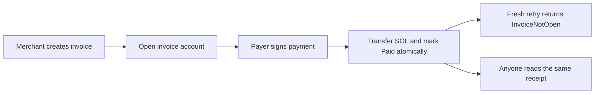

# ReceiptRail

A shareable Solana invoice that settles once, even when a payer retries after a lost response.

[Live demo](https://receiptrail-devnet.mistyaura.chatgpt.site/) · [Demo video](demo/receiptrail-demo.mp4) · [Program ID on devnet](https://explorer.solana.com/address/8NGSPufBmGB1oHqaZpY1jhJYz1X4gqFiNXCQmxfapYko?cluster=devnet) · [Demo invoice](https://explorer.solana.com/address/rZRAPpkLcfBcao5tMvdyZ1G7VzoDLcXiHZ7u4tPSZq2?cluster=devnet)

## The problem

A checkout can lose its response after the payer has already signed. The merchant sees an uncertain order and the payer sees a retry button. A fresh transaction has a different signature, so looking up the first signature alone does not protect the order from a second transfer.

## How it works



| Contract | Behavior |
| --- | --- |
| Invoice account | A 131-byte program-derived account tied to the merchant and a 32-byte invoice ID. It stores the designated payer, amount, expiry and payment slot. |
| `create_invoice` | The merchant signs and funds the invoice account. |
| `pay_invoice` | The designated payer signs before expiry. The program records Paid in the same transaction as the SOL transfer. |
| `cancel_invoice` | The merchant can cancel an open invoice. |
| Errors | `InvoiceNotOpen`, `InvoiceExpired`, `WrongPayer` and `WrongMerchant` explain common failures. The IDL lists all nine errors. |

In the recorded run, the merchant received **50,000 lamports**. A second transaction for the same invoice finalized with `InvoiceNotOpen`, transferred **zero principal** and charged the payer **5,000 lamports** in fees. Open both transactions to compare the balance changes. [Payment](https://explorer.solana.com/tx/6vZ6BvKwi27rnqbXUJ5iKrwYz7NSgPGe7hysYXyyYH8aHjCWx1DcV3Z3UA59CjfJcdaPGahwARgUWptJX74gsE3?cluster=devnet) · [Rejected retry](https://explorer.solana.com/tx/ig5D6PzpyunRL5CjzHX9GqNFwxUvAtNRK8WrvKToSZeMi9824mensd1fmtVyDpnYr6LB47ApJHFAsade91KWARe?cluster=devnet) · [IDL](docs/idl/receiptrail.json)

## Why Solana, and when a database is enough

A merchant, wallet and independent checkout can verify the same settlement without sharing a payment database. Solana places state and value transfer in one atomic transaction. A single operator that controls checkout and fulfillment can usually use a unique order key and a database transaction. Merchants still need a durable mapping from their own order to one invoice ID.

## Quick start

Use Node.js **24.22.2**. From a new terminal run the following commands. Open the local URL printed by Vite. A guest can view the demo receipt immediately.

```sh
git clone https://github.com/ntbaoheyhey/dev3pack-hackathon.git
cd dev3pack-hackathon
npm ci --prefix apps/web --ignore-scripts --no-fund
npm test --prefix apps/web
npm run build:receiptrail --prefix apps/web
npm run dev:receiptrail --prefix apps/web
```

To try a new payment, enable **Solana devnet** in Phantom and connect a funded merchant account. Choose **Create**, enter a different devnet payer and review the terms. Open the invoice link as the designated payer to pay. **Recheck receipt** reads the same account after a timeout. A separate, clearly labeled mock sandbox is available from the footer.

## Tests and evidence

The submission includes 32 on-chain runtime cases, 23 generated-client tests, 16 deployment, recovery and recording guards, and 67 web tests. The browser run covered create, pay, simulated lost response, recovery, a rejected on-chain retry and cancellation of a second invoice. [CI on main](https://github.com/ntbaoheyhey/dev3pack-hackathon/actions/workflows/ci.yml?query=branch%3Amain) · [Finalized transactions and accounting](docs/evidence/phase6/e2e-devnet-2026-11-28T112558Z.json) · [Deployed bytecode check](docs/evidence/phase6/preflight-2026-11-28.json)

## Security and limitations

Devnet and native SOL only. Refunds, escrow and order fulfillment are outside the contract. The program is unaudited and the upgrade authority can change it. Live reads depend on the public RPC. A fallback snapshot shows its capture time explicitly. Browser signing was tested with a local Wallet Standard demo wallet. Phantom, Solflare and Backpack extensions were not exercised in this run.

## Built before vs during the hackathon

**Before November 27** we designed and deployed the Anchor program, generated the IDL client, built the mock web flow and implemented Wallet Standard discovery. The retroactive `hackathon-start` tag marks public `work` commit `63f59ba`. Two research edits dated November 24 were merged during the event and count as pre-event work.

**During November 27–29** we connected the UI to devnet, added fee review, lost-response recovery, a controlled duplicate-payment demonstration and browser tests. We published the live app and produced the video, screenshots and finalized balance evidence. Codex, Antigravity and Claude assisted with engineering, research and review. [Event changes](https://github.com/ntbaoheyhey/dev3pack-hackathon/compare/hackathon-start...main)

## Team and license

Maintained by **ntbaoheyhey** for Dev3pack Global Hackathon 2026. [MIT license](LICENSE) · [Vietnamese project notes](docs/README-vi.md)
