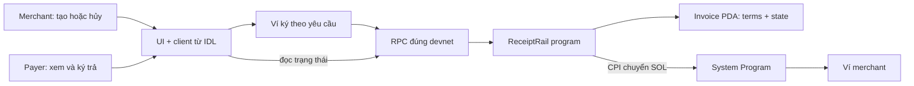
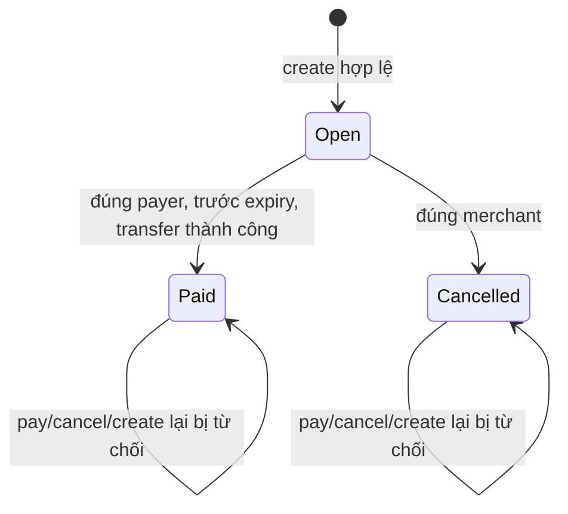

# ARCHITECTURE — ReceiptRail

Codex · 18/11/2026 · **v0.1, người dùng đã duyệt Phase2: “duyệt phase 2”**, giờ log09:27:18.464 ngày18/11/2026 UTC+7; không có giờ quyết định tự nêu. Scope [IDEA](IDEA.md); lựa chọn/nguyên văn/giờ tại [DECISION](ideas/DECISION.md). [ClusterProof](ARCHITECTURE-clusterproof-draft.md) là **dự phòng, chưa duyệt**. Note trước code: [023](learning/023-receiptrail-phase2-spike.md), 004/007/016/021.

## 1. Giải thích một trang cho người dùng

Hãy coi hóa đơn là một tờ ghi nợ mà cả người bán và người trả đều đọc được. Người bán ghi người phải trả, số SOL và hạn trả; các điều khoản này không sửa được. Địa chỉ hóa đơn được tính từ người bán và mã hóa đơn, nên mở lại đúng link là đọc lại đúng tờ đó.

Khi trả, program kiểm đúng người ký, đúng người nhận, hóa đơn còn mở và chưa hết hạn. Nó chuyển đúng số tiền đã ghi rồi đánh dấu Paid trong **cùng transaction**. Nếu một bước thất bại, các thay đổi đó bị hoàn tác. Nếu transaction mới cố trả lại hóa đơn đã Paid, program từ chối; **phí mạng của lần thất bại vẫn có thể bị tính**.

Nếu trình duyệt mất phản hồi, app giữ địa chỉ hóa đơn và đọc state lại. Nó không tự gọi timeout là thất bại, không tạo ID mới và không tự ký lại. Paid đã finalized là kết quả đã đối soát; confirmed còn phải hiện đang chờ finalized. Nếu RPC chưa trả lời rõ thì app nói “Chưa xác định, hãy kiểm tra lại”. Người dùng không cần ví để đọc; trả/hủy/tạo cần ví và chữ ký phù hợp.

Cơ chế chỉ bảo vệ **cùng một hóa đơn**. Người bán vẫn có thể tạo mã khác cho cùng đơn hàng; app không chứng minh giao hàng, không escrow/refund và chưa hỗ trợ stablecoin/x402. Invoice terminal được giữ lại nên tốn rent lâu dài. Người dùng còn phải tin code, upgrade authority và nguồn RPC; đây chưa phải sản phẩm đã audit.

Bản Phase2 hiện có thiết kế và program Anchor tối thiểu chạy trong LiteSVM cục bộ: **19 runtime tests đạt**, gồm transaction mới trả lặp, CPI thiếu tiền, rollback cả `[pay,pay]`, sai signer/recipient/account, expiry và pay/cancel. Chưa có UI ReceiptRail, wallet integration, devnet deployment hoặc demo mạng. Toolchain/web ClusterProof hiện có được giữ nguyên. Người dùng đã duyệt Phase2; T31/T32/T33 đã đóng sau một lượt cuối, phần thiếu ở [nợ tài liệu](DOCUMENTATION-DEBT.md); giáo viên chưa có verdict. Trạng thái Phase3 ở [NEXT](NEXT.md); cài thêm/deploy/public mới hỏi riêng.

## 2. Sơ đồ và ranh giới hệ thống

Cập nhật Phase4 ngày19/11: identity triển khai `8NGSPufBmGB1oHqaZpY1jhJYz1X4gqFiNXCQmxfapYko` đã có sau CI đầu đạt ([record](evidence/phase4/deployment-identity.json)); đang kiểm revision trước broadcast. ID/fixture local cũ bên dưới là lịch sử Phase2.

Sơ đồ là thiết kế tương lai; spike hiện dùng LiteSVM thay RPC/chain và signer chỉ trong bộ nhớ. Trên máy không chạy validator, không sử dụng file ví legacy. Program ID **local-only** `troKmWNxjNucevGMKo9PnKdF5p6W91VDGJ2PsjYvCPg` được tính từ hash nhãn công khai, không có deployment keypair; không phải địa chỉ đã deploy. ID deployment/authority phải được chốt sau quyền tương ứng và sinh lại client/IDL, không dùng mặc định từ link ngoài.

## 3. Account và PDA

| Account | Owner / quyền | Nội dung / vòng đời |
| --- | --- | --- |
| Invoice PDA | ReceiptRail, writable ở create/pay/cancel | Tạo một lần, 131bytes; Open→Paid hoặc Cancelled; không close/reset/update/reopen |
| Merchant | System-owned/data-empty khi create/pay; signer create/cancel; writable khi trả rent/nhận principal | Recipient chính là merchant, bất biến. Cancel chỉ cần đúng signer vì không chuyển SOL |
| Payer | Pubkey chỉ định khi create; signer System-owned/data-empty khi pay | Phải khác merchant/invoice và không là zero/System ID; không cho caller đổi payer khi pay |
| System Program | `Program<System>` đúng ID/executable | Chỉ create account và transfer native SOL, không arbitrary CPI |
| Clock | Sysvar đọc trong program | Slot quyết định expiry và paid_slot; không tin đồng hồ client |
| Fee payer | Transaction header, tách khỏi điều khoản invoice | Merchant/payer có thể tự trả phí trong UI; test dùng fee payer riêng để đo principal/rent |

PDA seeds chính xác `[b"invoice-v1", merchant_pubkey.to_bytes(), invoice_id_32]`. Hai field32bytes cố định tránh nhập nhằng ghép chuỗi. `find_program_address`/init dùng canonical bump; lưu bump và kiểm lại seeds+bump trong pay/cancel. Payer pubkey không phải account đầu vào của create; ví đó phải hợp lệ ở lần pay. Chỉ biết public address chưa chứng minh đang sở hữu private key.

| Field theo thứ tự serialize | Kiểu | Bytes | Offset gồm discriminator |
| --- | --- | ---: | ---: |
| discriminator Invoice | Anchor mặc định | 8 | 0 |
| version | u8 =1 | 1 | 8 |
| bump | u8 | 1 | 9 |
| merchant | Pubkey | 32 | 10 |
| payer | Pubkey | 32 | 42 |
| invoice_id | [u8;32] | 32 | 74 |
| amount_lamports | u64 | 8 | 106 |
| expires_slot | u64 | 8 | 114 |
| status | u8: Open0/Paid1/Cancelled2 | 1 | 122 |
| paid_slot | u64;0 khi chưa Paid | 8 | 123 |

Payload **123**, tổng **131bytes đã kiểm bằng runtime**. Borsh serialize theo thứ tự, không dùng `size_of` Rust có padding. Không PII, URL callback, signer secret hoặc transaction signature trong account. Merchant mapping business order→invoiceID phải giữ ổn định ngoài chain. Account terminal giữ rent; không hoàn rent tự động.

## 4. Instructions và trạng thái

| Instruction | Accounts theo thứ tự (w=writable, s=signer) | Args | Precondition và effect |
| --- | --- | --- | --- |
| `create_invoice` | merchant(w,s), invoice(w), system_program | invoice_id[32], payerPubkey, amount_lamports u64, expires_slot u64 | Init mới; amount>0, expiry>Clock.slot, payer không zero/merchant/invoice. Merchant trả rent; Open/paid_slot0, terms bất biến |
| `pay_invoice` | invoice(w), payer(w,s), merchant(w), system_program | Không | Owner/discriminator/seeds/version, has_one payer/merchant; ví System/data-empty; Open và slot<expiry. CPI chuyển đúng amount từ state; Paid/paid_slot trong cùng transaction |
| `cancel_invoice` | invoice(w), merchant(s) | Không | Owner/discriminator/seeds/version/has_one signer; Open, cả khi hết hạn. Cancelled, paid_slot0; không chuyển principal |
| read | RPC account theo address | Không transaction | Kiểm owner/discriminator/version/size/seeds; state là nguồn kết quả, event chỉ hỗ trợ tìm kiếm |

Expired là **trạng thái hiển thị** `Open && observed_slot >= expires_slot`, không field mới hay quyền reopen. Đúng slot expiry đã cấm pay. Cancel sau expiry vẫn hợp lệ. Mọi failure giữ state/principal, fee payer có thể mất phí. Invoice writable khiến transactions cạnh tranh trên cùng account được thực thi theo thứ tự; test hai thứ tự serial xác minh cả hai kết quả, chưa đo contention mạng. Hai pay trong cùng transaction phải rollback cả lần đầu nếu lần sau fail.

## 5. Lỗi, event và hợp đồng IDL

| Code custom | Tên | UI cần nói / hành động |
| ---: | --- | --- |
| 6000 | InvalidAmount | Số tiền phải lớn hơn0, nhập lại trước ký |
| 6001 | InvalidExpiry | Hạn phải ở tương lai, tạo invoice mới chỉ khi create cũ chắc chắn chưa thành công |
| 6002 | InvalidWallet | Địa chỉ/ví không phù hợp native SOL flow |
| 6003 | AliasedRoles | Người trả và người nhận phải khác nhau |
| 6004 | InvoiceNotOpen | Đọc lại: đã trả hoặc đã hủy; không gửi lại |
| 6005 | InvoiceExpired | Hết hạn, không trả; liên hệ merchant ngoài app nếu cần điều khoản mới |
| 6006 | WrongPayer | Dùng đúng ví đã ghi trên invoice; không tự đổi terms |
| 6007 | WrongMerchant | Dữ liệu recipient không khớp; dừng và tải lại invoice |
| 6008 | WrongVersion | Client chưa hỗ trợ phiên bản này; không ký |

Anchor errors owner/discriminator/seeds/signer/program và System CPI thiếu SOL được phân loại riêng theo **program ID + code**, không khớp chuỗi log để ra quyết định tài chính ở client. Unknown error hiển thị chưa rõ và cho kiểm state; không tự resubmit.

Events: `InvoiceCreated(invoice,merchant,payer,invoice_id,amount_lamports,expires_slot)`; `InvoicePaid(invoice,payer,amount_lamports,paid_slot)`; `InvoiceCancelled(invoice,merchant,cancelled_slot)`. Event chỉ index/hỗ trợ UX; event trong transaction fail hoặc log bị cắt không chứng minh Paid.

Contract v0.1: Anchor1.2.2, namespace `receiptrail`, 3 instructions/1 account/3 events/9 custom errors. UI dùng u64 dưới dạng bigint hoặc chuỗi thập phân; không JS Number. Amount input SOL parse tối đa9 chữ số thập phân bằng integer, overflow/âm/exponent bị từ chối. [IDL JSON](idl/receiptrail.json) đã được Anchor sinh local (log IDL r3 exit0); đã đối chiếu args, thứ tự/quyền accounts, fields/offsets, discriminators và errors với source/bảng trên. Hash lưu trong [metadata](evidence/phase2/receiptrail-build-metadata.json). Chưa gọi đây là client UI đã tích hợp. Đổi fields/args/discriminators cần cập nhật IDL+test+queue cùng commit; A không tự đoán layout.

## 6. Off-chain, retry và UX

Không backend/indexer bắt buộc cho demo. Merchant lưu mapping đơn hàng→invoiceID ở ứng dụng của mình; link chia sẻ chứa invoice address, program và cluster được client đối chiếu allowlist. Mất cả link/mapping thì MVP không tự tìm mọi invoice của merchant. LocalStorage giữ metadata không nhạy cảm là tiện ích, không là nguồn xác nhận payment. Không ký thay user, không lưu seed/private key hoặc chèn arbitrary HTML từ chain.

Flow pay sau này: đọc invoice và slot → kiểm terms/ví → xin user ký → lưu `{invoice,signature,lastValidBlockHeight}` trước broadcast → gửi transaction đã ký → theo signature và state với commitment rõ. Timeout: giữ cùng invoice, query lại; cùng signed bytes có thể được gửi lại có kiểm soát khi còn hạn nhưng không sinh transaction mới tự động. Chỉ đề nghị user ký transaction mới sau kiểm trạng thái/expiry và xác định giao dịch cũ đã hết hiệu lực; nếu vẫn unknown thì giữ unknown. Program vẫn phải chặn duplicate kể cả client làm sai.

| Màn hình | Wireframe nội dung chính | CTA và lỗi |
| --- | --- | --- |
| Merchant | `[Tạo hóa đơn] Người trả / SOL / Hạn slot → [Xem lại terms + rent + fee]` | Tạo sau chữ ký; create timeout tra đúng PDA, không tạo ID mới |
| Invoice | `[Open / hết hạn] Merchant / Payer / Amount / Hạn / Program+cluster / mức xác nhận` | Không ví: đọc được, hướng dẫn kết nối ví sẵn có; sai ví: đổi ví; đúng ví: Trả; user reject giữ invoice |
| Pending | `[Đang kiểm tra] invoice address + signature nếu đã có` | Kiểm tra lại, không nút “trả lại” mù; RPC fail→Unknown |
| Receipt | `[Paid / Cancelled / Expired] terms + paid_slot + commitment` | Paid không Pay; chỉ hiện Explorer khi có signature hợp lệ đã biết, không suy signature từ account |

Mobile: một cột, amount/status/recipient trước CTA, địa chỉ có copy và bản đầy đủ, nút đủ chạm, cảnh báo phí không bị cắt. Desktop: terms và panel state cạnh nhau. No-wallet không tự cài extension/tạo ví; không dùng tài sản thật. T12 giao A làm wireframe/copy/chọn SDK; bản C ở đây đủ triển khai tiếp sau duyệt, không chờ A để viết.

SDK decision: tái dùng React/Vite và Wallet Standard hiện có **sau duyệt UI**, tránh thêm SSR/backend. Anchor client/IDL sử dụng bộ đã có, phải kiểm tương thích và hỏi trước cài gói mới. Solana Pay/x402 là baseline so sánh, chưa tích hợp. Không cần oracle, Supabase, AI/Firecrawl/ElevenLabs hoặc sponsor SDK trong core; không thêm vì logo/điểm giải. Browser connect/reject/recovery là acceptance về sau, không coi tests VM thay thế.

## 7. Threat model và invariants

| Tài sản / mối đe dọa | Kiểm soát | Giới hạn / phép thử |
| --- | --- | --- |
| Principal trả hai lần | Invoice Open check+writable+atomic CPI/state, không close/reset | 2 tx mới và `[pay,pay]`; không bảo vệ hai invoiceID khác nhau |
| Đổi payer/recipient/terms | Signer+has_one+PDA+owner/discriminator/version; pay không nhận amount mới | Sai signer/recipient/owner/type/seeds/bump; không tin transaction do URL ngoài dựng |
| CPI lỗi hoặc độc hại | Program<System>, SOL system wallets/data-empty, write state sau CPI | Thiếu tiền, target program giả, rollback cả transaction |
| Hết hạn/race | Clock.slot, slot<expiry, terminal states | Trước/tại/sau expiry; pay→cancel và cancel→pay |
| Alias/overflow | Payer khác merchant/invoice/zero, u64; không arithmetic ngoài transfer | Tạo amount0/roles alias, System handle thiếu balance; client bigint |
| RPC/UI lừa/trễ | Cluster/program allowlist, owner/IDL/layout checks, commitment/Unknown, user xác nhận terms | Còn phải test RPC consistency/browser/reorg recovery; một provider không là oracle độc lập |
| Merchant/upgrade authority | Boundary công khai, không server signer, release review/version | Merchant vẫn có thể tạo ID khác, upgrade thay logic; authority/verified build chỉ quyết sau duyệt triển khai |
| Storage/PII | Terms tối thiểu, opaque32byteID, account terminal không xóa | Rent tăng theo số invoices, public amounts/addresses; không bảo mật thông tin giao dịch |

Không quảng cáo “chống double-spend toàn hệ thống” hoặc exactly-once delivery. Cam kết hẹp: một principal thành công cho cùng invoice PDA dưới program logic và lịch sử chain hợp lệ. Chưa audit độc lập; R giữ4 PLAN.

## 8. Test plan, kết quả spike và việc chưa kiểm

Nguồn thực thi: [program](../programs/receiptrail/src/lib.rs), [runtime tests](../programs/receiptrail/tests/runtime.rs), [script offline](../scripts/check-receiptrail.sh), [log r1](evidence/phase2/receiptrail-spike-r1.txt). Test nạp `.so` thật, bật kiểm chữ ký mặc định; create qua instruction thật. Chỉ ca malformed dùng fixture sửa account để thử boundary.

| Nhóm | Đã chạy local | Oracle |
| --- | --- | --- |
| Create/pay/retry tx mới | 1 happy-path với snapshot/metadata | Owner/131bytes/canonical bump/terms/rent, signature retry khác; principal một amount |
| Atomicity | CPI thiếu tiền; hai pay trong cùng tx | Invoice/principal rollback; lần sau hợp lệ vẫn pay được |
| Quyền | Wrong payer/merchant, thiếu signer create/pay/cancel | Lỗi đúng constraint/custom; data/balances giữ nguyên |
| Account substitution | Owner/discriminator/PDA/bump/version/System Program; payer có data/wrong owner | Fail trước chuyển principal |
| Lifecycle/expiry | Trước/tại/sau expiry; cancel sau expiry; 2 thứ tự pay/cancel; init lại Paid/Cancelled | Terminal không reset, paid_slot chỉ ghi ở pay |
| Input | Amount0, hạn<=slot, alias/zero, unknown instruction | Không giữ invoice mới/rent debit khi fail |

**19 runtime tests pass, 0 fail**, suite1.06s, build+test64s trên máy này. Account131bytes, rent giả lập1,802,640lamports, `.so`147,864bytes. Sample CU create8,775/pay6,608/retry6,017/cancel4,346; phí10,000lamports mỗi mẫu vì fixture có2signatures. Đây là số đo LiteSVM/default config, **không báo giá devnet hoặc benchmark mạng**. Source/bytecode hashes lưu cùng log và metadata. Sau khi siết runner dùng trực tiếp host compiler đã cài, [r2](evidence/phase2/receiptrail-spike-r2.txt) cũng đạt 19/19, suite1.00s/build+test3s bằng cache; source và bytecode hash giữ nguyên.

Chưa kiểm: frontend/client browser, RPC timeout/reorg/retry thật, Wallet Standard thực, contention/load mạng, Linux CI, devnet deployment, delivery goods, x402/stablecoin, review độc lập. Sau duyệt: thêm integration test browser+RPC fault injection, validate IDL client, latency/rent trên devnet; không dùng mock/replay để đánh đã chạy live.

### Bằng chứng bổ sung Phase4 local — 19/11

Runtime32/32 và client23/23 đã đạt; [evidence](evidence/phase4/README.md)/[review C](reviews/receiptrail-phase4-local.md) ghi hash và giới hạn. Program logic/wire ABI không đổi so với Phase2; thêm fee/rollback, readonly/crypto, u64, namespace và immutable terms. Client generated có owner/PDA/size/version/terms/state checks, tested bằng Rust/Anchor/Kit; contract đã giao A trong [PHASE4-CLIENT](PHASE4-CLIENT.md). Chưa A dùng được, CI cho code mới, devnet ReceiptRail hoặc UI ví thật. Các số19tests ở trên giữ mốc Phase2, không là số hiện hành.

## 9. Phân công và cổng phase tiếp theo

| Phase / phạm vi dự kiến | Codex | Antigravity | Bằng chứng/cổng |
| --- | --- | --- | --- |
| 2 hiện tại | Quyết định/luật, IDEA/ARCHITECTURE, note023, spike/tests/IDL, PR | T11 crawl/T12 UX/T13 review qua A-queue | Người dùng đã duyệt; lượt cuối A đã đóng với nợ tài liệu, giáo viên chưa có verdict |
| 3 chuẩn bị trong quyền hiện có | Kiểm lại quyền cần thiết, deployment identity/authority, CI local→runner | Kế hoạch web/hosting theo quyền được cho | Không cài/deploy/public mới khi chưa có câu đồng ý |
| 4 dự kiến | Harden program, độc lập review, CU/resource tests, client generated | Review lỗi hợp đồng UI | Tests/CI và devnet khi được phép, IDL contract versioned |
| 5 dự kiến | Review phần chạm ví/giao dịch | Merchant/invoice/receipt states theo contract | Mock ghi nhãn, responsive/reject/no-wallet; public hỏi trước |
| 6 dự kiến | RPC/state/confirmation/retry integration | E2E/browser/fault injection/demo | Devnet flow/evidence thật sau quyền triển khai |

C sở hữu `programs/`, scripts build, Cargo/IDL/core/docs quyết định. A sở hữu file kết quả được giao, UX/frontend khi scope mở. C không sửa A-done/HANDOFF A; A không sửa queue/core. Fetch/pull nhánhwork trước tích hợp; commit nhỏ, không force-push/merge PR7. File chung giữ cả phần có nguồn; conflict giải quyết và đi tiếp. C review thay đổi tiền/quyền; không lấy “A nói xong” thay test hoặc câu người dùng.

**Bước hiện tại (19/11):** người dùng đã mở Phase4 và Phase5 song song, code/test local bằng cache; nguyên văn/giờ log13:25:47UTC+7 tại DECISION. C làm program/client, A nhận T34 UI/ví. T31/T32/T33 vẫn đóng với nợ tài liệu; không mở vòng sửa report. Chưa verdict giáo viên; mọi cài thêm/tạo signer triển khai/deploy/public/mergePR7 trình riêng. Các mục “dự kiến/sau duyệt” ở trên mô tả thiết kế Phase2; quyền mở local đã có, không phải bằng chứng tính năng hoàn tất.

## 10. Nguồn và thay đổi

Đọc18/11: [Anchor constraints](https://www.anchor-lang.com/docs/references/account-constraints), [Anchor1.2.2 source](https://github.com/otter-sec/anchor/tree/v1.2.2/lang/src), [atomic transactions](https://solana.com/docs/core/transactions), [note023 và source build](learning/023-receiptrail-phase2-spike.md). Đối chiếu code, IDL, tests và evidence trước chốt; thiết kế tự soạn, không là chứng nhận upstream. Lịch sử r0/r1 C01 giữ nguyên; chỉ tăng F từ evidence spike, không đổi weights/ngưỡng để đạt.
