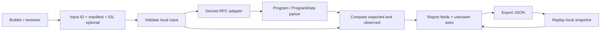

# ARCHITECTURE — ClusterProof

Codex · 17/11/2026 · bản thiết kế v0.3 để review Phase2. Lựa chọn tại [DECISION](ideas/DECISION.md), scope [IDEA](IDEA.md). **Chưa được giáo viên/người dùng duyệt; phần MVP bên dưới là thiết kế.** Baseline Phase3 đã public, giới hạn và bằng chứng ở [web.md](evidence/phase3/web.md). Tài liệu học trước thiết kế: [021](learning/021-payment-cluster-evidence.md), [022](learning/022-phase2-3-independent-prep.md), 004/005/007/016.

## 1. Giải thích một trang

Một địa chỉ program đúng cú pháp chưa bảo đảm app đang nối đúng phiên bản. ClusterProof đọc deployment devnet rồi đặt cạnh manifest mà reviewer chọn. Mỗi field có expected, observed và kết quả; thiếu expected thì UNKNOWN. Hash IDL chỉ cho biết file nào đã đưa vào, không chứng minh binary dùng cùng ABI. Hash payload loader có padding không phải verified-build hash.

Core không viết chain và không giữ ví. Nó không thay Anchor verify/Solana Verify; khi cần source proof phải dùng phương pháp đó và kiểm provenance riêng. Manifest nhập từ cùng RPC không trở thành trusted chỉ vì khớp. Snapshot có thời điểm/slot, program có thể upgrade sau đó; người tích hợp phải đọc lại trước sử dụng. RPC timeout là chưa biết, không là program hỏng.

Ba phần: (1) validate input/provenance; (2) capture và parse bytes, compare fields; (3) report/replay/export. C sở hữu core/schema/tests; A làm UI theo contract. Program hello Phase3 chỉ để học build/test/deploy và wallet, không dùng làm cơ sở chứng nhận các program khác.

## 2. Sơ đồ và ranh giới

Input và RPC không đáng tin tự động. Không backend bắt buộc, database/indexer/login/signer/transaction nào trong đường core. Web static client dùng endpoint devnet cấu hình cố định; secrets provider không được nhúng browser. Nếu public RPC quota/CORS không đáp ứng, phải chọn provider có public client policy hoặc proxy allowlist với secret phía server và review lại kiến trúc, không lách bằng arbitrary URL fetch.

## 3. Modules, runtime và phụ thuộc

| Module / vị trí dự kiến | Trách nhiệm | Chủ |
| --- | --- | --- |
| packages/cluster-proof-core | Types/schema, loader parser, hash meaning, comparison/replay | C |
| packages/cluster-proof-rpc | Timeout/size/safe integers/paired snapshot/genesis rules; dependency injected transport | C |
| apps/web | Input/report/replay/export; accessibility/mobile, explanation | A, C review report semantics |
| research/phase1 | Spike/evidence bất biến và oracle fixtures; chưa tự gọi product-ready | C |
| programs/phase3-hello + Anchor workspace | Lab hello và tests; không product dependency | C |
| docs/evidence/phase3 | Version/build/test/CI/devnet/public web evidence | C/A theo phần |

Chốt Node24.22.2 và React/Vite static từ template solana-foundation/templates commit9ec8eba94a98e22434356b6858defbb0e5ada8dc, đường kit/react-vite; giữ MIT attribution. Không SSR/backend trong baseline. Wallet Standard chỉ ở /lab qua client/react-hooks theo API official; pin stable/lock/build trước delivery, không dùng ranges RC nguyên trạng. Core không phụ thuộc Anchor client. Client CLI lab riêng tools/devnet-lab dùng core1.2.2/web3.js1.99.0; không cast giữa web3 và Kit types.

Baseline đã pin React19.3.1, client1.7.0/react-hooks1.4.1 (Kit5), Vite8.3.8, plugin-react6.3.0, TypeScript5.9.3; lock/peer graph/npm ci/typecheck/build đều đã kiểm. Chỉ đọc genesis + account metadata với commitment **confirmed** và dataSlice0; không triển khai paired ProgramData capture hoặc report contract bên dưới. Product adapter sẽ dùng **finalized** và kiểm cùng pair theo mục4/5. Hai mức kiểm chứng này phải giữ tách biệt trong UI và tests.

## 4. Account, PDA, instruction, event và IDL

**Product core: không custom program/PDA/instruction/event/IDL mới.** Program account loader-v3 có pointer ProgramData; parser kiểm owner/type/executable/size. ProgramData có upgrade slot/authority và bytes executable+padding. Đọc program và ProgramData cùng getMultipleAccounts, giữ context slot và xác nhận pointer không đổi. Loader khác→unsupported; không suy PDA tự tính từ program name.

Input IDL là artifact exact bytes, có address/schema checks và hash; provenance có thể thiếu. Event/IDL không chứng minh state đã commit hoặc ABI đúng; source attestation chưa là tính năng MVP. RPC chỉ getGenesisHash/getAccountInfo/getMultipleAccounts; không getProgramAccounts scan toàn cluster.

Lab Phase3 là counter từ template Anchor1.2.2: initialize/increment, PDA seed counter, Counter48 bytes (count:u64, authority:pubkey), MAX_COUNT10; initialize CPI System chuyển1lamport ngoài rent. Program ID 2yzxUQEpaeLmgCMhDipwnVL3DHsxez18KcePonqZRiXL chưa deploy. IDL đã sinh/đối chiếu, 6 runtime tests local và 8 client tests offline đạt. Chỉ payer lab devnet, không nhận tiền người dùng hay lưu dữ liệu sản phẩm. Singleton có thể bị initialize trước; client kiểm authority và không reset. Fee payer/program keypair dành riêng devnet, ngoài Git; quyền upgrade chưa revoke. Test lab không được dùng nâng F/R của feature product chưa triển khai.

## 5. Contract v1 dự thảo

| Thành phần | Fields / nghĩa |
| --- | --- |
| Input | schemaVersion=1, cluster=devnet, programId(base58 32bytes), optional expected manifest, optional IDL bytes; manifest max64KiB, IDL max1MiB (ngân sách đề xuất, chưa benchmark) |
| Expected | genesisHash/programId/programDataAddress/owner/upgradeSlot/upgradeAuthority/accountSha256/payloadSha256WithPadding/idlSha256; provenance repo/commit/reviewer label; thiếu field hợp lệ nhưng UNKNOWN |
| Observation | rpcHost, genesisHash, programId, programDataAddress, owner, executable, contextSlot safe integer, commitment=finalized, runAtUtc, upgradeSlot dạng chuỗi u64, authority|null, length và hashMeaning |
| Check | field, expected?, observed?, status MATCH/MISMATCH/UNKNOWN, reason; null authority là giá trị biết được, khác field thiếu |
| Report | schemaVersion, mode LIVE/REPLAY, capture status, observation, checks, abiCompatibility=UNKNOWN/sourceVerification=NOT_RUN, expectationTrust OBSERVED_ONLY/USER_ACCEPTED, warnings; USER_ACCEPTED không là cryptographic trust |
| Error | stable code, userMessage, retryable, optional safe details; không URL chứa credential/stack trace trong export |

Số u64 raw dùng string, không JSON Number đã làm tròn. Slot API bắt buộc safe integer; export format exact byte/hash rõ canonicalization, không gán integrity proof khi chưa có raw data. Product replay phải chứa raw accounts hoặc tham chiếu byte artifact xác minh được, giới hạn total8MiB và đọc streaming; spike hiện chỉ reject response>6MB sau load, cần harden trước product. Schema hiện là draft contract, chưa validator chạy.

Không all-green safety verdict. Summary chỉ đếm mismatch/missing, luôn hiển thị ABI/source axes. IDL hash missing hoặc expected unknown không thành mismatch giả. Label debug kỹ thuật nằm trong phần mở rộng; câu chính giải thích hành động tiếp theo.

### Quyết định chốt cho triển khai v1

- Một lần user bấm chỉ dùng endpoint devnet cố định, deadline12giây cho toàn capture. Đọc program ban đầu lấy pointer và slotS0; getMultipleAccounts(program, ProgramData) dùng finalized/minContextSlotS0. Pair phải trả cùng context, pointer giữ nguyên, owner/layout/executable hợp lệ; slot đi lùi hoặc pointer đổi thì lỗi rõ, không ghép hai snapshot. Không tự retry nền.
- Ngân sách v1: manifest64KiB, IDL1MiB, RPC body6MiB và snapshot export/replay8MiB. Chặn byte count khi đọc stream, không đợi tải toàn body. Vượt giới hạn trả lỗi có nguyên nhân; không cắt bytes rồi hash. Đây là giới hạn sản phẩm chủ động, chưa benchmark mọi deployment Solana.
- Manifest/replay JSON chỉ nhận schemaVersion1 và field đã định nghĩa; reject duplicate object keys, depth>16, field/string quá giới hạn, number không safe integer. u64 biểu diễn decimal string canonical; authority null khác field thiếu. Cài validator/duplicate-key parser và fuzz tests ở Phase4, không dựa JSON.parse một mình để phát hiện key trùng.
- accountSha256 là SHA-256 toàn raw ProgramData account bytes; payloadSha256WithPadding loại header ProgramData nhưng giữ padding. programAccountSha256 được lưu riêng khi cần đối chiếu pointer account. idlSha256 tính trên exact bytes file trước parse; không hash object JSON đã normalize rồi gọi tương đương source.
- Export lưu raw program/ProgramData base64, IDL bytes nếu có, manifest, commitment/slot/UTC và hashMeaning. Replay kiểm schema/size, giải mã và tính lại hashes từ bytes rồi chạy cùng parser/comparator; luôn modeREPLAY và giữ thời điểm capture. Hash nội bộ chỉ phát hiện dữ liệu không khớp trong snapshot, không chứng minh nguồn RPC hoặc manifest đáng tin.
- Thiếu expected field → UNKNOWN; expected hợp lệ nhưng khác observed → MISMATCH. Capture sai cluster, thiếu account, malformed bytes/pointer/slot hoặc timeout → ERROR, không tạo report MATCH từ observation dở. Loader ngoài v3 → UNSUPPORTED. ABI/source vẫn UNKNOWN/NOT_RUN trong cả live và replay.

SDK đã chọn cho baseline: @solana/client + @solana/react-hooks chỉ phục vụ wallet lab; core RPC/parser không cần thêm SDK transaction. Anchor phục vụ hello lab, không thêm program sản phẩm. Không tích hợp Firecrawl/ElevenLabs/Light/Token-2022 chỉ để có tên nhà tài trợ: không có nhu cầu crawl server, giọng nói, compressed state hoặc chuyển token trong C02; nếu scope đổi phải review lại theo note014. Không coi template hoặc SDK sử dụng là bằng chứng đạt partner track.

## 6. State/UX và phục hồi

| UI state | Trigger | Next / điều không được làm |
| --- | --- | --- |
| idle/editing | Nhập ID/manifest | Validate, lỗi field hiển thị tại chỗ |
| capturing | Validate pass, user nhấn Kiểm tra | Disable duplicate request; AbortController timeout/cancel; không ký hoặc tự retry nền |
| report | Capture/compare xong | Có slot/time, mismatch/missing; export/re-read có chủ ý |
| unsupported | Loader/type ngoài scope | Giải thích chưa hỗ trợ, không tô program nguy hiểm |
| error | Null/RPC/malformed/pointer đổi | Giữ input; retry nếu lý do cho phép, không copy report cũ thành kết quả mới |
| replay | User chọn snapshot local | Banner REPLAY + capture time, không nút gợi ý đây là trạng thái chain hiện hành |

Wireframe: header Devnet + mục đích; form Program ID, expected manifest/IDL optional; nút Kiểm tra. Report gồm câu ngắn “2 mục khác / 1 mục chưa đủ dữ liệu”, bảng expandable expected/observed, thẻ ABI và source riêng, thời điểm + Export/Đọc lại. Lỗi có một hành động phục hồi. C02 core không hiện Connect Wallet; lab Phase3 đặt trang riêng `/lab` với giải thích đây là bài học, devnet-only. T5 cung cấp mẫu UX nhưng không tự đổi contract.

## 7. Threat model và test matrix

| Threat | Boundary / test oracle |
| --- | --- |
| Fake expected manifest | Provenance user-accepted, không tự trust; test expected thiếu/giả và OBSERVED_ONLY |
| Malicious/stale RPC | Owner/layout/genesis/slot/pointer checks, finalization; không cryptographic proof, compare endpoint độc lập là mở rộng |
| Upgrade giữa hai đọc | Re-read cùng pair và so pointer; test adapter trả pointer khác, reject |
| Hash gây nhầm source/ABI | UI/schema tests luôn giữ unknown axes, hashMeaning exact; review text không chứa kết luận an toàn |
| Oversized/invalid local files | Bound bytes trước parse; JSON depth/shape/type constraints, no eval; fuzz truncation/duplicate keys policy ở validator |
| SSRF/credential leak | Core browser endpoint allowlist; không server fetch arbitrary URI hoặc xuất full private RPC URL |
| Script injection từ labels | React text rendering, không raw HTML; file names/provenance là data |
| Secret/privileged CI | Không wallet/keys trong PR jobs; least privilege và pinned deps; không upload target/deploy keypair |
| Replay bị trình là live | Mode/time immutable trong report, snapshot file integrity check; UI acceptance |

Unit/runtime/UI/live layers theo note022. C02 actual spike chỉ bao phủ một phần parser/compare; mỗi task phải bổ sung tests đúng requirement, không chỉ unit mirror implementation. Tests âm xác nhận lỗi đúng nguyên nhân và state/output không optimistic. Không R5/audit claim trước reviewer độc lập.

## 8. Chia việc và quy trình phối hợp

| Phase / việc | C | A | Done evidence |
| --- | --- | --- | --- |
| 2 | Schema/parser/account model/threat/review | T5: templates/flows/onboarding | Architecture review + người dùng đồng ý |
| 3 | Toolchain, hello program/test/devnet, CI; đã tích hợp/publish baseline web | T9: review web công khai/mobile/ví thật, T10: review kiến trúc | Versions/logs, programID+tx, web URL, CI xanh |
| 4 | Harden product core/RPC/schema, tests | Chuẩn bị UI theo contract | Core test/failure cases; không tạo on-chain product dư |
| 5 | Review amount/hash/cluster/security | Input/report/replay/export UI + browser tests | Mock và live rõ, responsive |
| 6 | Integration/adapters/recovery | Wire core và deploy web | E2E đúng scope devnet/unknown |
| 7 | Security/source/release review | Bug bash/README/video draft | Không critical findings, người dùng giải thích được |

Chủ file tự review/commit nhỏ, không chờ A đồng ý. A trả file/commit/tests qua A-done; C fetch/pull trước kết luận thiếu. C đã nhận tích hợp baseline apps/web và ghi DEVLOG/queue; A tiếp tục browser/UX theo T9, không dựng framework song song. C sở hữu Anchor/Cargo/programs; root package/workspace change cần ghi queue tránh giẫm file. Contract changes version/diff và giữ fixture cũ cho regression. Không force-push, không merge PR7 tự động.

## 9. Rủi ro còn mở và cổng ra

Toolchain arm64 đã build/IDL/runtime test đạt. CI bị chặn GitHub Billing & plans trước khi khởi chạy; payer0SOL tại slot523329001 nên chưa deploy. Web lock/build/browser và public hosting đã có bằng chứng; public RPC qua browser trả đúng genesis và program chưa tồn tại. Wallet reject/retry/connect/disconnect mới kiểm bằng fixture Wallet Standard local, chưa extension thật. Public RPC quota và browser/wallet compatibility vẫn cần theo dõi, không suy uptime/SLA từ một lần chạy. Repo private chưa delivery open-source; người dùng/giáo viên chưa duyệt IDEA/architecture này.

Phase2 chỉ đánh đạt khi bản final không còn lựa chọn kỹ thuật trọng yếu mở, review giáo viên/xử lý findings và người dùng đọc bản giải thích đồng ý. Phase3 chỉ đạt khi có version thực + hello build/test, devnet programID/tx thật, web hello công khai và CI xanh. DECISION không thay các bằng chứng này. Kế hoạch tiếp theo ở HANDOFF, chỉ viết NEXT final khi các cổng thật đạt.
