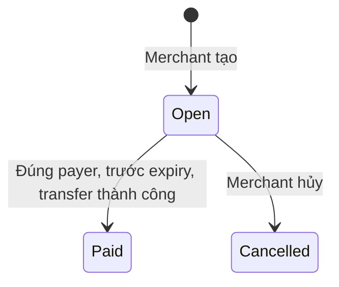

# ReceiptRail — hóa đơn SOL có trạng thái để đối soát

**Bản nháp cho giám khảo, 19/11/2026.** ReceiptRail giúp người bán và người trả kiểm tra cùng một hóa đơn sau khi thanh toán bị mất phản hồi. Với cùng invoice PDA, program chỉ chuyển tiền gốc một lần; một transaction mới cũng không trả lại hóa đơn đã Paid.

## Xem và kiểm chứng

- [Mã nguồn open source](https://github.com/ntbaoheyhey/dev3pack-hackathon), [MIT](../LICENSE).
- [Demo local](http://127.0.0.1:4175/receiptrail/): **mock**, không chuyển SOL. Chưa có link ReceiptRail công khai hoặc video nộp bài; kế hoạch quay ở [demo 165 giây](DEMO-165S-DRAFT.md).
- Program trên **devnet**: [8NGSPufBmGB1oHqaZpY1jhJYz1X4gqFiNXCQmxfapYko](https://explorer.solana.com/address/8NGSPufBmGB1oHqaZpY1jhJYz1X4gqFiNXCQmxfapYko?cluster=devnet). [Chữ ký, trạng thái và đối soát P4-B](evidence/phase4/README.md).
- UI hiện chưa nối giao dịch thật với program. Không dùng video mock để nói đã có end-to-end devnet.

## Người dùng và vấn đề

Một người bán gửi hóa đơn với người trả, số SOL và hạn slot đã chốt. Khi mạng mất phản hồi, hai bên cần biết hóa đơn còn Open hay đã Paid, thay vì tạo một lần trả mới theo phỏng đoán. Đây là giả thuyết sản phẩm; chưa có pilot/khách hàng hoặc số đo tiết kiệm chi phí. [Nguồn và giới hạn](data/receiptrail-evidence.md), [IDEA](IDEA.md).

## Luồng hoạt động

1. Merchant ký tạo hóa đơn: payer, amount, expiry và invoiceID bất biến.
2. Payer xem đúng terms rồi ký Pay. Program kiểm quyền, trạng thái và hạn, chuyển native SOL đúng merchant và ghi Paid trong cùng transaction.
3. Sau timeout, đọc lại cùng PDA. Paid và commitment được trình bày riêng; thao tác kiểm tra lại không tự ký hoặc gửi thêm.
4. Merchant có thể Cancel hóa đơn Open, kể cả khi đã hết hạn. Cancel không hoàn rent và không hoàn khoản thanh toán đã Paid.



Expired là cách hiển thị Open khi slot đã tới hạn; Unknown mô tả kết quả gửi chưa rõ. Hai nhãn đó không phải trạng thái mới được lưu trong account.

## Vì sao dùng Solana

Account Invoice 131 bytes lưu terms và trạng thái chung mà cả hai bên đọc được. PDA lấy từ namespace `invoice-v1`, merchant và invoiceID 32 bytes; status guard kết hợp atomic CPI/state ngăn trả lần hai cùng hóa đơn. Anchor kiểm signer/owner/seeds/quan hệ account; client được sinh từ IDL, UI dùng Wallet Standard và React. Không token, oracle, escrow hoặc backend riêng trong MVP. [Kiến trúc](ARCHITECTURE.md), [contract client](PHASE4-CLIENT.md).

## Những gì đã kiểm

| Lớp | Bằng chứng có sẵn | Giới hạn |
| --- | --- | --- |
| Program/client |32 runtime, 23 client; CI revision triển khai đạt; [Phase4](PHASE4-RESULT.md) | Có test âm quyền/account/expiry/u64/rollback; không gọi là audit độc lập |
| Devnet |162 tx finalized trong đợt triển khai và smoke; debit 0.760701080 SOL dưới cap 1.8 SOL | Đây là chi phí đợt deploy/smoke, không phải phí một hóa đơn |
| Frontend mock |45 web tests/build, 7 ca tái hiện lỗi đạt; [review r3](reviews/receiptrail-phase5-r3.md) | T37 phát hiện lỗi bootstrap P5-F01; kết quả qua route fix chỉ có điều kiện, T40 đang sửa. Chưa public hoặc kiểm ví thật |
| Bảo mật |[Tự review r1](reviews/receiptrail-security-r1.md) | Chưa verified source build; upgrade authority còn quyền nâng cấp |

## Chạy bằng môi trường đã chuẩn bị

Repo dùng bộ cache đã kiểm: Rust 1.100.0, Anchor 1.2.2, Agave 4.1.2, platform-tools v1.57; web Node 24.22.2 và lockfile hiện hành. Các lệnh sau chạy bằng cache có sẵn; thiếu dependency phải chuẩn bị riêng, không tự tải qua script.

```sh
# Từ root repo
bash scripts/check-receiptrail.sh
bash scripts/check-receiptrail-client.sh
cd apps/web
npm test
npm run dev -- --port 4175 --strictPort
```

Tự mở `/receiptrail/` trên localhost 4175, chọn ví mock Tiệm Cà phê/Alice và xem nhãn mock. Không cần seed hoặc ví có tiền thật để thử UI. [Checklist thao tác](PHASE5-PLAN.md).

## Trước sự kiện và trong hackathon

**Trước 27/11/2026:** nghiên cứu/spec, Anchor program, IDL/client, tests/CI, deploy/smoke devnet và frontend mock được chuẩn bị với AI. Codex chủ trì program/review, Antigravity hỗ trợ nguồn/UI/browser; người dùng quyết định phạm vi. Tất cả ghi trong [DEVLOG](DEVLOG.md). Tag `hackathon-start` chỉ tạo khi sự kiện mở, chưa tạo sớm.

**Trong 27–29/11/2026:** chưa có công việc tại thời điểm bản nháp. Khi thực hiện, ghi commit và tính năng thật vào mục này; không chuyển phần chuẩn bị trước thành thành tích trong sự kiện. Repo cần người dùng hiểu và giải thích được code. [Note thể lệ đã đọc 17/11](learning/012-winning-solana-hackathons.md); giờ UTC deadline/partner tracks còn cần kiểm lại tại portal.

## Giới hạn sản phẩm

Merchant vẫn có thể tạo invoiceID khác cho cùng đơn; ReceiptRail chỉ ngăn trả lại cùng PDA. Receipt không chứng minh giao hàng, không refund/escrow. Rent của hóa đơn terminal vẫn giữ trong account. Người dùng còn tin cậy RPC, wallet và upgrade authority; devnet có thể reset/rate limit. Bản thử chưa có bảo đảm vận hành production. [Kế hoạch tích hợp](PHASE6-PLAN.md) còn chờ duyệt, không quảng cáo phần chưa xây.
