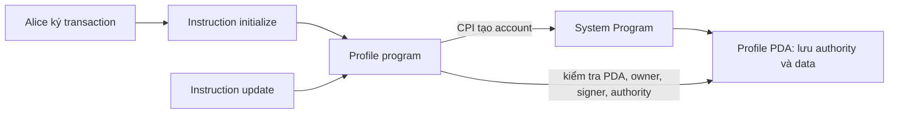

# 002 — Solana căn bản trong 15 phút

> Ngày kiểm tra: 2026-11-17 (Asia/Ho_Chi_Minh). Phạm vi: nền tảng, không giao dịch.
> Trạng thái: đã đối chiếu docs chính thức; ví dụ trên giấy, chưa chạy on-chain.

## 1. Mục tiêu và điều cần nhớ

Sau 15 phút, hãy giải thích được: **program thực thi quy tắc, account giữ trạng thái, transaction mang instruction và chữ ký, runtime kiểm soát quyền truy cập**. PDA là địa chỉ có thể suy ra và dùng làm authority khi CPI; không phải một chiếc ví có private key.

Chia thời gian: 4 phút account/owner, 4 phút transaction/signer, 4 phút PDA/CPI, 3 phút phí/cluster và tự kiểm tra. Không cần biết Rust trước.

## 2. Phiên bản và bằng chứng kiểm tra

| Thành phần | Phiên bản hoặc mốc tài liệu | Mức kiểm chứng |
| --- | --- | --- |
| Solana core docs | Bản web truy cập 17/11/2026; tài liệu sống, không có semver chung | Đã đọc các trang ở mục 6 |
| Bộ công cụ cho bài học tiếp theo | Anchor 1.2.2, Agave CLI 4.1.2, platform-tools v1.57, SBPF v3 | Khuyến nghị của release notes; chưa cài/chạy |
| Transaction | Phân biệt legacy/v0 và v1 trong docs hiện tại | Không giả định tính năng đã bật trên một cluster cụ thể |

Pin công cụ không đồng nghĩa pin phiên bản mạng. Xem [003](003-solana-toolchain.md) trước khi thực hành; note này không cần cài gì.

## 3. Kiến thức chính

### Account là đơn vị lưu dữ liệu

Hình dung blockchain là bản đồ `địa chỉ → account`. Địa chỉ dài 32 byte, thường hiển thị base58. Một account có:

| Trường | Hiểu ngắn gọn |
| --- | --- |
| `lamports` | Số dư SOL theo đơn vị nhỏ nhất; 1 SOL = 1.000.000.000 lamports |
| `data` | Bytes trạng thái hoặc thông tin liên quan đến program |
| `owner` | Program được runtime cho phép sửa data và trừ lamports |
| `executable` | Account có đại diện cho program có thể thực thi hay không |
| `rent_epoch` | Trường cũ, đã deprecated; không dùng để thiết kế “tiền thuê hàng tháng” |

Quyền trên còn chịu kiểm tra writable, ownership và các quy tắc runtime khác. Không phải cứ owner đúng là mọi thao tác đều hợp lệ. Nguồn: [Accounts](https://solana.com/docs/core/accounts), [Account structure](https://solana.com/docs/core/accounts/account-structure).

### Khác EVM ở chỗ nào?

| Khía cạnh | Cách nghĩ EVM quen thuộc | Cách nghĩ Solana |
| --- | --- | --- |
| Code và state | Contract có code và storage gắn với địa chỉ contract | Program xử lý nhiều data account tách biệt |
| Dữ liệu cần dùng | Contract đọc storage của mình, có thể gọi contract khác | Instruction khai báo các account cần đọc/ghi |
| Quyền người dùng | Thường kiểm tra `msg.sender` | Kiểm tra account có signer và quan hệ với authority lưu trong state |
| Giao dịch độc lập | Không mặc định suy từ account list của người gọi | Runtime có thể xử lý song song khi tập account không xung đột |

Đây là so sánh ở mức lập trình, không phải khẳng định mọi EVM đều có cùng cơ chế thực thi. Không chuyển máy móc `mapping(address => State)` thành một account khổng lồ; có thể dùng PDA riêng cho từng người. Nguồn: [Solana programs](https://solana.com/docs/core/programs), [Ethereum accounts](https://ethereum.org/en/developers/docs/accounts/).

### Program cũng là account; owner khác authority

Program được triển khai thành account executable do loader quản lý; với upgradeable loader, bytecode và thông tin upgrade có thể nằm ở ProgramData riêng. “Program stateless” nghĩa là state nghiệp vụ thay đổi nằm trong data account, không có nghĩa ứng dụng không lưu gì. [Programs](https://solana.com/docs/core/programs)

Ví dụ account `Profile`:

- `owner` của account là program `ProfileProgram`.
- Trường `authority` bên trong `Profile.data` có thể là public key của Alice.
- Program chỉ cho cập nhật nếu authority truyền vào đúng Alice **và** có quyền signer.

Với token account, program owner thường là Token Program; người được chuyển token là authority trong dữ liệu token. Hai nghĩa của chữ “owner” rất dễ bị lẫn. Một keypair có thể ký không có nghĩa nó được runtime cho sửa trực tiếp mọi account mang cùng tên người dùng.

### Rent là khoản giữ tối thiểu cho lưu trữ

Khi tạo data account, cần cấp đủ lamports cho dung lượng. Theo docs hiện tại, ongoing rent collection đã tắt; “rent-exempt minimum” là tên vẫn dùng trong RPC. Account đóng hợp lệ có thể hoàn lại số dư cho đích được phép. Đây khác phí transaction đã trả.

Không hard-code công thức hoặc số SOL từ tutorial: dùng `getMinimumBalanceForRentExemption(data_len)` theo cluster khi thực hành, hoặc `Rent` của runtime. Feature gate có thể làm mức tiền khác nhau. [Account structure](https://solana.com/docs/core/accounts/account-structure)

### Transaction, instruction và signer

**Instruction** là một yêu cầu: program ID đích, account metadata (địa chỉ, signer/writable) và dữ liệu tham số. **Transaction** đóng gói một hay nhiều instruction, message và chữ ký; thường dùng recent blockhash để giới hạn thời gian hợp lệ.

Các instruction trong cùng transaction có tính atomic: nếu một bước lỗi, thay đổi state bị rollback; transaction đã được xử lý thất bại vẫn có thể mất phí. Không nhầm atomicity với “chắc chắn lên chain”. RPC nhận request chưa chứng minh transaction đã confirmed/finalized. [Transactions](https://solana.com/docs/core/transactions)

Signer là quyền runtime kiểm tra. Ở transaction ngoài cùng, đó thường là chữ ký Ed25519 hợp lệ trên message; trong CPI, quyền signer còn có thể đến từ PDA. Chỉ đưa địa chỉ Alice vào danh sách accounts **không** tạo chữ ký Alice. Đánh dấu writable cũng không trao quyền sở hữu.

Recent blockhash hết hạn thì cần kiểm tra trạng thái và xây lại transaction đúng cách; không đoán thời gian cố định từ số giây trong bài cũ. Khi thực hành, theo dõi `lastValidBlockHeight` do RPC trả về. [Transaction confirmation](https://solana.com/developers/guides/advanced/confirmation)

### CPI là program gọi program

Ví dụ `ProfileProgram` nhờ System Program tạo account. Đó là CPI (Cross-Program Invocation). `invoke` dùng quyền có sẵn; `invoke_signed` thêm quyền signer cho PDA hợp lệ của program gọi. Callee không được tự nâng account read-only thành writable hoặc biến một account bất kỳ thành signer. CPI dùng chung compute budget của transaction. [CPI](https://solana.com/docs/core/cpi)

Không tin `program_id` do client gửi tùy ý: phải kiểm tra đúng program cần gọi. Cũng không coi mọi cơ chế gọi lồng là EVM reentrancy; các giới hạn CPI và feature gates phải tra theo runtime hiện hành.

### PDA: seeds, program ID và bump

PDA được suy ra từ **program ID + seeds + bump** sao cho địa chỉ nằm ngoài đường cong Ed25519. Vì vậy không có private key tương ứng. Cùng đầu vào thì cùng địa chỉ; tính được địa chỉ **chưa tạo ra account** tại địa chỉ đó.

Ví dụ namespace: `[b"profile", alice_pubkey]`. `bump` là một byte để thử địa chỉ hợp lệ; canonical bump là giá trị đầu tiên tìm được khi dò từ 255 xuống. Anchor `seeds = [...], bump` có thể kiểm tra địa chỉ và canonical bump cho bạn. [PDA](https://solana.com/docs/core/pda), [PDA derivation](https://solana.com/docs/core/pda/pda-derivation)

Mỗi seed tối đa 32 byte; tổng giới hạn 16 seed tính cả bump khi thêm vào derivation. Dùng prefix cố định, public key và integer có độ rộng xác định. Ghép hai chuỗi tùy ý dễ gây trùng biểu diễn: `ab|c` và `a|bc` có thể cho cùng bytes. Xem [007](007-solana-program-security.md).

**Program tạo địa chỉ PDA và program owner của account là hai quan hệ khác nhau.** Program A có thể ký cho PDA dẫn xuất từ A ngay cả khi account tại đó do một program khác sở hữu. Quyền ký PDA không thay thế owner check, signer check hoặc business authorization.

### Compute units và priority fee

Compute units (CU) là ngân sách tính toán. Vượt budget thì transaction thất bại. Với legacy/v0, priority fee được tính theo **CU limit yêu cầu**, không theo CU thực dùng:

```text
priority_fee_lamports = ceil(CU_limit × CU_price_micro_lamports / 1_000_000)
ví dụ: limit 200.000 × giá 1.000 micro-lamports/CU → 200 lamports
base fee mẫu: 1 chữ ký × 5.000 lamports
tổng trong ví dụ = 5.200 lamports (chưa tính tiền tạo account)
```

Đặt limit quá rộng có thể trả phí thừa; simulate để ước lượng, thêm biên an toàn phù hợp. Priority fee tăng cơ hội được xử lý, không bảo đảm thành công. Docs hiện nêu trần 1,4 triệu CU/transaction; không lấy số này thay cho đo đạc. [Fees](https://solana.com/docs/core/fees)

**Chú ý phiên bản:** docs năm 2026 có transaction v1 với cấu hình fee riêng theo tổng lamports. Công thức CU-price ở trên dành cho legacy/v0; không áp vào v1. Tương tự, giới hạn 1.232 byte quen thuộc không bao trùm v1. Học định dạng cụ thể trước khi dùng SDK mới; baseline Anchor không có nghĩa mọi client đã hỗ trợ v1.

### Localnet, devnet và mainnet

| Môi trường | Dùng khi nào | Điều cần nhớ |
| --- | --- | --- |
| Localnet | Test nhanh, reset trạng thái có kiểm soát | Không phải mạng công khai; mô phỏng không chứng minh production |
| Devnet | Thử luồng tích hợp công khai | SOL thử từ faucet, có thể reset; RPC có rate limit |
| Testnet | Validator/network upgrade testing | Không phải lựa chọn mặc định cho app học tập |
| Mainnet | Hoạt động thật | SOL và tài sản thật; ngoài phạm vi phiên này |

Cùng một địa chỉ có thể có trạng thái khác giữa các cluster. Xem explorer phải chọn đúng devnet. [Clusters](https://solana.com/docs/references/clusters)

## 4. Ví dụ hoặc quy trình tối thiểu

Ví dụ trên giấy: Alice tạo rồi cập nhật một `Profile`.



Ở initialize, Alice trả phí và tiền lưu trữ; program tính đúng PDA và dùng CPI để tạo account. Ở update, Alice ký, program kiểm tra quan hệ authority rồi mới sửa data. Bob biết địa chỉ PDA vẫn không được sửa profile của Alice. Đây là ví dụ học account model, không phải ý tưởng sản phẩm hay code đã deploy.

Đoạn giải thích 60 giây cho giám khảo: “Solana tách program khỏi state. Mỗi instruction chỉ ra account cần đọc và ghi. Tôi kiểm tra program owner, loại dữ liệu, PDA và authority có signer trước khi thay đổi state. PDA cho phép địa chỉ xác định và ký trong CPI mà không lưu private key. Tôi đo compute bằng simulation, test lỗi quyền và chạy devnet trước khi nghĩ đến production.”

## 5. Tự kiểm tra

1. Bob truyền public key Alice nhưng ký bằng ví Bob: đủ quyền chưa? **Chưa**; địa chỉ khớp không chứng minh chữ ký Alice.
2. Tính được PDA có nghĩa account tồn tại? **Không**; vẫn cần tạo/cấp tiền/khởi tạo.
3. PDA thuộc derivation của A có bắt buộc `account.owner == A`? **Không**; signer derivation và owner độc lập.
4. Instruction thứ hai fail thì state instruction thứ nhất còn không? **Rollback**, nhưng phí có thể vẫn bị thu.
5. Limit 300.000 CU, giá 2.000 micro-lamports/CU: priority fee legacy/v0? **600 lamports**, dù chạy ít hơn.
6. Đóng account hoàn tiền storage có hoàn phí transaction không? **Không**.

Tiêu chí đạt: giải thích được sáu câu bằng lời của mình, vẽ ba account (wallet/program/data) và chỉ đúng owner của từng account. Chưa có bài nào ở đây được thực thi on-chain.

## 6. Nguồn và độ tin cậy

Tất cả truy cập 17/11/2026; ngày xuất bản riêng không được các trang docs sống công bố nhất quán:

- Chính thức: [Accounts](https://solana.com/docs/core/accounts), [Account structure](https://solana.com/docs/core/accounts/account-structure), [Programs](https://solana.com/docs/core/programs).
- Chính thức: [Instructions](https://solana.com/docs/core/instructions), [Transactions](https://solana.com/docs/core/transactions), [Confirmation](https://solana.com/developers/guides/advanced/confirmation).
- Chính thức: [PDA derivation](https://solana.com/docs/core/pda/pda-derivation), [CPI](https://solana.com/docs/core/cpi), [Fees](https://solana.com/docs/core/fees), [Clusters](https://solana.com/docs/references/clusters).
- Chính thức: [Ethereum accounts](https://ethereum.org/en/developers/docs/accounts/) để đối chiếu EVM.
- Maintainer: [Anchor 1.2.2 release notes](https://www.anchor-lang.com/docs/updates/release-notes/1-2-2), tag phát hành 28/10/2026. Ví dụ Profile và bài tập do người viết tự soạn.

## 7. Điểm chưa kiểm chứng và bước tiếp theo

Chưa hỏi RPC để xác định feature gates, phí, rent hoặc phiên bản validator của devnet. Không có giao dịch hay ví được tạo. Các con số runtime chỉ là mốc docs; cần kiểm tra lại khi bắt đầu thực hành.

Tiếp theo đọc [003](003-solana-toolchain.md), rồi [004](004-anchor-a-to-z.md). Nếu còn nhầm owner với authority, làm lại câu 1 và 3 trước khi đọc constraints.
