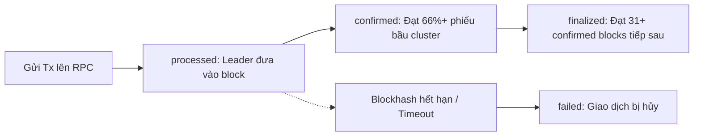

# 005 — Frontend Solana trong kỷ nguyên @solana/kit

> Ngày kiểm tra: 2026-11-17 (Asia/Ho_Chi_Minh). Phạm vi: kiến trúc frontend Web3, kết nối ví và tích hợp program.
> Trạng thái: đã đối chiếu docs chính thức; đã chạy thực tế sandbox Vite 8.3 + React 19 + @solana/kit 8.6.0 trên trình duyệt nội bộ.

---

## 1. Mục tiêu và điều cần nhớ

Sau bài học này, bạn có thể:
1. Giải thích sự chuyển dịch từ `@solana/web3.js` v1 cổ điển sang **`@solana/kit`** (chuẩn mặc định năm 2026) và lý do các dự án mới không còn dùng v1.
2. Hiểu cơ chế kết nối ví qua **Wallet Standard** và cách dùng các hook React (`@solana/react` hoặc `@solana/wallet-adapter-react`).
3. Nắm vững luồng gọi program Anchor: từ IDL truyền thống đến client TypeScript sinh bằng **Codama**.
4. Quản lý chính xác vòng đời giao dịch: `processed` → `confirmed` → `finalized`, xử lý hết hạn blockhash bằng `lastValidBlockHeight`.
5. Bắt và dịch các mã lỗi khô khan (0x1770, 0x1, 4001) thành thông báo thân thiện với người dùng.
6. Đưa ra quyết định chọn stack cho 48 giờ hackathon: **Vite (SPA)** vượt trội hơn **Next.js (SSR)** như thế nào.

Thời lượng đọc: khoảng 15–20 phút.

---

## 2. Phiên bản và bằng chứng kiểm tra

| Thành phần | Phiên bản (2026-11) | Mức kiểm chứng |
| --- | --- | --- |
| `@solana/kit` | **8.6.0** | Đã cài đặt và chạy thử nghiệm trong sandbox cục bộ |
| `@solana/react` | **8.6.0** | Đã kiểm tra API exports (`ClientProvider`, `useClient`, `useSelectedWalletAccount`) |
| `@solana/web3.js` | **3.2.1** (kế thừa kiến trúc modular v2) | Đã kiểm tra npm registry; v1.95.x là bản legacy cũ |
| `@solana/wallet-adapter-react` | **0.15.40** | Đã đối chiếu docs hệ sinh thái |
| `@codama/cli` (mốc source) | **2.0.0-rc.0**, commit `141998e` | Đã đọc manifest + CLI README của cùng commit; chưa cài/chạy codegen, không xác nhận version thực trong repo |
| `vite` & `react` | Vite **8.3.8**, React **19.3.1** | Đã build và chạy dev server thành công (build: 74ms, gzip: 77.6 kB) |
| Kiểm tra Browser | Chrome-headless (Browser Subagent) | Đã click mô phỏng trạng thái và bắt lỗi thành công tại `http://127.0.0.1:5173` |

---

## 3. Kiến thức chính

### 3.1. So sánh `@solana/kit` vs `@solana/web3.js`: Bản nào là mặc định năm 2026?

Trong nhiều năm, thư viện tiêu chuẩn của Solana là `@solana/web3.js` v1. Tuy nhiên, v1 gặp phải những hạn chế cố hữu:
- **Monolithic & Cồng kềnh**: Kéo theo toàn bộ dependencies nặng như `bn.js`, polyfills Node.js (`Buffer`, `crypto`), khiến bundle size ban đầu của frontend thường vượt quá 500 KB – 1 MB.
- **Không hỗ trợ Tree-shaking**: Dù chỉ dùng một hàm nhỏ, trình đóng gói (bundler) vẫn phải đóng gói hầu hết thư viện.
- **Mutable Data Structures**: Các lớp như `Transaction` chứa mutation state nội bộ, dễ dẫn đến lỗi khó tái hiện khi ký nhiều lần hoặc cập nhật blockhash.

**Bước ngoặt 2024–2026**:
Hệ sinh thái Solana đã hoàn thành quá trình tái cấu trúc:
1. `@solana/web3.js` từ phiên bản v2 trở đi được chia nhỏ thành hàng chục package con chuyên biệt: `@solana/addresses`, `@solana/transactions`, `@solana/rpc`, `@solana/signers`, v.v.
2. **`@solana/kit`** được phát hành như bộ công cụ hợp nhất (All-in-one Toolkit Suite), đóng gói các package trên với kiến trúc Functional Programming, Immutable và Tree-shakeable 100%.
3. Trong năm 2026, **`@solana/kit`** là tiêu chuẩn được Solana Foundation khuyến nghị chính thức cho mọi dự án mới. `@solana/web3.js` v1 chỉ còn được duy trì ở trạng thái bảo trì cho các code base cũ.

| Tiêu chí | `@solana/web3.js` v1 (Legacy) | `@solana/kit` (Tiêu chuẩn 2026) |
| --- | --- | --- |
| Triết lý thiết kế | Lớp đối tượng (OOP), mutable state (`new Transaction()`) | Hàm thuần túy (Functional), immutable pipelines (`pipe(...)`) |
| Kích thước Bundle | Rất lớn (>500 kB), cần polyfill `Buffer` | Siêu nhẹ (~77 kB gzipped), native BigInt, native Uint8Array |
| Dependencies Node.js | Phụ thuộc nặng vào Node.js built-ins (`crypto`, `buffer`) | Web standard thuần túy, chạy mượt trên Browser, Cloudflare Workers, Edge |
| Hỗ trợ RPC | `Connection` monolithic | `createSolanaRpc()` nhẹ, tùy biến middleware linh hoạt |

---

### 3.2. Kết nối ví (Wallet Connection) & Wallet Standard

Trước đây, mỗi nhà phát triển ví (Phantom, Solflare, Backpack) phải inject một đối tượng riêng vào `window` (ví dụ `window.solana`, `window.phantom.solana`), dẫn đến sự phân mảnh lớn.

**Wallet Standard là gì?**
Wallet Standard là chuẩn mở được định nghĩa bởi Solana Foundation và hệ sinh thái Web3. Các ví đăng ký năng lực (features) của mình vào một registry chung trên `window`. DApp chỉ cần tương tác với interface chuẩn:
- `standard:connect`: Yêu cầu kết nối và lấy danh sách tài khoản.
- `standard:events`: Lắng nghe sự kiện chuyển tài khoản hoặc ngắt kết nối.
- `solana:signAndSendTransaction`: Ký và gửi transaction trực tiếp.
- `solana:signTransaction`: Ký transaction trả về bytes thô.
- `solana:signMessage`: Ký thông điệp tùy ý (dùng cho SIWS - Sign-in with Solana).

**Lựa chọn thư viện trên React**:
1. **`@solana/react`** (thuộc bộ `@solana/kit`): Thư viện React chính thức thế hệ mới. Cung cấp các hook như `useClient()`, `useSelectedWalletAccount()`, `useSignAndSendTransaction()`. Giao diện hiện đại, tối giản.
2. **`@solana/wallet-adapter-react`**: Thư viện quen thuộc với cộng đồng nhiều năm qua, đi kèm modal UI sẵn có (`@solana/wallet-adapter-react-ui`). Thư viện này hiện đã tương thích hoàn toàn với Wallet Standard.

> [!TIP]
> Trong 48h hackathon, nếu bạn cần một UI nút bấm chọn ví đẹp mắt có sẵn trong 5 phút, `@solana/wallet-adapter-react` + `@solana/wallet-adapter-react-ui` vẫn là lựa chọn nhanh nhất. Nếu bạn muốn kiểm soát giao diện và bundle size tối ưu, `@solana/react` kết hợp Wallet Standard là giải pháp sạch nhất.

---

### 3.3. Gọi Program Anchor từ Frontend: IDL vs Codama Client

Khi tương tác với Anchor Program, frontend cần biết định dạng tham số và cấu trúc account:

1. **Phương pháp truyền thống (Anchor Provider + `@coral-xyz/anchor`)**:
   - Dùng file `target/idl/my_program.json`.
   - Khởi tạo `new Program(idl, provider)`.
   - **Nhược điểm**: `@coral-xyz/anchor` kéo theo thư viện web3.js v1 và hệ thống type dynamically parsed, làm bundle nặng và autocomplete TypeScript đôi khi không trọn vẹn.

2. **Codama (client generator)**:
   - CLI đọc cấu hình, nạp Anchor/Codama IDL, áp visitors rồi chạy renderer để sinh client. API đầu ra phụ thuộc IDL, renderer và version; phải xem exports thực tế trước khi viết frontend.
   - Mốc đối chiếu ngày 17/11/2026: **`@codama/cli` 2.0.0-rc.0**, [package.json tại commit `141998e`](https://github.com/codama-idl/codama/blob/141998ef817294a79629c4592cdfdce93bd6939d/packages/cli/package.json), [CLI README cùng commit](https://github.com/codama-idl/codama/blob/141998ef817294a79629c4592cdfdce93bd6939d/packages/cli/README.md). Đây là **source prerelease**, không khẳng định là bản stable/nên cài hoặc đã cài. Không dùng version 1.11.0 ở bản note cũ như bằng chứng đã kiểm tra.

#### Quy trình `codama init` → cấu hình renderer → `codama run`

**Chưa chạy.** Các lệnh dưới chỉ minh họa cho phiên thực hành sau khi đã được phép chuẩn bị môi trường và khóa bộ version tương thích. Phiên sửa tài liệu không cài package, không chạy `npx` hoặc codegen. `init` có thể yêu cầu thêm dependency; không tự chấp nhận cài trong phạm vi tài liệu.

```sh
# Khi binary đã có trong môi trường được phép dùng:
codama init
# Chọn IDL target/idl/my_program.json và preset phù hợp trong prompt.
# Review codama.json; đường dẫn output thuộc args của renderer, không phải flag --output.
codama run js
```

Ví dụ `codama.json` theo schema và recipe JavaScript renderer của CLI README; `js` là **tên script tự đặt trong cấu hình này**, không phải tên hàm generated:

```json
{
  "idl": "target/idl/my_program.json",
  "scripts": {
    "js": {
      "from": "@codama/renderers-js",
      "args": ["src/client"]
    }
  }
}
```

`codama run` không có tên script chỉ chạy `before` visitors, không tự chạy renderer; cần `codama run js` hoặc `codama run --all` nếu muốn chạy tất cả script đã cấu hình. CLI README xác nhận trường `idl` có thể nhận Anchor IDL và chuyển sang Codama IDL.

Trước khi chạy thật, khóa version CLI/Codama, Anchor adapter, renderer và Kit theo compatibility của từng package; **bộ tương thích và kết quả codegen chưa kiểm chứng** trong repo này. Sau đó xem diff và exports sinh ra, dùng đúng tên/type đó và chạy build/client test. Không tự suy tên hàm fetch/instruction từ tên account; mẫu trên chưa tạo bất kỳ file client nào.

---

### 3.4. Vòng đời giao dịch (Transaction Lifecycle) & Xử lý trạng thái

Một lỗi phổ biến của người mới làm Solana là hiển thị "Giao dịch thành công" ngay khi RPC trả về signature. Trên thực tế, một giao dịch phải trải qua các mốc cam kết (commitment levels):



1. **`processed`**: Block chứa transaction đã được validator (leader) sinh ra. Tốc độ ~400ms, nhưng vẫn có khả năng bị fork/rollback nhẹ.
2. **`confirmed`**: Khối đã nhận được trên 66% phiếu bầu của cụm validator. **Đây là mốc chuẩn để cập nhật giao diện người dùng (UI update)** vì tính ổn định đã được bảo đảm.
3. **`finalized`**: Khối đã có 31+ khối confirmed xếp sau, không thể đảo ngược trên mạng lưới. Dùng cho các giao dịch chuyển tiền lớn hoặc rút nạp sàn.

**Xử lý Blockhash Expiry & Timeout**:
Transaction Solana không tồn tại vĩnh viễn trên mempool. Mỗi transaction mang theo một `recentBlockhash`. Nếu sau khoảng 150 blocks (~60–90 giây) mà transaction chưa được đưa vào khối, blockhash sẽ hết hạn và transaction bị hủy bỏ hoàn toàn.
- Khi gửi transaction, hãy lưu lại `lastValidBlockHeight`.
- Dùng `getSignatureStatuses` hoặc subscriptions WebSocket để theo dõi trạng thái. Nếu `blockHeight > lastValidBlockHeight` mà signature vẫn chưa có confirmation, báo lỗi hết hạn và cho phép người dùng bấm "Thử lại" với blockhash mới.

---

### 3.5. Hiển thị lỗi thân thiện (User-Friendly Error Handling)

Mã custom chỉ có nghĩa trong namespace của **program phát lỗi**. `6000` thường là điểm bắt đầu custom error Anchor, nhưng tên/ý nghĩa phải tra `errors` trong IDL khớp program ID và bản triển khai. Không phân loại một đoạn hex thành lỗi thiếu SOL trên toàn mạng.

| Bằng chứng kỹ thuật | Cách xử lý |
| --- | --- |
| System Program `11111111111111111111111111111111`, custom `0x1` | `ResultWithNegativeLamports`: tài khoản nguồn thiếu lamports cho thao tác; không đồng nhất với thiếu phí transaction |
| Program của ứng dụng, `0x1770` / `0x1771` | Tra mã nguyên vẹn `6000` / `6001` trong IDL của đúng program |
| Program khác có cùng mã | Dùng error map của program đó; chưa có map thì hiển thị program ID + mã, không dùng IDL ứng dụng |
| Wallet rejection, `InsufficientFundsForFee`, blockhash expiry | Là nhóm lỗi riêng; xử lý theo kiểu lỗi của wallet/SDK và dữ liệu RPC, không dò chuỗi hex |
| Không có logs hoặc chuỗi CPI phức tạp | Giữ thông báo trung tính và bằng chứng; chưa đủ căn cứ thì không đoán nguyên nhân |

Nguồn: [Anchor Custom Errors](https://www.anchor-lang.com/docs/features/errors), [SystemError source](https://docs.rs/solana-system-interface/latest/src/solana_system_interface/error.rs.html), [Agave stable runtime logs](https://github.com/anza-xyz/agave/blob/master/program-runtime/src/stable_log.rs), đối chiếu 17/11/2026.

---

### 3.6. Stack gợi ý cho Hackathon: Vite (SPA) vs Next.js (App Router)

Trong ngân sách làm việc 48 giờ tự đặt của đội, lựa chọn framework nên dựa trên kinh nghiệm và flow cần demo. Chưa có phép đo để quy đổi lựa chọn này thành tỷ lệ tăng tốc.

| Khía cạnh | Next.js (App Router / SSR) | Vite + React (SPA) | Lựa chọn cho Hackathon |
| --- | --- | --- | --- |
| **Hydration Mismatch** | **Rất dễ gặp lỗi**. Ví Web3 chỉ tồn tại trên `window` client, SSR render HTML không khớp với Client DOM &rarr; lỗi trắng trang nếu không bọc `dynamic(..., { ssr: false })`. | **Không bao giờ bị**. Chạy thuần túy Client-Side Rendering (CSR), `window.solana` sẵn sàng ngay lập tức. | **Vite thắng tuyệt đối** |
| **Node Polyfill Issues** | Thường xung đột khi Webpack/Turbopack cố nạp các module crypto/buffer của các package Web3 cũ. | ESM-native, `@solana/kit` chạy trơn tru mà không cần cấu hình polyfill phức tạp. | **Vite thắng** |
| **Tốc độ Dev & Build** | Khởi động lạnh chậm hơn, biên dịch trang lâu hơn khi codebase phình to. | Khởi động dev server < 200ms, HMR tức thì (< 50ms), build production chỉ vài giây. | **Vite thắng** |
| **SEO & Social Share** | Tốt nhờ SSR/Metadata sinh động. | Kém hơn, nhưng hackathon ưu tiên app tương tác (dApp) chứ không phải blog tin tức. | Không quá quan trọng |

> [!IMPORTANT]
> **Đề xuất của người viết, không phải yêu cầu BTC**: Cân nhắc **Vite + React + TailwindCSS (hoặc shadcn/ui)** nếu phù hợp kỹ năng đội và app chủ yếu chạy phía client. Chưa đo thời gian tiết kiệm so với Next.js; “48h” là ngân sách nội bộ, sự kiện Dev3pack diễn ra ba ngày theo [001](001-hackathon-rules.md).

---

## 4. Ví dụ hoặc quy trình tối thiểu

### Ví dụ 4.1. Khởi tạo RPC và đọc dữ liệu với `@solana/kit` (Đã chạy kiểm tra)

```typescript
import { createSolanaRpc, address } from '@solana/kit';

// Khởi tạo RPC client nhẹ, không cần new Connection()
const rpc = createSolanaRpc('https://api.devnet.solana.com');

async function getAccountInfo(accountAddressString: string) {
  try {
    const target = address(accountAddressString);
    // Gọi RPC method getAccountInfo với format jsonParsed
    const response = await rpc.getAccountInfo(target, { encoding: 'jsonParsed' }).send();

    if (!response.value) {
      console.log('Account chưa tồn tại trên chain.');
      return null;
    }

    console.log('Lamports:', response.value.lamports);
    console.log('Owner Program:', response.value.owner);
    return response.value;
  } catch (error) {
    console.error('Lỗi gọi RPC:', error);
    throw error;
  }
}
```

### Ví dụ 4.2. Parse cặp program ID + mã lỗi, rồi tra IDL

Hàm nhận **runtime logs đầy đủ của transaction đã thất bại**, lấy từ simulation/preflight logs hoặc `meta.logMessages` qua adapter của SDK đang dùng. Không suy program ID từ tên instruction, message hay transaction gửi đi vì lỗi có thể nằm trong CPI. Chỉ khớp dòng runtime `Program ... failed: ...`, không khớp dòng tự ghi `Program log: ...`.

```typescript
type IdlError = { code: number; name: string; msg?: string };
type ErrorMaps = ReadonlyMap<string, ReadonlyMap<number, string>>;
type ProgramFailure = { programId: string; code?: number; detail: string };

export function idlErrorMap(errors: readonly IdlError[]): Map<number, string> {
  return new Map(errors.map(e => [e.code, e.msg ?? e.name]));
}

export function parseSolanaError(
  logs: readonly string[],
  maps: ErrorMaps,
): { message: string; failures: ProgramFailure[] } {
  const failures: ProgramFailure[] = [];
  for (const line of logs) {
    const failed = /^Program ([1-9A-HJ-NP-Za-km-z]{32,44}) failed: (.+)$/.exec(line);
    if (!failed) continue;
    const [, programId, detail] = failed;
    const custom = /^custom program error: (0x[0-9a-f]+|[0-9]+)$/i.exec(detail);
    const numeric = custom ? Number(custom[1]) : undefined;
    const code = numeric !== undefined && Number.isSafeInteger(numeric)
      && numeric >= 0 && numeric <= 0xffffffff ? numeric : undefined;
    failures.push({ programId, code, detail });
  }
  if (failures.length !== 1) {
    // CPI có thể bắt, đổi hoặc truyền tiếp lỗi. Không gán IDL của caller cho callee.
    return {
      message: failures.length
        ? 'Nhiều lần program báo lỗi; cần đối chiếu call stack CPI và IDL trước khi kết luận.'
        : 'Chưa đủ runtime logs để xác định program và mã lỗi.',
      failures,
    };
  }
  const failure = failures[0];
  const label = failure.code === undefined
    ? undefined : maps.get(failure.programId)?.get(failure.code);
  return {
    message: label ?? `Program ${failure.programId}: ${failure.code === undefined
      ? failure.detail : `custom error ${failure.code} (0x${failure.code.toString(16)}) chưa có trong error map`}`,
    failures,
  };
}
```

Khởi tạo `maps` với System Program → `{1: "Tài khoản nguồn thiếu lamports cho thao tác."}` và `programId` thực → `idlErrorMap(idl.errors ?? [])`. Mỗi program phải có map riêng, khớp deployment/version của nó. Không tự gán mã `6000` cho một tên lỗi chung. Với nhiều dòng failure, hàm trả **tất cả cặp ID/mã đúng theo log**, cố ý không chọn nguyên nhân gốc từ lần lỗi đầu/cuối; cần phân tích `invoke [depth]`, `success` và failure để loại CPI đã được bắt. Khi logs bị cắt, phải giữ nhãn thiếu bằng chứng, không dùng mẫu này như parser toàn diện.

Bảng ca kiểm tra dùng IDL **giả lập** của program A: `6000 → BetTooSmall`, `6001 → MarketClosed`; B chưa có map. A/B chỉ là nhãn mô tả, fixture thực dùng chuỗi base58 giả hợp lệ về hình thức, không phải địa chỉ triển khai.

| Input runtime failure | Cặp trích xuất | Kết quả mong đợi |
| --- | --- | --- |
| System Program, `0x1` | System / 1 | Thiếu lamports cho thao tác |
| A, `0x1770` | A / 6000 | `BetTooSmall`, không phải thiếu SOL |
| A, `0x1771` | A / 6001 | `MarketClosed`, không phải thiếu SOL |
| B, `0x1` | B / 1 | Chưa có map, không gán lỗi System Program |
| B, `0x1770` | B / 6000 | Chưa có map, không gán lỗi A |
| A, `6001` (decimal) | A / 6001 | `MarketClosed` |
| `Program log: Program A failed: ...` | Không có | Bỏ qua log do program tự ghi |
| Chỉ message `custom program error: 0x1770`, không có logs | Không có | Thiếu program ID, không đoán |
| B failure rồi A failure (CPI) | B và A, giữ riêng từng mã | Chưa tự chọn nguyên nhân gốc |
| Mã ngoài `u32` hoặc `0x1770junk` | Program ID có, mã không hợp lệ | Không tra nhầm IDL |

Đã chạy 11 fixture offline bằng Node có sẵn ngày 17/11/2026 từ chính snippet này; không gọi RPC, không cài dependency, chưa thử với giao dịch/ví thật.

---

## 5. Tự kiểm tra

1. **Tại sao `@solana/kit` lại được coi là tương lai của frontend Solana thay thế `@solana/web3.js` v1?**
   - *Đáp án*: Vì `@solana/kit` theo kiến trúc functional, tree-shakeable, loại bỏ phụ thuộc nặng vào polyfills Node.js (`Buffer`, `crypto`), giảm kích thước bundle từ >500 kB xuống còn ~77 kB, tương thích chuẩn Web Standards.

2. **Nếu transaction đạt trạng thái `processed`, bạn có nên thông báo cho người dùng là "Giao dịch thành công hoàn toàn" không?**
   - *Đáp án*: Không nên. Trạng thái `processed` chỉ có nghĩa là leader hiện tại đã đưa transaction vào block, nhưng vẫn có khả năng bị loại bỏ nếu xảy ra fork mạng nhẹ. Nên chờ tối thiểu trạng thái `confirmed` (66%+ phiếu bầu cluster) trước khi cập nhật UI thành công.

3. **Khi làm dApp trong 48h hackathon, tại sao nên ưu tiên Vite (SPA) hơn Next.js (App Router)?**
   - *Đáp án*: Vì các đối tượng ví chỉ inject vào `window` ở phía client. Next.js chạy SSR sẽ gây lỗi hydration mismatch (`window is not defined` hoặc sai khác DOM giữa server và client), làm tiêu tốn nhiều giờ debug cấu hình `dynamic import` và polyfills. Vite chạy thuần CSR nên hoàn toàn không gặp lỗi này.

---

## 6. Nguồn và độ tin cậy

- [Solana Web3.js / Kit Official Docs](https://solana.com/docs/clients/javascript) — Tài liệu chính thức từ Solana Foundation về JavaScript & TypeScript SDKs (Đã đọc và đối chiếu).
- [Wallet Standard Specification](https://github.com/wallet-standard/wallet-standard) — Đặc tả chuẩn kết nối ví đa nền tảng (Đã đọc).
- [Codama CLI README tại `141998e`](https://github.com/codama-idl/codama/blob/141998ef817294a79629c4592cdfdce93bd6939d/packages/cli/README.md) — `init`, `run`, schema config và renderer recipe; source version 2.0.0-rc.0, đã đọc, chưa chạy.
- [Solana Transaction Confirmation Guide](https://solana.com/developers/guides/advanced/confirmation) — Hướng dẫn xử lý vòng đời giao dịch, commitment levels và blockhash expiry (Đã đọc).
- [Sandbox cục bộ](/tmp/sandbox-frontend-solana) — Thử nghiệm thực tế với Vite 8.3 + React 19 + @solana/kit 8.6.0 đã chạy thành công và được xác minh qua browser subagent.

---

## 7. Điểm chưa kiểm chứng và bước tiếp theo

- **Điểm chưa kiểm chứng**: Thử nghiệm sandbox trên được chạy trên localhost với mock outcome và devnet slot call, chưa thực hiện ký giao dịch thật qua tiện ích ví trình duyệt (extension Phantom/Solflare) vì môi trường chạy agent không có GUI extension.
- **Bước tiếp theo**: Khi bắt đầu xây dựng dự án hackathon, khởi tạo project mẫu bằng Vite, cài đặt `@solana/wallet-adapter-react` để có sẵn giao diện chọn ví, kết hợp `@solana/kit` cho các lệnh đọc dữ liệu RPC và Codama cho client program.

**Bài học / lỗi đã gặp (R02/R08):** parse custom error bằng cặp program ID/mã đầy đủ; pin tài liệu CLI và kiểm output codegen trước dùng tên hàm. 11 fixture parser là test offline, không chứng minh SDK/codegen hay transaction thật hoạt động.
