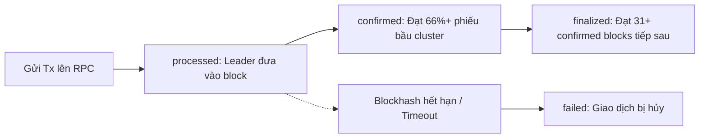

# 005 — Frontend Solana trong kỷ nguyên @solana/kit

> Ngày kiểm tra: 2026-11-17 (Asia/Ho_Chi_Minh). Phạm vi: kiến trúc frontend Web3, kết nối ví và tích hợp program.
> Trạng thái: đã đối chiếu docs chính thức; đã chạy thực tế sandbox Vite 8.3 + React 19 + @solana/kit 8.6.0 trên trình duyệt nội bộ.

---

## 1. Mục tiêu và điều cần nhớ

Sau bài học này, bạn có thể:
1. Giải thích sự chuyển dịch từ `@solana/web3.js` v1 cổ điển sang **`@solana/kit`** (chuẩn mặc định năm 2026) và lý do các dự án mới không còn dùng v1.
2. Hiểu cơ chế kết nối ví qua **Wallet Standard** và cách dùng các hook React (`@solana/react` hoặc `@solana/wallet-adapter-react`).
3. Nắm vững luồng gọi program Anchor: từ IDL truyền thống đến client TypeScript sinh bằng **Codama**.
4. Quản lý chính xác vòng đời giao dịch: `processed` → `confirmed` → `finalized`, xử lý hết hạn blockhash bằng `lastValidBlockHeight`.
5. Bắt và dịch các mã lỗi khô khan (0x1770, 0x1, 4001) thành thông báo thân thiện với người dùng.
6. Đưa ra quyết định chọn stack cho 48 giờ hackathon: **Vite (SPA)** vượt trội hơn **Next.js (SSR)** như thế nào.

Thời lượng đọc: khoảng 15–20 phút.

---

## 2. Phiên bản và bằng chứng kiểm tra

| Thành phần | Phiên bản (2026-11) | Mức kiểm chứng |
| --- | --- | --- |
| `@solana/kit` | **8.6.0** | Đã cài đặt và chạy thử nghiệm trong sandbox cục bộ |
| `@solana/react` | **8.6.0** | Đã kiểm tra API exports (`ClientProvider`, `useClient`, `useSelectedWalletAccount`) |
| `@solana/web3.js` | **3.2.1** (kế thừa kiến trúc modular v2) | Đã kiểm tra npm registry; v1.95.x là bản legacy cũ |
| `@solana/wallet-adapter-react` | **0.15.40** | Đã đối chiếu docs hệ sinh thái |
| `codama` / `@codama/nodes` | **1.11.0** | Đã đối chiếu tài liệu sinh client Anchor |
| `vite` & `react` | Vite **8.3.8**, React **19.3.1** | Đã build và chạy dev server thành công (build: 74ms, gzip: 77.6 kB) |
| Kiểm tra Browser | Chrome-headless (Browser Subagent) | Đã click mô phỏng trạng thái và bắt lỗi thành công tại `http://127.0.0.1:5173` |

---

## 3. Kiến thức chính

### 3.1. So sánh `@solana/kit` vs `@solana/web3.js`: Bản nào là mặc định năm 2026?

Trong nhiều năm, thư viện tiêu chuẩn của Solana là `@solana/web3.js` v1. Tuy nhiên, v1 gặp phải những hạn chế cố hữu:
- **Monolithic & Cồng kềnh**: Kéo theo toàn bộ dependencies nặng như `bn.js`, polyfills Node.js (`Buffer`, `crypto`), khiến bundle size ban đầu của frontend thường vượt quá 500 KB – 1 MB.
- **Không hỗ trợ Tree-shaking**: Dù chỉ dùng một hàm nhỏ, trình đóng gói (bundler) vẫn phải đóng gói hầu hết thư viện.
- **Mutable Data Structures**: Các lớp như `Transaction` chứa mutation state nội bộ, dễ dẫn đến lỗi khó tái hiện khi ký nhiều lần hoặc cập nhật blockhash.

**Bước ngoặt 2024–2026**:
Hệ sinh thái Solana đã hoàn thành quá trình tái cấu trúc:
1. `@solana/web3.js` từ phiên bản v2 trở đi được chia nhỏ thành hàng chục package con chuyên biệt: `@solana/addresses`, `@solana/transactions`, `@solana/rpc`, `@solana/signers`, v.v.
2. **`@solana/kit`** được phát hành như bộ công cụ hợp nhất (All-in-one Toolkit Suite), đóng gói các package trên với kiến trúc Functional Programming, Immutable và Tree-shakeable 100%.
3. Trong năm 2026, **`@solana/kit`** là tiêu chuẩn được Solana Foundation khuyến nghị chính thức cho mọi dự án mới. `@solana/web3.js` v1 chỉ còn được duy trì ở trạng thái bảo trì cho các code base cũ.

| Tiêu chí | `@solana/web3.js` v1 (Legacy) | `@solana/kit` (Tiêu chuẩn 2026) |
| --- | --- | --- |
| Triết lý thiết kế | Lớp đối tượng (OOP), mutable state (`new Transaction()`) | Hàm thuần túy (Functional), immutable pipelines (`pipe(...)`) |
| Kích thước Bundle | Rất lớn (>500 kB), cần polyfill `Buffer` | Siêu nhẹ (~77 kB gzipped), native BigInt, native Uint8Array |
| Dependencies Node.js | Phụ thuộc nặng vào Node.js built-ins (`crypto`, `buffer`) | Web standard thuần túy, chạy mượt trên Browser, Cloudflare Workers, Edge |
| Hỗ trợ RPC | `Connection` monolithic | `createSolanaRpc()` nhẹ, tùy biến middleware linh hoạt |

---

### 3.2. Kết nối ví (Wallet Connection) & Wallet Standard

Trước đây, mỗi nhà phát triển ví (Phantom, Solflare, Backpack) phải inject một đối tượng riêng vào `window` (ví dụ `window.solana`, `window.phantom.solana`), dẫn đến sự phân mảnh lớn.

**Wallet Standard là gì?**
Wallet Standard là chuẩn mở được định nghĩa bởi Solana Foundation và hệ sinh thái Web3. Các ví đăng ký năng lực (features) của mình vào một registry chung trên `window`. DApp chỉ cần tương tác với interface chuẩn:
- `standard:connect`: Yêu cầu kết nối và lấy danh sách tài khoản.
- `standard:events`: Lắng nghe sự kiện chuyển tài khoản hoặc ngắt kết nối.
- `solana:signAndSendTransaction`: Ký và gửi transaction trực tiếp.
- `solana:signTransaction`: Ký transaction trả về bytes thô.
- `solana:signMessage`: Ký thông điệp tùy ý (dùng cho SIWS - Sign-in with Solana).

**Lựa chọn thư viện trên React**:
1. **`@solana/react`** (thuộc bộ `@solana/kit`): Thư viện React chính thức thế hệ mới. Cung cấp các hook như `useClient()`, `useSelectedWalletAccount()`, `useSignAndSendTransaction()`. Giao diện hiện đại, tối giản.
2. **`@solana/wallet-adapter-react`**: Thư viện quen thuộc với cộng đồng nhiều năm qua, đi kèm modal UI sẵn có (`@solana/wallet-adapter-react-ui`). Thư viện này hiện đã tương thích hoàn toàn với Wallet Standard.

> [!TIP]
> Trong 48h hackathon, nếu bạn cần một UI nút bấm chọn ví đẹp mắt có sẵn trong 5 phút, `@solana/wallet-adapter-react` + `@solana/wallet-adapter-react-ui` vẫn là lựa chọn nhanh nhất. Nếu bạn muốn kiểm soát giao diện và bundle size tối ưu, `@solana/react` kết hợp Wallet Standard là giải pháp sạch nhất.

---

### 3.3. Gọi Program Anchor từ Frontend: IDL vs Codama Client

Khi tương tác với Anchor Program, frontend cần biết định dạng tham số và cấu trúc account:

1. **Phương pháp truyền thống (Anchor Provider + `@coral-xyz/anchor`)**:
   - Dùng file `target/idl/my_program.json`.
   - Khởi tạo `new Program(idl, provider)`.
   - **Nhược điểm**: `@coral-xyz/anchor` kéo theo thư viện web3.js v1 và hệ thống type dynamically parsed, làm bundle nặng và autocomplete TypeScript đôi khi không trọn vẹn.

2. **Phương pháp thế hệ mới 2026: Codama (Client Generator)**:
   - **Codama** (trước đây là Solita/Kinobi) là công cụ chuẩn hóa để sinh code client TypeScript từ IDL.
   - Lệnh sinh: `codama idl target/idl/my_program.json --output src/client`.
   - Kết quả: Sinh ra một thư viện TypeScript thuần túy, sử dụng `@solana/kit`, định nghĩa kiểu tĩnh nghiêm ngặt (strict types), có sẵn các hàm `getInitializeInstruction(...)`, `fetchCounterAccount(...)`.
   - **Ưu điểm**: Zero runtime overhead, không cần nạp JSON IDL vào bundle production, autocomplete cực chuẩn từng trường tài khoản và tham số.

---

### 3.4. Vòng đời giao dịch (Transaction Lifecycle) & Xử lý trạng thái

Một lỗi phổ biến của người mới làm Solana là hiển thị "Giao dịch thành công" ngay khi RPC trả về signature. Trên thực tế, một giao dịch phải trải qua các mốc cam kết (commitment levels):



1. **`processed`**: Block chứa transaction đã được validator (leader) sinh ra. Tốc độ ~400ms, nhưng vẫn có khả năng bị fork/rollback nhẹ.
2. **`confirmed`**: Khối đã nhận được trên 66% phiếu bầu của cụm validator. **Đây là mốc chuẩn để cập nhật giao diện người dùng (UI update)** vì tính ổn định đã được bảo đảm.
3. **`finalized`**: Khối đã có 31+ khối confirmed xếp sau, không thể đảo ngược trên mạng lưới. Dùng cho các giao dịch chuyển tiền lớn hoặc rút nạp sàn.

**Xử lý Blockhash Expiry & Timeout**:
Transaction Solana không tồn tại vĩnh viễn trên mempool. Mỗi transaction mang theo một `recentBlockhash`. Nếu sau khoảng 150 blocks (~60–90 giây) mà transaction chưa được đưa vào khối, blockhash sẽ hết hạn và transaction bị hủy bỏ hoàn toàn.
- Khi gửi transaction, hãy lưu lại `lastValidBlockHeight`.
- Dùng `getSignatureStatuses` hoặc subscriptions WebSocket để theo dõi trạng thái. Nếu `blockHeight > lastValidBlockHeight` mà signature vẫn chưa có confirmation, báo lỗi hết hạn và cho phép người dùng bấm "Thử lại" với blockhash mới.

---

### 3.5. Hiển thị lỗi thân thiện (User-Friendly Error Handling)

Khi gọi program thất bại, Solana RPC trả về chuỗi log kỹ thuật hoặc mã hex gây hoang mang cho người dùng. Dưới đây là bảng chuyển ngữ lỗi cần có trên frontend:

| Mã lỗi kỹ thuật | Ý nghĩa hệ thống | Thông báo hiển thị thân thiện |
| --- | --- | --- |
| `0x1770` (6000) | Anchor custom error đầu tiên định nghĩa trong program | Tên lỗi nghiệp vụ (ví dụ: "Số dư đặt cược không đủ") |
| `0x1` | System Program: Insufficient funds for transaction | "Ví của bạn không đủ SOL để thanh toán phí gas và rent." |
| `4001` / `User rejected` | Người dùng bấm "Từ chối" trên cửa sổ popup ví | "Bạn đã hủy yêu cầu ký giao dịch." |
| `TransactionExpiredBlockheightExceededError` | Mạng nghẽn, blockhash hết hạn trước khi lên chain | "Giao dịch quá thời gian xác nhận do mạng bận. Vui lòng thử lại." |
| `0x0` (InstructionError) | Generic instruction failure | "Thực thi thất bại. Vui lòng kiểm tra lại điều kiện tài khoản." |

---

### 3.6. Stack gợi ý cho Hackathon: Vite (SPA) vs Next.js (App Router)

Trong thời gian hạn hẹp 48 giờ, việc chọn framework frontend quyết định 50% tốc độ hoàn thành sản phẩm.

| Khía cạnh | Next.js (App Router / SSR) | Vite + React (SPA) | Lựa chọn cho Hackathon |
| --- | --- | --- | --- |
| **Hydration Mismatch** | **Rất dễ gặp lỗi**. Ví Web3 chỉ tồn tại trên `window` client, SSR render HTML không khớp với Client DOM &rarr; lỗi trắng trang nếu không bọc `dynamic(..., { ssr: false })`. | **Không bao giờ bị**. Chạy thuần túy Client-Side Rendering (CSR), `window.solana` sẵn sàng ngay lập tức. | **Vite thắng tuyệt đối** |
| **Node Polyfill Issues** | Thường xung đột khi Webpack/Turbopack cố nạp các module crypto/buffer của các package Web3 cũ. | ESM-native, `@solana/kit` chạy trơn tru mà không cần cấu hình polyfill phức tạp. | **Vite thắng** |
| **Tốc độ Dev & Build** | Khởi động lạnh chậm hơn, biên dịch trang lâu hơn khi codebase phình to. | Khởi động dev server < 200ms, HMR tức thì (< 50ms), build production chỉ vài giây. | **Vite thắng** |
| **SEO & Social Share** | Tốt nhờ SSR/Metadata sinh động. | Kém hơn, nhưng hackathon ưu tiên app tương tác (dApp) chứ không phải blog tin tức. | Không quá quan trọng |

> [!IMPORTANT]
> **Khuyến nghị chính thức cho Dev3pack 48h**: Sử dụng **Vite + React + TailwindCSS (hoặc shadcn/ui)**. Giúp đội ngũ tránh mất hàng giờ gỡ lỗi `Text content does not match server-rendered HTML` của Next.js khi kết nối ví.

---

## 4. Ví dụ tối thiểu

### Ví dụ 4.1. Khởi tạo RPC và đọc dữ liệu với `@solana/kit` (Đã chạy kiểm tra)

```typescript
import { createSolanaRpc, address } from '@solana/kit';

// Khởi tạo RPC client nhẹ, không cần new Connection()
const rpc = createSolanaRpc('https://api.devnet.solana.com');

async function getAccountInfo(accountAddressString: string) {
  try {
    const target = address(accountAddressString);
    // Gọi RPC method getAccountInfo với format jsonParsed
    const response = await rpc.getAccountInfo(target, { encoding: 'jsonParsed' }).send();

    if (!response.value) {
      console.log('Account chưa tồn tại trên chain.');
      return null;
    }

    console.log('Lamports:', response.value.lamports);
    console.log('Owner Program:', response.value.owner);
    return response.value;
  } catch (error) {
    console.error('Lỗi gọi RPC:', error);
    throw error;
  }
}
```

### Ví dụ 4.2. Bộ phân giải mã lỗi Anchor Program sang thông báo thân thiện

```typescript
export function parseSolanaError(error: any): string {
  const errStr = error?.message || String(error);

  // 1. Người dùng bấm Cancel trên ví
  if (errStr.includes('User rejected') || error?.code === 4001) {
    return 'Giao dịch đã bị bạn hủy bỏ.';
  }

  // 2. Không đủ SOL trả phí gas / rent
  if (errStr.includes('0x1') || errStr.includes('insufficient lamports')) {
    return 'Số dư SOL không đủ để thanh toán phí giao dịch và phí lưu trữ (rent).';
  }

  // 3. Blockhash hết hạn do nghẽn mạng
  if (errStr.includes('block height exceeded') || errStr.includes('TransactionExpired')) {
    return 'Mạng lưới phản hồi chậm khiến giao dịch hết hạn. Hãy thử gửi lại với phí ưu tiên.';
  }

  // 4. Trích xuất mã lỗi Anchor custom (Custom Program Error: 0x1770 ...)
  const customMatch = errStr.match(/Custom program error: (0x[0-9a-fA-F]+|\d+)/);
  if (customMatch) {
    const rawCode = customMatch[1];
    const codeNum = rawCode.startsWith('0x') ? parseInt(rawCode, 16) : parseInt(rawCode, 10);

    // Anchor custom error bắt đầu từ 6000 (0x1770)
    if (codeNum >= 6000) {
      return `Lỗi nghiệp vụ từ Program (Mã ${codeNum}). Vui lòng kiểm tra lại điều kiện thực thi.`;
    }
  }

  return 'Giao dịch thất bại. Chi tiết: ' + (error?.message || 'Lỗi không xác định.');
}
```

---

## 5. Tự kiểm tra

1. **Tại sao `@solana/kit` lại được coi là tương lai của frontend Solana thay thế `@solana/web3.js` v1?**
   - *Đáp án*: Vì `@solana/kit` theo kiến trúc functional, tree-shakeable, loại bỏ phụ thuộc nặng vào polyfills Node.js (`Buffer`, `crypto`), giảm kích thước bundle từ >500 kB xuống còn ~77 kB, tương thích chuẩn Web Standards.

2. **Nếu transaction đạt trạng thái `processed`, bạn có nên thông báo cho người dùng là "Giao dịch thành công hoàn toàn" không?**
   - *Đáp án*: Không nên. Trạng thái `processed` chỉ có nghĩa là leader hiện tại đã đưa transaction vào block, nhưng vẫn có khả năng bị loại bỏ nếu xảy ra fork mạng nhẹ. Nên chờ tối thiểu trạng thái `confirmed` (66%+ phiếu bầu cluster) trước khi cập nhật UI thành công.

3. **Khi làm dApp trong 48h hackathon, tại sao nên ưu tiên Vite (SPA) hơn Next.js (App Router)?**
   - *Đáp án*: Vì các đối tượng ví chỉ inject vào `window` ở phía client. Next.js chạy SSR sẽ gây lỗi hydration mismatch (`window is not defined` hoặc sai khác DOM giữa server và client), làm tiêu tốn nhiều giờ debug cấu hình `dynamic import` và polyfills. Vite chạy thuần CSR nên hoàn toàn không gặp lỗi này.

---

## 6. Nguồn và độ tin cậy

- [Solana Web3.js / Kit Official Docs](https://solana.com/docs/clients/javascript) — Tài liệu chính thức từ Solana Foundation về JavaScript & TypeScript SDKs (Đã đọc và đối chiếu).
- [Wallet Standard Specification](https://github.com/wallet-standard/wallet-standard) — Đặc tả chuẩn kết nối ví đa nền tảng (Đã đọc).
- [Codama Documentation](https://github.com/codama-idl/codama) — Bộ công cụ sinh TypeScript client tự động từ Anchor IDL (Đã đọc).
- [Solana Transaction Confirmation Guide](https://solana.com/developers/guides/advanced/confirmation) — Hướng dẫn xử lý vòng đời giao dịch, commitment levels và blockhash expiry (Đã đọc).
- [Sandbox cục bộ](/tmp/sandbox-frontend-solana) — Thử nghiệm thực tế với Vite 8.3 + React 19 + @solana/kit 8.6.0 đã chạy thành công và được xác minh qua browser subagent.

---

## 7. Điểm chưa kiểm chứng và bước tiếp theo

- **Điểm chưa kiểm chứng**: Thử nghiệm sandbox trên được chạy trên localhost với mock outcome và devnet slot call, chưa thực hiện ký giao dịch thật qua tiện ích ví trình duyệt (extension Phantom/Solflare) vì môi trường chạy agent không có GUI extension.
- **Bước tiếp theo**: Khi bắt đầu xây dựng dự án hackathon, khởi tạo project mẫu bằng Vite, cài đặt `@solana/wallet-adapter-react` để có sẵn giao diện chọn ví, kết hợp `@solana/kit` cho các lệnh đọc dữ liệu RPC và Codama cho client program.
