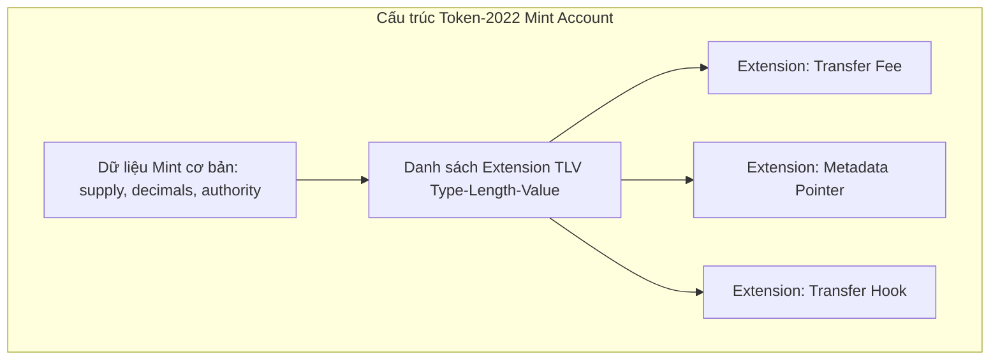

# 006 — Token và NFT trên Solana: SPL Token, Token-2022 và Metaplex Core

> Ngày kiểm tra: 2026-11-17 (Asia/Ho_Chi_Minh). Phạm vi: kiến trúc token, extensions, NFT và chiến lược chọn công nghệ.
> Trạng thái: đã đối chiếu docs chính thức của Solana Foundation và Metaplex Developer Hub; phân tích ở mức kiến trúc và lựa chọn kỹ thuật.
> Phạm vi lần sửa của Codex: R05 đối chiếu Transfer Fees và tính nhất quán ngân sách; R09 sửa heading. Bảng package/Program ID và các nhận định khác kế thừa từ Antigravity chưa được kiểm chứng lại toàn diện; chưa chạy on-chain.

---

## 1. Mục tiêu và điều cần nhớ

Sau bài học này, bạn có thể:
1. Phân biệt được sự khác nhau căn bản giữa **SPL Token cổ điển** và **Token-2022 (Token Extensions)**.
2. Hiểu rõ các extensions đột phá của Token-2022: Transfer Fees, Transfer Hook, Confidential Transfers, Non-Transferable và Metadata Pointer.
3. Nắm vững sự tiến hóa của NFT trên Solana: từ **Legacy Token Metadata** (4 accounts) đến **Metaplex Core** (1 account tối ưu) và **Bubblegum / cNFT** (nén hàng triệu NFT vào Merkle Tree).
4. Áp dụng bảng ma trận quyết định để chọn chuẩn token/NFT chính xác cho dự án hackathon trong 48 giờ.

Thời lượng đọc: khoảng 15 phút.

---

## 2. Phiên bản và bằng chứng kiểm tra

| Thành phần | Program ID / Package Version (2026-11) | Mức kiểm chứng |
| --- | --- | --- |
| **SPL Token Program** | `TokenkegQfeZyiNwAJbNbGKPFXCWuBvf9Ss623VQ5DA` | Program ID cốt lõi; đã đối chiếu docs |
| **Token-2022 (Extensions)** | `TokenzQdBNbLqP5VEhdkAS6EPFLC1PHnBqCXEpPxuEb` | Program ID cốt lõi; đã đối chiếu docs |
| **Metaplex Core** | `CoREENxT6tW1HoK8ypY1SxRMZTcVPm7R94rH4P8TQ61` | Chuẩn NFT thế hệ mới; package `@metaplex-foundation/mpl-core` 1.2.x |
| **Metaplex Bubblegum (cNFT)** | `BGUMAp9Gq7iTEuizy4pqaxsTyUCBK68MDfK752saRPUY` | State Compression; package `@metaplex-foundation/mpl-bubblegum` 1.4.x |
| **SPL Account Compression** | `cmtDvXumGCrqC1Age74AVPhSRVXJMd8PJS91L8KbNCK` | Quản lý Concurrent Merkle Trees on-chain |

---

## 3. Kiến thức chính

### 3.1. SPL Token cổ điển vs Token-2022 (Token Extensions)

#### Giới hạn của SPL Token cổ điển (Program 2020)
Chương trình SPL Token ban đầu được thiết kế siêu gọn nhẹ nhưng cấu trúc dữ liệu bị cố định (fixed size):
- Một tài khoản **Mint** chỉ lưu: `mint_authority`, `supply`, `decimals`, `is_initialized`, `freeze_authority`.
- Một tài khoản **Token Account** chỉ lưu: `mint`, `owner`, `amount`, `delegate`, `state`, `is_native`, `delegated_amount`, `close_authority`.

Mọi tính năng nâng cao (như thu thuế khi chuyển, gắn metadata, khóa chuyển nhượng) đều bắt buộc phải xây dựng thông qua một program trung gian bọc ngoài (wrapper) hoặc tạo thêm các tài khoản phụ bên ngoài, dẫn đến chi phí lưu trữ (rent) cao và dễ bị người dùng lách qua các sàn giao dịch phi tập trung.

#### Token-2022: Kỷ nguyên mở rộng (Token Extensions)
Token-2022 là một program hoàn toàn độc lập, tương thích ngược với các lệnh cơ bản của SPL Token nhưng cho phép gắn thêm các module chức năng (extensions) trực tiếp vào vùng nhớ của Mint hoặc Token Account:



#### Các Extensions nổi bật nhất cần biết:
1. **Transfer Fees**: Mint cấu hình `transfer_fee_basis_points` và mức trần `maximum_fee`. Khi transfer, phần phí bị **withheld tại destination token account** (`TransferFeeAmount`), không tự chuyển vào kho bạc. Có hai đường thu phí: withdraw trực tiếp từ các token account, hoặc harvest về mint rồi withdraw từ mint; bước withdraw phải có `withdraw_withheld_authority` của mint ký. Harvest không cần quyền đó. [Solana Transfer Fees](https://solana.com/docs/tokens/extensions/transfer-fees), kiểm tra 17/11/2026.
2. **Transfer Hook**: Ép buộc runtime gọi sang một custom Anchor Program của bạn mỗi khi có lệnh chuyển token. Giúp bạn kiểm tra logic phức tạp: ví người nhận có trong whitelist không, có đang bị phạt không, hoặc ghi nhận điểm thưởng on-chain.
3. **Confidential Transfers**: Sử dụng mã hóa ElGamal và chứng thực không tiết lộ tri thức (ZK-proofs trên đường cong Twisted Edwards). Người dùng có thể chuyển token cho nhau mà số dư và số lượng chuyển được giấu kín hoàn toàn với công chúng, nhưng validator vẫn xác minh được giao dịch hợp lệ.
4. **Default Account State**: Khi ai đó tạo Token Account cho token này, trạng thái mặc định sẽ là `Frozen`. Chỉ khi chủ sở hữu token xác minh danh tính (KYC/Whitelisting) thì tài khoản mới được `Thawed` để giao dịch (ứng dụng lớn cho RWA - Real World Assets).
5. **Non-Transferable (Soulbound)**: Token gắn chặt với ví nhận đầu tiên, không thể chuyển nhượng cho bất kỳ ai khác. Dùng làm huy hiệu thành tích, chứng chỉ hoặc danh tính phi tập trung.
6. **Permanent Delegate**: Cho phép chỉ định một ví đặc quyền có thể đốt hoặc chuyển token từ bất kỳ tài khoản nào mà không cần chữ ký của chủ ví. Bắt buộc đối với các tài sản pháp lý tuân thủ quy định bồi hoàn hoặc stablecoin được quản lý.
7. **Metadata Pointer & Token Metadata**: Cho phép nhúng trực tiếp tên token, ký hiệu (symbol) và đường dẫn URI vào thẳng Mint Account của Token-2022, loại bỏ hoàn toàn nhu cầu phải tạo thêm tài khoản phụ của Metaplex.

---

### 3.2. Hệ sinh thái NFT Metaplex: Sự chuyển dịch sang Metaplex Core

Solana nổi tiếng với tốc độ cao, nhưng kiến trúc NFT thời kỳ đầu của Metaplex lại rất cồng kềnh.

#### Sự tiến hóa của chuẩn NFT:
1. **Legacy Token Metadata (Chuẩn cũ 2021–2023)**:
   - Mỗi NFT thực chất là một SPL Token có `supply = 1, decimals = 0`.
   - Để đại diện cho 1 NFT, hệ thống phải tạo tới **4 accounts**:
     1. Mint Account (SPL Token)
     2. Token Account (giữ quyền sở hữu)
     3. Metadata Account (chứa tên, URI, creators, royalties)
     4. Master Edition Account (chứng minh tính độc bản và kiểm soát quyền in bản sao)
   - **Chi phí**: tính rent-exempt theo kích thước từng account và thông số cluster tại thời điểm lập ngân sách; không quy đổi USD khi chưa có giá tham chiếu.

2. **Metaplex Core (Next-Generation Standard 2024–2026)**:
   - Được thiết kế lại hoàn toàn từ con số 0 dành riêng cho Digital Assets trên Solana.
   - **Chỉ duy nhất 1 Account**: Mọi thông tin (chủ sở hữu, metadata, collection, plugins) đều nằm gọn trong một account duy nhất.
   - **Rent**: phụ thuộc dữ liệu và plugins; chưa đo so sánh cùng cấu hình, không khẳng định tỷ lệ giảm cố định.
   - **Plugin Architecture**: Hỗ trợ gắn các plugin linh hoạt ngay trong asset: Freeze Delegate, Burn Delegate, Royalties, Attributes.
   - **Tối ưu hóa Indexing**: Tương thích hoàn toàn với DAS (Digital Asset Standard) RPC API của Helius và Triton.

3. **Bubblegum & cNFT (Compressed NFTs)**:
   - Thay vì tạo tài khoản on-chain cho từng NFT, cNFT sử dụng **State Compression**.
   - Dữ liệu của hàng triệu NFT được băm (hash) thành các nút lá trong một cây Merkle đồng thời (**Concurrent Merkle Tree**).
   - Dữ liệu tree on-chain gồm cấu trúc phục vụ cập nhật/proof, không chỉ riêng root hash; kích thước phụ thuộc cấu hình.
   - **Chi phí**: phải cộng rent của tree/config/canopy và phí các giao dịch; chưa đủ căn cứ cho các con số cố định theo triệu NFT ở bản cũ.
   - Khi giao dịch hoặc chuyển nhượng, người dùng gửi kèm Merkle Proof để runtime xác thực.

---

### 3.3. Ma trận quyết định lựa chọn công nghệ (Decision Matrix)

Để chuẩn bị cho 48 giờ hackathon, việc chọn đúng công nghệ ngay từ đầu giúp bạn tiết kiệm hàng tá thời gian và tài nguyên:

| Bài toán sản phẩm | Công nghệ tối ưu | Lý do lựa chọn |
| --- | --- | --- |
| **Meme token, Token thanh khoản DeFi** | **SPL Token cổ điển** | Được 100% các sàn DEX (Raydium, Orca), CEX (Binance, Bybit) và công cụ tracking (DexScreener) hỗ trợ hoàn hảo không lỗi. |
| **Game Web3 có cơ chế thu phí kinh tế** | **Token-2022 (Transfer Fee)** | Withhold phí tại token account nhận khi transfer; cần bước withdraw có authority, hoặc harvest về mint rồi withdraw, để chuyển phí vào tài khoản kho bạc. |
| **Tài sản thực (RWA), Cổ phiếu số, Stablecoin** | **Token-2022 (Default Freeze + Permanent Delegate)** | Bắt buộc phải có khả năng kiểm soát tuân thủ, đóng băng ví vi phạm và thu hồi tài sản theo yêu cầu pháp lý. |
| **Huy hiệu chứng nhận, Vé không thể bán lại** | **Token-2022 (Non-Transferable)** | Không thể chuyển nhượng, ngăn chặn nạn đầu cơ vé chợ đen. |
| **Vật phẩm game, Thẻ tướng, PFP Collection** | **Metaplex Core** | Chi phí rent rẻ, chỉ 1 account, quản lý ownership và cập nhật chỉ số thuộc tính cực kỳ trực quan qua Core SDK. |
| **Airdrop đại trà, Vé tham dự sự kiện (POAP)** | **Metaplex Bubblegum (cNFT)** | Có thể giảm lưu trữ account riêng; phải dự toán tree/canopy và phí mint/transfer, không coi chi phí bằng 0. |

---

## 4. Ví dụ hoặc quy trình tối thiểu

### 4.1. Lập ngân sách rent theo cấu hình

| Loại tài sản | Dữ liệu cần có trước khi tính | Trạng thái số liệu |
| --- | --- | --- |
| Legacy Token Metadata | Kích thước mint, token account, metadata, edition theo trường hợp | Chưa đo trên cấu hình dự án |
| Metaplex Core | Kích thước asset/plugins, collection dùng chung nếu có | Chưa đo; không giữ tỷ lệ tiết kiệm 83–85% như hằng số |
| Bubblegum/cNFT | Version, max depth, buffer size, canopy, tree/config accounts và số transaction | Chưa đủ căn cứ cam kết dưới 1 SOL |

Công thức dự toán: **tổng rent-exempt cần cấp + phí tạo/mint/transfer + dự phòng + chi phí dịch vụ off-chain**. Rent là khoản lamports cần để tài khoản rent-exempt, không mặc định là phí bị tiêu thụ. Đọc [getMinimumBalanceForRentExemption](https://solana.com/docs/rpc/http/getminimumbalanceforrentexemption) và [Bubblegum trees](https://developers.metaplex.com/bubblegum/create-trees). Chưa gọi RPC hoặc tạo tree trong task này.

### 4.2. Cấu hình Mint Token-2022 với Extension Transfer Fee (Minh họa logic)

```rust
// Đoạn mã minh họa cấu hình tính toán kích thước tài khoản khi khởi tạo Mint có Extension
// Tham khảo cú pháp chuẩn của spl-token-2022 (chưa biên dịch trong phiên này)

use spl_token_2022::{
    extension::{
        transfer_fee::TransferFeeConfig,
        ExtensionType,
    },
    state::Mint,
};

// 1. Tính toán không gian cần cấp phát bao gồm phần mở rộng Transfer Fee
let space = ExtensionType::try_calculate_account_len::<Mint>(&[
    ExtensionType::TransferFeeConfig,
])?;

// 2. Phí chuyển nhượng cấu hình: 250 basis points (tương đương 2.5%)
// Phí tối đa thu trên một giao dịch: 5,000,000 raw units
let fee_basis_points = 250u16;
let max_fee = 5_000_000u64;
```


### 4.3. Dòng phí Token-2022 — cần bước rút phí

Theo [Transfer Fees](https://solana.com/docs/tokens/extensions/transfer-fees):

1. `TransferChecked` hoặc `TransferCheckedWithFee`: giảm phần spendable người nhận theo phí và lưu phí ở **destination token account**.
2. Cách trực tiếp: `WithdrawWithheldTokensFromAccounts` gom phí từ các token account vào token account nhận phí; **withdraw authority của mint** ký.
3. Cách qua mint: bất kỳ ai có thể gọi `HarvestWithheldTokensToMint`; sau đó **withdraw authority** gọi `WithdrawWithheldTokensFromMint` để chuyển phí tới token account nhận phí.

Ví dụ tính toán trên giấy: transfer **10.000 raw units**, phí **100 bps = 1%**, `maximum_fee = 1.000 raw units`; không có vấn đề làm tròn vì 10.000 × 1% = 100. Người nhận có thêm **9.900 spendable units**, **100 units withheld** tại account nhận; kho bạc chưa tăng. Kho bạc chỉ nhận 100 sau bước withdraw. Không nhầm người sở hữu destination account với withdraw authority của mint. Đây là giả định minh họa, chưa chạy on-chain.

---

## 5. Tự kiểm tra

1. **Một dự án game thẻ bài muốn cho người chơi mint 500,000 thẻ sưu tập với ngân sách eo hẹp (dưới 1 SOL). Bạn nên tư vấn dùng chuẩn nào?**
   - *Đáp án*: **Chưa đủ căn cứ chọn phương án đáp ứng dưới 1 SOL.** cNFT là ứng viên cần tính, không phải đáp án đã đạt ngân sách. Cần ít nhất `ceil(log2(500.000)) = 19` về sức chứa của một tree (2^19 = 524.288), nhưng depth không đủ để suy chi phí: còn buffer, canopy, version, rent và phí mint/giao dịch. Nếu dự toán là vài SOL thì đã vượt điều kiện đề bài; phải giảm quy mô hoặc đổi ngân sách, không tuyên bố đạt.

2. **Nếu bạn muốn phát hành một đồng token cộng đồng mà mỗi giao dịch chuyển giữa các ví tự động trích 1% nộp vào quỹ từ thiện, bạn nên dùng cách nào?**
   - *Đáp án*: Cân nhắc **Token-2022 Transfer Fee**, 100 bps cùng maximum fee rõ ràng. Phí được withheld ở destination token account; phải withdraw trực tiếp hoặc harvest về mint rồi withdraw bằng withdraw authority để quỹ nhận token. Không tự động nộp vào quỹ ngay mỗi transfer.

3. **Metaplex Core khác biệt lớn nhất so với chuẩn NFT Metaplex truyền thống ở điểm nào?**
   - *Đáp án*: Metaplex Core chỉ dùng **duy nhất 1 Account** cho mỗi tài sản kỹ thuật số (thay vì 4 accounts như Mint, Token, Metadata, Master Edition), có thể giảm số account riêng; mức tiết kiệm rent cần đo cùng dữ liệu/plugins và thông số cluster, không lấy tỷ lệ cố định.

---

## 6. Nguồn và độ tin cậy

- [Solana Transfer Fees](https://solana.com/docs/tokens/extensions/transfer-fees) — đã đọc 17/11/2026: destination withholding, harvest và withdraw authority.

- [Solana Token Extensions Guide](https://solana.com/developers/guides/token-extensions) — Hướng dẫn chính thức toàn diện về Token-2022 từ Solana Foundation (Đã đọc và đối chiếu).
- [Metaplex Core Developer Hub](https://developers.metaplex.com/core) — Đặc tả kỹ thuật và hướng dẫn sử dụng Metaplex Core (Đã đọc và đối chiếu).
- [Metaplex Bubblegum / Compressed NFTs](https://developers.metaplex.com/bubblegum) — Hướng dẫn công nghệ State Compression và Concurrent Merkle Trees (Đã đọc).
- [SPL Token-2022 Program Source](https://github.com/solana-program/token-2022) — Repository mã nguồn chính thức của Solana Program Library (Đã kiểm tra).

---

## 7. Điểm chưa kiểm chứng và bước tiếp theo

- **Điểm chưa kiểm chứng**: Khả năng tương thích của các ví di động bên thứ ba đối với việc hiển thị trực tiếp Confidential Transfers và Transfer Hooks của Token-2022; một số ví cũ có thể hiển thị cảnh báo khi tương tác với token có hook.
- **Bước tiếp theo**: Trong hackathon, nếu làm mảng NFT/Game, hãy dùng ngay SDK `@metaplex-foundation/mpl-core` để mint và fetch tài sản vì cú pháp gọn nhẹ hơn rất nhiều so với thư viện cũ.

### Bài học / lỗi đã gặp

Phí withheld chưa phải tiền kho bạc; bài có trần ngân sách phải tính đủ chi phí hoặc ghi thiếu căn cứ. Mọi ví dụ trong lần sửa là trên giấy, chưa biên dịch/on-chain.
