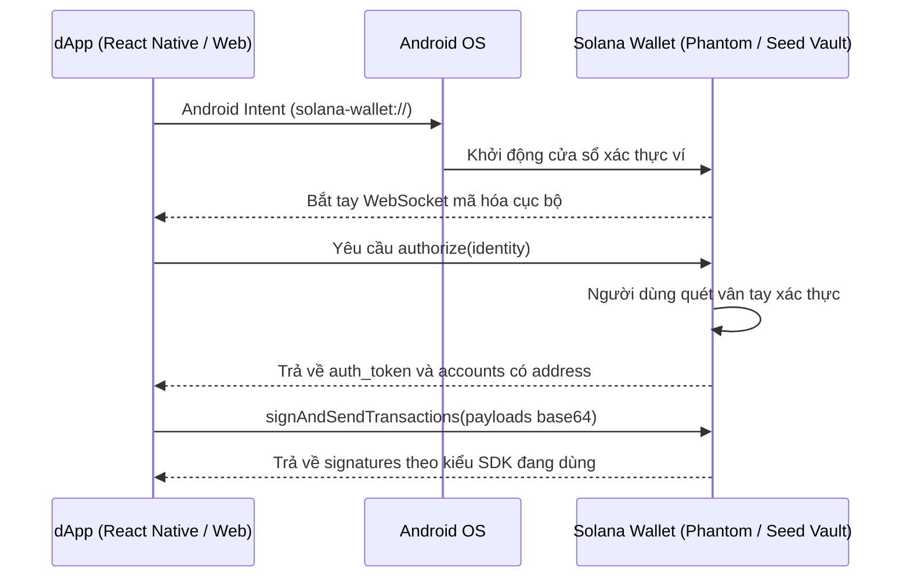

# 008 — Solana Mobile và Hệ sinh thái Seeker: MWA, dApp Store và Tính khả thi 48h

> Ngày kiểm tra: 2026-11-17 (Asia/Ho_Chi_Minh). Phạm vi: kiến trúc di động Solana Mobile Stack, Mobile Wallet Adapter, dApp Store và chiến lược hackathon.
> Trạng thái: đã đối chiếu tài liệu chính thức từ Solana Mobile Developer Hub; phân tích khả thi kỹ thuật và rủi ro triển khai.

---

## 1. Mục tiêu và điều cần nhớ

Sau bài học này, bạn có thể:
1. Hiểu bản chất của **Mobile Wallet Adapter (MWA)**: cách ứng dụng di động giao tiếp với ví thông qua Android Intent mà không cần nắm giữ private key.
2. Nắm rõ kiến trúc và chính sách của **Solana dApp Store**: triết lý 0% phí hoa hồng và cách đóng gói ứng dụng cho thiết bị **Solana Seeker**.
3. Liệt kê các tiêu chí bắt buộc nếu muốn cạnh tranh ở hạng mục Mobile / Seeker Track trong hackathon.
4. Có câu trả lời dứt khoát cho câu hỏi: **"Với 48 giờ hackathon, làm app mobile thuần có khả thi không?"** và biết chiến lược thay thế thông minh nhất.

Thời lượng đọc: khoảng 15 phút.

---

## 2. Phiên bản và bằng chứng kiểm tra

| Thành phần | Phiên bản / Mốc tài liệu (2026-11) | Mức kiểm chứng |
| --- | --- | --- |
| **Mobile Wallet Adapter (MWA)** | **Specification v2.0** | Đã đối chiếu đặc tả giao thức |
| `@solana-mobile/mobile-wallet-adapter-protocol` | **3.0.2**, source commit `2695142` | Đã đọc package.json, types và encoding exports; chưa cài/build/chạy ví |
| **Solana Seeker Specs** | Thế hệ Seeker (ra mắt 2025–2026) | Phần cứng tích hợp Seed Vault & Android 14+ |
| **Solana dApp Store CLI** | `@solana-mobile/dapp-store-cli` | Công cụ đóng gói và ký APK metadata |
| **React Native / Expo** | React Native 0.76+, Expo SDK 52+ | Khuyến nghị môi trường phát triển chính thức |

---

## 3. Kiến thức chính

### 3.1. Mobile Wallet Adapter (MWA) hoạt động như thế nào?

Trên máy tính để bàn (Desktop), dApp kết nối với ví thông qua đối tượng JavaScript được tiện ích mở rộng (browser extension) chèn vào `window`. Tuy nhiên, trên thiết bị di động, cơ chế này không hoạt động vì:
- Hầu hết trình duyệt di động (Chrome, Safari) không hỗ trợ tiện ích mở rộng.
- Việc buộc người dùng phải mở dApp bên trong trình duyệt nhúng (in-app browser) của ví tạo ra trải nghiệm người dùng (UX) rất tù túng và hạn chế hiệu năng.

**Giải pháp MWA**:
MWA là một giao thức chuẩn mở (Client-Server Architecture) hoạt động cục bộ trên thiết bị:
1. **DApp (Client)**: Khi người dùng bấm "Kết nối ví", ứng dụng bắn một **Android Intent** với scheme `solana-wallet://`.
2. **Hệ điều hành Android**: Tìm kiếm và hiển thị danh sách các ứng dụng ví tương thích đã cài đặt (Phantom, Solflare, Seed Vault).
3. **Thiết lập kênh WebSocket cục bộ**: Một kết nối mã hóa cục bộ được thiết lập tức thì giữa dApp và ví qua một cổng ngẫu nhiên trên `127.0.0.1`.
4. **Ký giao dịch**: DApp gửi transaction cần ký sang ví. Ví hiển thị màn hình xác thực sinh trắc học (vân tay/Face ID). Sau khi người dùng đồng ý, ví gửi chữ ký (hoặc gửi transaction đã ký lên mạng) rồi trả kết quả về cho dApp.



---

### 3.2. Hệ sinh thái Seeker và Solana dApp Store

**Thiết bị Seeker (Seeker Phone)**:
Được thiết kế là thiết bị Web3 chuyên dụng thế hệ thứ hai của Solana:
- **Seed Vault**: Môi trường bảo mật cấp phần cứng (Hardware Secure Execution Environment). Khóa riêng tư được lưu trữ tách biệt hoàn toàn khỏi hệ điều hành Android thông thường; mã độc hay virus trong app không bao giờ đọc được private key.
- **Tích hợp sâu MWA**: Mọi thao tác ký trên Seeker đều được xác nhận mượt mà bằng nút quét vân tay vật lý.

**Solana dApp Store**:
- **0% Phí nền tảng (0% Take Rate)**: Khác biệt hoàn toàn với chính sách thu phí 30% của Apple App Store và Google Play Store.
- **Tự do kinh doanh Web3**: Cho phép thanh toán trực tiếp bằng token SPL, giao dịch NFT tự do, airdrop phần thưởng mà không lo bị gỡ app vì chính sách hạn chế tiền mã hóa.
- **Nhận diện Publisher qua NFT**: Nhà phát triển mint một "Publisher NFT" on-chain để định danh quyền cập nhật và sở hữu app của mình trên dApp Store.

---

### 3.3. Gợi ý trải nghiệm mobile — không phải điều kiện track đã công bố

[Trang chủ Dev3pack](https://hack.dev3pack.xyz) công bố giải Seeker Phones cho Best Mobile App Built on Solana Mobile (kiểm tra 17/11/2026). [FAQ](https://hack.dev3pack.xyz/faq) chưa công bố điều kiện partner track chi tiết. Các ý sau là đề xuất sản phẩm, không phải tiêu chí bắt buộc của BTC hoặc bảo đảm PWA đủ điều kiện:
1. **Tận dụng đặc tính di động (Mobile-native features)**:
   - Dùng camera quét mã QR tức thì (chuyển tiền, kết bạn, tham gia phòng game).
   - Công nghệ chạm NFC (Tap-to-Pay, Tap-to-Connect với thẻ vật lý hoặc máy Seeker khác).
   - Tối ưu hóa giao diện một tay (One-handed navigation, bottom sheets, haptic feedback).
2. **Tích hợp MWA chuẩn mực**:
   - Đo thời gian kết nối trên thiết bị thật; chưa có số đo hoặc SLA 3 giây.
   - Nếu cache authorization, xử lý token hết hiệu lực/revoke và reauthorization theo SDK; không bảo đảm ví không hỏi lại.
3. **Phù hợp đời sống thực (Real-world Utility)**:
   - Ứng dụng thanh toán tại điểm bán (Point of Sale).
   - Game di động casual có tương tác on-chain vi mô (micro-transactions).
   - DePIN (mạng lưới hạ tầng vật lý phi tập trung): thu thập dữ liệu cảm biến, bản đồ, chia sẻ mạng.

---

### 3.4. Đánh giá tính khả thi trong 48 giờ: Có nên làm Native Mobile không?

Đây là câu hỏi mang tính sống còn cho thành tích của đội.

#### Bảng phân tích rủi ro kỹ thuật:

| Hạng mục rủi ro | Mức độ rủi ro | Hậu quả thực tế trong 48 giờ |
| --- | --- | --- |
| **Cài đặt môi trường Android/RN** | **Cực kỳ cao** | Lỗi phiên bản Java JDK, Android SDK Platform, NDK, Gradle sync thất bại. Có thể "cháy" từ 6 đến 12 giờ quý giá chỉ để chạy được màn hình "Hello World". |
| **Lỗi build APK Release** | **Cao** | Chạy trên máy dev được nhưng khi build file `.apk` độc lập để nộp thì bị crash do cấu hình ProGuard / Hermes / native symbols. |
| **Rào cản chấm bài của Giám khảo** | **Chí mạng** | Chưa kiểm chứng thiết bị giám khảo dùng. Chỉ có APK có thể tăng bước cài đặt; cần link/video và hướng dẫn dùng thử phù hợp, không suy tỷ lệ hay điểm phạt. |

#### Chiến lược tối ưu cho 48 giờ (Smart Strategy):

> [!IMPORTANT]
> **Quy tắc vàng**: Trừ khi trong đội của bạn **đã có một lập trình viên Mobile kỳ cựu** sở hữu sẵn project React Native cấu hình hoàn chỉnh từ trước hackathon, **tuyệt đối KHÔNG nên chọn làm Native Mobile từ con số 0**.

**Phương án thay thế đạt điểm tối đa (PWA + Mobile Web MWA)**:
1. Xây dựng ứng dụng dưới dạng **Mobile-first Web App (PWA)** bằng **Vite + React + TailwindCSS**.
2. Thiết kế giao diện theo tỉ lệ màn hình điện thoại (mobile viewport ~390px rộng), các nút bấm lớn, bottom navigation bar.
3. Tích hợp thư viện `@solana/wallet-adapter-react` hỗ trợ MWA trên mobile browser: Khi giám khảo mở link web trên điện thoại Android có ví Phantom, web sẽ tự động gọi Intent mở ví Phantom trên máy!
4. **Lợi ích kép**:
   - Giám khảo dùng laptop vẫn bấm link dùng thử trực tiếp được ngay (không rào cản).
   - Giám khảo dùng điện thoại Android / Seeker vẫn trải nghiệm được flow native mượt mà.
   - Có thể giảm công việc native, nhưng phải thử MWA trên browser/wallet mục tiêu; chưa đo mức tiết kiệm thời gian.

---

## 4. Ví dụ và Quy trình tối thiểu

### 4.1. Authorize và chọn account với protocol package 3.0.2

Đã đối chiếu [package.json](https://github.com/solana-mobile/mobile-wallet-adapter/blob/2695142af5203c6c938da12222e9fc61dbe227dc/js/packages/mobile-wallet-adapter-protocol/package.json), [types.ts](https://github.com/solana-mobile/mobile-wallet-adapter/blob/2695142af5203c6c938da12222e9fc61dbe227dc/js/packages/mobile-wallet-adapter-protocol/src/types.ts) và [encoding exports](https://github.com/solana-mobile/mobile-wallet-adapter/blob/2695142af5203c6c938da12222e9fc61dbe227dc/js/packages/mobile-wallet-adapter-protocol/src/encoding.ts), ngày 17/11/2026. Đây là **source snapshot 3.0.2**, không phải phiên bản đã cài trong repo; mẫu chưa compile hoặc kết nối ví.

`AuthorizationResult` chứa `accounts`, `auth_token`, `wallet_uri_base`; **không có `publicKey` ở cấp kết quả**. Raw MWA `accounts[i].address` là **base64 của bytes public key**, không phải địa chỉ base58 để dán vào Explorer. Đặc biệt, type `Account` của **3.0.2** là union với `WalletAccount` của Wallet Standard: nhánh này có `publicKey` bytes ngay trong account và address dạng base58 đối với Solana. Phải phân biệt trước khi decode, không tự giả định mọi wrapper cùng encoding.

```typescript
import { transact } from '@solana-mobile/mobile-wallet-adapter-protocol';
import {
  base58FromUint8Array,
  base64ToUint8Array,
} from '@solana-mobile/mobile-wallet-adapter-protocol/encoding';

export async function connectMobileWallet() {
  return transact(async wallet => {
    const authResult = await wallet.authorize({
      chain: 'solana:devnet', // chain thay cho cluster đã deprecated ở type này
      identity: {
        name: 'Dev3pack Demo',
        uri: 'https://example.com', // Thay bằng origin HTTPS của app thật
        icon: 'favicon.ico',
      },
    });
    const account = authResult.accounts[0];
    if (!account) throw new Error('Ví không trả tài khoản được cấp quyền.');
    const addressFromWallet = account.address;
    const publicKeyBytes = 'publicKey' in account
      ? account.publicKey // Wallet Standard: bytes sẵn có trong account
      : base64ToUint8Array(addressFromWallet); // Raw MWA: address là base64
    if (publicKeyBytes.length !== 32) throw new Error('Public key Solana phải có 32 bytes.');
    return {
      addressBase58: base58FromUint8Array(publicKeyBytes),
      publicKeyBytes,
    };
  });
}
```

Mẫu chỉ authorize và chọn account đầu tiên; app nhiều account cần UI chọn account và xử lý người dùng từ chối/revoke. Chạy từ thao tác người dùng trên môi trường MWA được hỗ trợ. Không log `auth_token`. Ví dụ này không ký, gửi hay xác nhận transaction.

Nếu nối bước ký/gửi sau: protocol package 3.0.2 nhận `signAndSendTransactions({ payloads: [...] })` với transaction **base64** và trả `{ signatures: [...] }` **base64**; không trộn với wrapper web3.js dùng transaction object/kiểu khác. Signature được trả về cũng chưa chứng minh transaction finalized; xem [005](005-solana-frontend.md).

---

## 5. Tự kiểm tra

1. **Tại sao dApp trên mobile không thể dùng cơ chế `window.solana` giống như trên trình duyệt desktop?**
   - *Đáp án*: Vì trình duyệt di động mặc định không hỗ trợ cài đặt browser extensions để inject đối tượng vào `window`. MWA ra đời để giải quyết vấn đề này bằng cách kết nối qua Android Intent và WebSocket cục bộ.

2. **Chính sách khác biệt lớn nhất giữa Solana dApp Store và Apple/Google Store là gì?**
   - *Đáp án*: Solana dApp Store áp dụng chính sách **0% phí hoa hồng** và hoàn toàn cởi mở với các tính năng crypto, NFT, airdrop, không bị kiểm duyệt gắt gao như mức cắt phế 30% của Apple/Google.

3. **Nếu đội thi không có người chuyên làm React Native, họ có nên cố gắng làm app Android native trong 48h để nhắm giải Seeker không?**
   - *Đáp án*: Không nên. Rủi ro kẹt môi trường Gradle/SDK và rào cản giám khảo không thể cài file APK là rất lớn. Nên làm **Mobile-first Web App (PWA)** có hỗ trợ MWA; vừa mở được trên web cho mọi giám khảo, vừa dùng mượt trên trình duyệt điện thoại Seeker.

---

## 6. Nguồn và độ tin cậy

- [Solana Mobile Documentation](https://docs.solanamobile.com/) — Cổng tài liệu chính thức cho nhà phát triển Solana Mobile Stack và Seeker (Đã đọc và đối chiếu).
- [Mobile Wallet Adapter Protocol Specification](https://solana-mobile.github.io/mobile-wallet-adapter/spec/spec.html) — Đặc tả kỹ thuật chi tiết của giao thức MWA (Đã đọc).
- [Solana dApp Store Publishing Guide](https://docs.solanamobile.com/dapp-publishing/overview) — Hướng dẫn quy trình đóng gói và phát hành ứng dụng lên dApp Store (Đã đọc).

---

## 7. Điểm chưa kiểm chứng và bước tiếp theo

- **Điểm chưa kiểm chứng**: Trải nghiệm thực tế của thiết bị phần cứng Solana Seeker vật lý (vì thiết bị thuộc diện bàn giao thị trường mới; các nhà phát triển chủ yếu dùng Seeker Emulator trên Android Studio).
- **Bước tiếp theo**: Trong trường hợp chọn làm sản phẩm có yếu tố mobile, ưu tiên thiết kế web responsive 100% trước, sau đó nếu còn thừa thời gian (trên 15 tiếng) mới cân nhắc bọc sang khung React Native hoặc Capacitor.

**Bài học / lỗi đã gặp:** spec RPC và wrapper SDK không đồng nhất shape/encoding. R06 đã đối chiếu đúng source 3.0.2; chưa build, thử thiết bị hoặc xác nhận trải nghiệm PWA/native.
