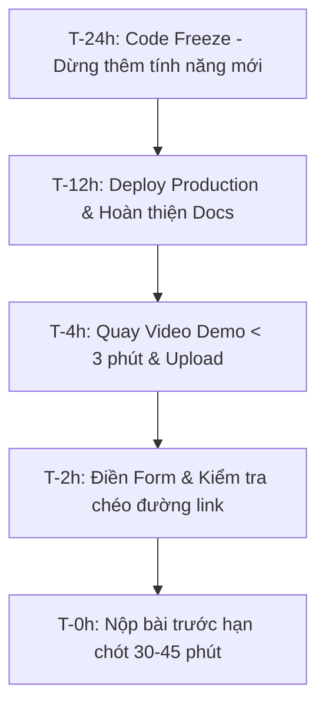

# 012 — Cách Thắng Hackathon Solana: Phân Tích Quán Quân và Tiêu Chí Dev3pack

> Ngày kiểm tra: 2026-11-17 (Asia/Ho_Chi_Minh). Phạm vi: chiến lược hackathon, phân tích dự án thắng giải và quy trình chuẩn bị nộp bài.
> Trạng thái: đã đối chiếu các bài thi đoạt giải tại Colosseum Renaissance, Radar và mạng lưới Superteam; tổng hợp tiêu chí đánh giá chuẩn quốc tế.

---

## 1. Mục tiêu và điều cần nhớ

Sau bài học này, bạn có thể:
1. Hiểu được tâm lý và cách thức chấm điểm của Ban giám khảo tại các kỳ Solana Hackathon quốc tế.
2. Nắm rõ công thức thành công của các dự án đoạt quán quân gần đây: bài toán họ chọn, cách họ làm demo và tiêu chuẩn repo của họ.
3. Tự chấm điểm dự án của mình theo **6 tiêu chí cốt lõi của Dev3pack**: Product Clarity, Impact, Demo, Deployment, Repo Quality và Solana/SDK Depth.
4. Áp dụng bảng **Checklist "Những thứ phải có trước giờ nộp"** theo từng mốc thời gian (T-24h, T-12h, T-2h, T-0) để không bao giờ bị mất điểm oan.

Thời lượng đọc: khoảng 15–20 phút.

---

## 2. Phiên bản và bằng chứng kiểm tra

| Sự kiện / Nguồn dữ liệu | Thời gian / Mốc kiểm chứng | Dự án tiêu biểu phân tích |
| --- | --- | --- |
| **Colosseum Renaissance Hackathon** | 2024–2025 | **Ore** (Grand Champion - Proof of Work on Solana), **Urani** (DeFi CoW Swap), **Blockmesh** (DePIN) |
| **Colosseum Radar Hackathon** | 2024–2025 | Các dự án thắng giải mảng Consumer, AI Agents, Payments |
| **Superteam Global & Superteam VN** | Dữ liệu 2025–2026 | Quy chuẩn review bài thi hackathon và tiêu chuẩn repo mã nguồn mở |
| **Tiêu chí Dev3pack Global Hackathon** | Mốc 27–29/11/2026 | 6 tiêu chí đánh giá chính thức (chi tiết ở mục 3.2) |

---

## 3. Kiến thức chính

### 3.1. Mổ xẻ các dự án Quán quân Solana Hackathon

Quan sát các kỳ hackathon lớn nhất của Solana (do Colosseum tổ chức với hàng ngàn dự án toàn cầu), các đội thắng giải Grand Champion hoặc Giải nhất từng Track đều có những điểm chung rõ rệt:

#### 1. Họ giải bài toán gì?
- **Không bao giờ làm "EVM clone"**: Họ không mang một Uniswap v2 hay Compound đơn giản từ Ethereum sang Solana. Họ giải quyết những bài toán mà **chỉ có Solana mới đủ khả năng đáp ứng**:
  - *Thông lượng cực cao và độ trễ dưới 1 giây*: Ví dụ **Ore** đưa thuật toán đào Proof-of-Work trực tiếp vào smart contract Solana với hàng ngàn giao dịch/giây mà không làm nghẽn mạng.
  - *Giao dịch vi mô (Micro-transactions) & State Compression*: Đưa chi phí phát hành xuống 0.00001 USD để ứng dụng vào mạng lưới phân tán (DePIN) hoặc game hàng triệu người chơi.
  - *Token Extensions (Token-2022)*: Ứng dụng Transfer Fee hoặc Transfer Hook để tạo ra cơ chế kinh tế tự vận hành.
  - *AI Agent On-chain*: Cho phép các mô hình ngôn ngữ lớn (LLM) sở hữu ví, tự gọi RPC và thực thi chiến lược giao dịch tự động.

#### 2. Họ làm Demo như thế nào?
- **Zero-Friction (Không một giây trở ngại)**:
  - Giám khảo có chưa đầy 5 phút để đánh giá một bài thi giữa hàng trăm submissions. Nếu vào trang web mà thấy màn hình trắng, hoặc bắt giám khảo phải kết nối ví mainnet có tiền thật, hoặc bắt đọc tài liệu 10 trang &rarr; **Dự án trượt ngay lập tức**.
  - Dự án thắng giải luôn có: **Nút "Chạy thử ngay" (Try Demo with 1-Click)**, tự động tạo ví tạm (ephemeral wallet) hoặc có sẵn số dư Devnet để giám khảo bấm nút và thấy kết quả on-chain hiển thị ngay lập tức.
- **Happy Path trau chuốt 100%**:
  - Không dàn trải làm 10 tính năng dang dở. Họ chỉ tập trung vào **1 luồng trải nghiệm duy nhất (Core Loop)** nhưng hoàn thiện đến mức hoàn hảo: giao diện đẹp mắt, hiệu ứng mượt mà, số dư nhảy thời gian thực và hiển thị link Solana Explorer rõ ràng cho mỗi giao dịch.

#### 3. Repository của họ trông ra sao?
- **README như một Landing Page cao cấp**:
  - Có hình ảnh banner đại diện và ảnh GIF động mô tả sản phẩm trong 10 giây đầu.
  - Tóm tắt vấn đề và giải pháp trong 3 gạch đầu dòng rõ ràng.
  - Có sơ đồ kiến trúc hệ thống (System Architecture Diagram).
  - Có bảng liệt kê: Program ID trên Devnet, link Live App, link Video Demo 3 phút.
  - Hướng dẫn cài đặt và chạy thử cục bộ trong đúng 2 câu lệnh (`pnpm install && pnpm dev`).
- **Lịch sử commit trong sạch**:
  - Commit message chuyên nghiệp theo chuẩn Conventional Commits (`feat:`, `fix:`, `docs:`).
  - Không có file rác, file `.env` chứa secret, hay file build `.DS_Store`, `node_modules/`.
  - Có bộ kiểm thử (test suite) bằng Anchor hoặc Mollusk chứng minh smart contract hoạt động đúng.

---

### 3.2. Đối chiếu 6 Tiêu Chí Chấm Điểm của Dev3pack Hackathon

| Tiêu chí | Trọng số kỳ vọng | Giám khảo tìm kiếm điều gì? | Cách đạt điểm tối đa (Actionable Tip) |
| --- | --- | --- | --- |
| **1. Product Clarity** *(Độ rõ ràng của sản phẩm)* | 20% | Dự án giải quyết vấn đề gì? Cho ai? Sản phẩm có dễ hiểu không hay nói những từ đao to búa lớn vô nghĩa? | Viết một câu định vị duy nhất (One-line pitch): *"X là [giải pháp] giúp [đối tượng] giải quyết [nỗi đau] bằng cách [công nghệ Solana]".* |
| **2. Impact** *(Tác động & Tiềm năng)* | 20% | Đây có phải là một thị trường thật không? Có tiềm năng phát triển thành startup sau cuộc thi không? | Nêu rõ quy mô thị trường mục tiêu (TAM) và lộ trình tiếp cận 1,000 người dùng đầu tiên (Go-to-market). |
| **3. Demo** *(Chất lượng bản thử nghiệm)* | 20% | Sản phẩm có hoạt động thật trên Devnet không? Hay chỉ là bản thiết kế Figma hoặc mock dữ liệu giả? | Toàn bộ các nút bấm chính phải gọi RPC thật, có thanh tiến trình trạng thái và cập nhật số dư on-chain. |
| **4. Deployment** *(Triển khai thực tế)* | 15% | Đã đưa lên môi trường thật chưa? Có link web truy cập được ngay không? Program đã verify chưa? | Deploy frontend lên Vercel/Cloudflare Pages; verify Anchor IDL và source code trên Solana Explorer/SolanaFM. |
| **5. Repo Quality** *(Chất lượng kho mã nguồn)* | 10% | Code có sạch không? Có tài liệu hướng dẫn không? Có test cases không? Bản quyền rõ ràng không? | Viết README chuẩn chỉnh; có file LICENSE (MIT); tổ chức thư mục tách bạch giữa contract và frontend. |
| **6. Solana/SDK Depth** *(Độ sâu công nghệ Solana & SDKs)* | 15% | Có tận dụng được thế mạnh độc bản của Solana không? Có tích hợp các SDK của nhà tài trợ không? | Tích hợp ít nhất 2 tính năng đặc trưng (PDA, Token-2022, CPI) và dùng các SDK tài trợ (Supabase, ElevenLabs, Firecrawl, MWA). |

---

### 3.3. Checklist "Những thứ phải có trước giờ nộp" (Submission Checklist)

Hackathon là cuộc đua với thời gian. Hầu hết các đội thất bại không phải vì thiếu ý tưởng mà vì bị "cháy giáo án" ở những giờ cuối cùng. Dưới đây là lịch trình chuẩn bị bắt buộc:



#### Mốc T-24 Giờ: Code Freeze (Đóng băng mã nguồn)
- [ ] Dừng thêm bất kỳ tính năng lớn mới nào.
- [ ] Chốt luồng người dùng cốt lõi (Core User Journey).
- [ ] Chạy kiểm thử toàn diện: smart contract test và frontend build test (`pnpm build`).
- [ ] Dọn dẹp code rác, xóa các câu `console.log` thừa.

#### Mốc T-12 Giờ: Deployment & Verification
- [ ] Deploy frontend lên nền tảng ổn định (khuyến nghị Vercel hoặc Cloudflare Pages).
- [ ] Cấu hình Custom Domain (nếu có) hoặc subdomain rõ ràng, đảm bảo HTTPS hoạt động.
- [ ] Deploy Anchor Program lên Solana Devnet; ghi lại Program ID.
- [ ] Tải IDL lên chain bằng lệnh `anchor idl init` để Program hiển thị đẹp trên Solana Explorer.
- [ ] Kiểm tra mở trang web trên 3 môi trường: Chrome desktop, Safari trên điện thoại, và chế độ ẩn danh (Incognito).

#### Mốc T-4 Giờ: Video Demo & README
- [ ] Quay video demo sản phẩm (độ dài nghiêm ngặt: **dưới 3 phút**).
- [ ] Xuất video chất lượng 1080p, âm thanh to rõ, không có tạp âm.
- [ ] Tải video lên YouTube ở chế độ **Unlisted** (hoặc Public) và kiểm tra link mở được.
- [ ] Cập nhật file `README.md` của repo: gắn link video, link live app, link explorer và sơ đồ kiến trúc.

#### Mốc T-2 Giờ: Chuẩn bị nộp bài & Kiểm tra chéo (Pre-flight Check)
- [ ] Mở form nộp bài của ban tổ chức (portal hackathon).
- [ ] Soạn thảo trước văn bản mô tả dự án ra file text (tránh trường hợp web nộp bài bị refresh mất chữ):
  - Tên dự án (Project Name).
  - Khẩu hiệu ngắn (Tagline - dưới 100 ký tự).
  - Mô tả bài toán và giải pháp (Problem & Solution).
  - Danh sách công nghệ và SDKs đã sử dụng.
- [ ] Kiểm tra trạng thái Repository: Chắc chắn repo đang để chế độ **PUBLIC** (repo Private sẽ bị tính 0 điểm ngay lập tức).
- [ ] Kiểm tra toàn bộ đường link trong bài nộp:
  - Link Live Demo (bấm thử trên máy tính khác xem có bị lỗi CORS hay lỗi RPC không).
  - Link Video Demo (kiểm tra có bị hạn chế độ tuổi hoặc bị chặn bản quyền âm nhạc không).
  - Link Github Repo.

#### Mốc T-0 (Trước hạn chót 45 phút): Nộp bài chính thức
- [ ] Bấm nút **Submit**.
- [ ] Chụp lại ảnh màn hình thông báo "Submission Received / Đã nhận bài thi thành công".
- [ ] Không chỉnh sửa git commit trên branch chính sau khi đã hết giờ nộp bài.

---

## 4. Mẫu Cấu Trúc README Giành Giải (Winning README Template)

```markdown
# 🚀 Tên Dự Án (Project Name)
> Khẩu hiệu ngắn gọn định vị sản phẩm trong 1 câu (Ví dụ: The first autonomous AI Agent for Solana yield routing).

[](https://your-app.vercel.app)
[](https://youtu.be/your-video)
[](https://explorer.solana.com/address/YOUR_PROGRAM_ID?cluster=devnet)

## 📌 Vấn đề & Giải pháp (Problem & Solution)
- **Vấn đề**: [Mô tả nỗi đau thực tế của người dùng Web3 hiện tại]
- **Giải pháp**: [Dự án của bạn giải quyết triệt để vấn đề đó như thế nào]

## 🛠 Kiến trúc Kỹ thuật (Technical Architecture)
\`\`\`mermaid
flowchart LR
    User[Người dùng] --> Web[Vite + React Frontend]
    Web --> Program[Anchor Program on Solana Devnet]
    Program --> Token[Token-2022 Extensions]
    Web --> Sponsor[Supabase / ElevenLabs SDK]
\`\`\`

## ⚡ Điểm sâu Solana & SDK Nhà tài trợ (Solana & Sponsor SDK Depth)
1. **Solana Native Features**: Tận dụng PDA để lưu trữ trạng thái người chơi; dùng Token-2022 Transfer Fee để tự động chia sẻ lợi nhuận.
2. **Sponsor SDKs**:
   - **Supabase**: Quản lý hồ sơ off-chain và bảng xếp hạng realtime.
   - **ElevenLabs**: Tạo giọng nói AI phản hồi theo từng giao dịch on-chain.

## 🚀 Hướng dẫn Chạy thử Cục bộ (Quickstart)
\`\`\`bash
# 1. Cài đặt dependencies
pnpm install

# 2. Khởi chạy frontend
pnpm dev
\`\`\`
```

---

## 5. Tự kiểm tra

1. **Tại sao một dự án có công nghệ rất phức tạp nhưng vẫn có thể bị trượt ở vòng loại hackathon?**
   - *Đáp án*: Vì thiếu **Product Clarity** (không ai hiểu làm cái gì sau 1 phút) và **Demo trục trặc / rào cản lớn** (bắt cài đặt phức tạp, web bị lỗi trắng trang hoặc không có link video demo chứng minh hoạt động).

2. **Khi nộp bài hackathon, việc để repository ở chế độ Private sẽ dẫn đến hậu quả gì?**
   - *Đáp án*: Giám khảo không thể truy cập mã nguồn để chấm tiêu chí Repo Quality và xác minh code thật, dẫn đến việc bài thi bị đánh giá 0 điểm hoặc bị loại trực tiếp.

3. **Nguyên tắc "Code Freeze" trước 24 giờ có ý nghĩa gì đối với một đội thi hackathon?**
   - *Đáp án*: Giúp đội dừng việc viết tính năng mới (vốn rất dễ sinh ra lỗi không lường trước), dành toàn bộ thời gian còn lại để kiểm thử, deploy production, quay video demo mượt mà và hoàn thiện bài thuyết trình nộp giải.

---

## 6. Nguồn và độ tin cậy

- [Colosseum Renaissance Winners Announcement](https://www.colosseum.org/) — Danh sách và phân tích các dự án đoạt giải quán quân Solana toàn cầu (Đã đối chiếu).
- [Superteam Earn & Hackathon Best Practices](https://earn.superteam.fun/) — Bộ quy chuẩn đánh giá và kinh nghiệm thi đấu hackathon Web3 (Đã đối chiếu).
- [Solana Foundation Hackathon Judging Criteria](https://solana.com/hackathon) — Tài liệu tham chiếu tiêu chí chấm điểm chính thức của hệ sinh thái Solana (Đã đọc).

---

## 7. Điểm chưa kiểm chứng và bước tiếp theo

- **Điểm chưa kiểm chứng**: Danh sách giám khảo cụ thể của Dev3pack 2026 (mỗi hội đồng giám khảo có thể có khẩu vị thiên về hạ tầng kỹ thuật hoặc thiên về tính thương mại/sản phẩm người dùng).
- **Bước tiếp theo**: Khi chốt ý tưởng sản phẩm ở giai đoạn sau, lập tức in ra checklist mục 3.3 và gán người chịu trách nhiệm cho các mốc T-24h, T-12h và T-4h.
