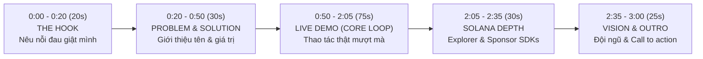

# 013 — Kịch Bản Video Demo Dưới 3 Phút: Công Thức Thuyết Phục Giám Khảo

> Ngày kiểm tra: 2026-11-17 (Asia/Ho_Chi_Minh). Phạm vi: nghệ thuật làm video pitch, cấu trúc thời gian và template kịch bản mẫu.
> Trạng thái: đã đối chiếu các video demo đoạt giải quán quân tại Colosseum và Solana Hackathons; đúc kết thành bộ khung chuẩn mực.

---

## 1. Mục tiêu và điều cần nhớ

Sau bài học này, bạn có thể:
1. Hiểu vì sao video demo dưới 3 phút là yếu tố quyết định 60% ấn tượng ban đầu của Ban giám khảo.
2. Nắm vững cấu trúc thời gian "bất di bất dịch": **Hook (20s) &rarr; Vấn đề/Giải pháp (30s) &rarr; Demo thật (75s) &rarr; Điểm Solana sâu (30s) &rarr; Kết luận (25s)**.
3. Chọn lựa và sử dụng đúng các công cụ quay dựng nhanh (Screen Studio, Loom, CapCut).
4. Nhận biết và triệt tiêu 5 lỗi "tử huyệt" khiến video bị loại sớm.
5. Sử dụng ngay **Template kịch bản mẫu điền sẵn chỗ trống** (kèm lời thoại tiếng Anh chuyên nghiệp) để sản xuất video trong vòng 1–2 giờ.

Thời lượng đọc: khoảng 15 phút.

---

## 2. Phiên bản và bằng chứng kiểm tra

| Thành phần | Tiêu chuẩn / Phiên bản | Mức kiểm chứng |
| --- | --- | --- |
| **Thời lượng tối đa** | **< 3:00 phút (nghiêm ngặt)** | Quy định chuẩn của Colosseum và các giải Solana toàn cầu |
| **Độ phân giải & Tỷ lệ** | **1080p (1920x1080), 60fps, 16:9** | Đảm bảo hiển thị sắc nét chữ và số dư trên ví |
| **Định dạng & Nền tảng** | **YouTube (Unlisted/Public) hoặc Loom** | Nền tảng hỗ trợ phát mượt mà không bắt tải file |
| **Công cụ quay dựng** | Screen Studio 2.x, OBS Studio 30.x, CapCut 4.x | Bộ ba công cụ tối ưu cho sản xuất video nhanh |

---

## 3. Kiến thức chính

### 3.1. Tâm lý giám khảo: Họ xem video của bạn như thế nào?

Một giám khảo hackathon thường phải chấm từ 30 đến 50 dự án trong vòng vài ngày. Họ mệt mỏi, thiếu ngủ và bị "bão hòa thông tin".
- Nếu video mở đầu bằng slide chữ lê thê, họ sẽ tua nhanh hoặc tắt sau 20 giây.
- Nếu video dài quá 3 phút, nhiều giám khảo sẽ tự động dừng xem ở mốc 3:00 và trừ điểm kỷ luật thời gian.
- **Quy tắc vàng**: Video của bạn phải khiến giám khảo tỉnh ngủ ngay từ 10 giây đầu tiên, chứng minh sản phẩm hoạt động thật và nêu bật lý do dự án này bắt buộc phải xây dựng trên Solana.

---

### 3.2. Cấu trúc kịch bản chuẩn 3 phút (The 3-Minute Formula)



#### Phân đoạn 1: The Hook (0:00 – 0:20) — 20 giây
- **Mục tiêu**: Bắt lấy sự chú ý ngay lập tức.
- **Hành động hình ảnh**: Mở đầu bằng một hình ảnh số liệu biết nói hoặc câu hỏi trực diện.
- **Lời thoại mẫu**: *"Mỗi ngày, có hàng trăm triệu USD bị thất thoát trên các giao thức DeFi chỉ vì giao dịch chậm và trượt giá cao. Người dùng nhỏ lẻ luôn là người chịu thiệt hại cuối cùng."*
- **Tuyệt đối tránh**: *"Xin chào ban giám khảo, tôi tên là Nguyễn Văn A, hôm nay tôi xin đại diện nhóm..."* (Lãng phí thời gian quý giá!).

#### Phân đoạn 2: Problem & Solution (0:20 – 0:50) — 30 giây
- **Mục tiêu**: Định vị sản phẩm là giải pháp duy nhất giải quyết triệt để nỗi đau trên.
- **Hành động hình ảnh**: Hiển thị Logo, khẩu hiệu và giao diện trang chủ ấn tượng của ứng dụng.
- **Lời thoại mẫu**: *"Đó là lý do chúng tôi xây dựng [Tên dự án]. [Tên dự án] là giao thức định tuyến thanh khoản tức thời đầu tiên trên Solana, tận dụng tốc độ sub-second để triệt tiêu trượt giá và bảo vệ người dùng."*

#### Phân đoạn 3: The Live Demo (0:50 – 2:05) — 75 giây (Trọng tâm)
- **Mục tiêu**: Chứng minh sản phẩm thật 100%, không phải đồ họa dựng sẵn.
- **Hành động hình ảnh**:
  1. Người dùng bấm "Connect Wallet" &rarr; ví kết nối ngay lập tức.
  2. Người dùng nhập số liệu và bấm nút thực hiện hành động chính.
  3. Cửa sổ ví mở ra, người dùng bấm "Approve".
  4. Trạng thái chuyển mượt mà: `pending` &rarr; `confirmed` &rarr; số dư hoặc bảng xếp hạng cập nhật ngay tức thì.
- **Lưu ý**: Hãy chuẩn bị sẵn một kịch bản quay thành công (Happy Path). Nếu mạng Devnet chập chờn, hãy dùng bản ghi hình dự phòng mượt mà đã quay trước đó.

#### Phân đoạn 4: Solana & Sponsor Depth (2:05 – 2:35) — 30 giây
- **Mục tiêu**: Giành trọn điểm ở tiêu chí "Độ sâu công nghệ" và "Bounty nhà tài trợ".
- **Hành động hình ảnh**: Chuyển tab sang màn hình Solana Explorer và backend dashboard.
- **Lời thoại mẫu**: *"Để đạt được điều này, chúng tôi đã xây dựng smart contract bằng Anchor trên Solana Devnet. Đây là transaction vừa hoàn thành: sử dụng PDA để quản lý trạng thái phi tập trung và Token-2022 Transfer Fee để chia sẻ doanh thu tự động. Đồng thời, chúng tôi tích hợp Supabase để đồng bộ hóa bảng xếp hạng theo thời gian thực và ElevenLabs để tạo giọng nói AI tương tác."*

#### Phân đoạn 5: Vision & Outro (2:35 – 3:00) — 25 giây
- **Mục tiêu**: Kết thúc chuyên nghiệp, để lại ấn tượng tốt đẹp.
- **Hành động hình ảnh**: Màn hình tổng kết hiển thị tên đội thi, link live app và mã QR để giám khảo trải nghiệm.
- **Lời thoại mẫu**: *"Toàn bộ hệ sinh thái này được đội ngũ chúng tôi hoàn thành trong 48 giờ. Chúng tôi đã mở mã nguồn hoàn toàn trên GitHub và triển khai bản live trên Vercel. Cảm ơn Ban giám khảo Dev3pack, hãy truy cập [đường dẫn app] để trực tiếp trải nghiệm ngay bây giờ!"*

---

### 3.3. Bộ công cụ quay và dựng đề xuất

1. **Screen Studio (Khuyến nghị số 1 trên macOS)**:
   - Tự động zoom mềm mại vào các nút bấm và con trỏ chuột.
   - Bo tròn góc cửa sổ, tự thêm hình nền gradient sang trọng chuẩn Apple style.
   - Tiết kiệm 80% thời gian cắt dựng thủ công.
2. **OBS Studio (Hoàn toàn miễn phí / Đa nền tảng)**:
   - Thu âm chất lượng studio nếu biết bật các bộ lọc Noise Suppression và Compressor.
   - Quay trực tiếp màn hình không giới hạn watermark.
3. **CapCut Desktop (Chỉnh sửa & Cắt gọt)**:
   - Sử dụng tính năng **Auto Captions** để tạo phụ đề tiếng Anh tự động trong 30 giây.
   - Cắt bỏ những đoạn "ờ, à" hoặc khoảng lặng dài giữa các thao tác để nhịp video nhanh và cuốn hút.

---

### 3.4. Năm lỗi "tử huyệt" khiến video demo bị đánh trượt

1. **Video lố thời gian (Ví dụ 3 phút 08 giây)**: Bị đánh giá là thiếu tính kỷ luật và không tôn trọng thời gian của giám khảo.
2. **Chỉ trình chiếu Slide PowerPoint**: Giám khảo muốn xem **sản phẩm thật đang chạy**, không ai muốn xem slide lý thuyết trong 3 phút.
3. **Âm thanh tồi tệ**: Tiếng nói lí nhí, tiếng quạt gió laptop rè rè, hoặc bật nhạc nền EDM đinh tai át mất tiếng thuyết minh.
4. **Demo bị đơ / văng lỗi (Crash)**: Bấm nút giao dịch mà vòng xoay cứ quay mãi hoặc hiện popup đỏ rực mà không có lời giải thích hay phương án dự phòng.
5. **Không có phụ đề tiếng Anh**: Rất nhiều giám khảo quốc tế không thể nghe rõ giọng phát âm của các đội không nói tiếng Anh bản xứ nếu không có subtitle to rõ hỗ trợ.

---

## 4. Template Kịch Bản Mẫu Điền Sẵn Chỗ Trống (Ready-to-fill Script)

> Hãy sao chép kịch bản dưới đây, điền các thông tin trong ngoặc vuông `[...]` và dùng phần mềm quay video đọc theo:

```text
[0:00 - 0:20] THE HOOK
Visual: Quay màn hình giao diện Web3 thông thường bị chậm, nghẽn mạng hoặc biểu đồ trượt giá.
Voiceover (English):
"Have you ever tried trading on decentralized platforms, only to lose money to high slippage, failed transactions, and terrible user experience? In Web3 today, user adoption is broken because speed and simplicity are missing."

[0:20 - 0:50] PROBLEM & SOLUTION
Visual: Chuyển mượt sang trang chủ sản phẩm của bạn, hiển thị logo [Tên Dự Án] và khẩu hiệu.
Voiceover (English):
"Welcome to [Tên Dự Án] — the first [mô tả giải pháp trong 3 từ] built specifically for the high-speed Solana ecosystem. We combine Solana's sub-second finality with smart routing to deliver zero-friction experiences for everyday users."

[0:50 - 2:05] LIVE PRODUCT DEMO
Visual: Quay thao tác chuột: Bấm Connect Wallet -> Chọn tính năng chính -> Bấm Execute -> Popup ví hiện lên -> Bấm Approve -> Giao diện cập nhật thành công.
Voiceover (English):
"Let’s see it in action. Right here on our live deployment, I connect my wallet with just one click.
Now, I want to [thực hiện hành động chính: ví dụ: mint an in-game asset / swap token / create an autonomous agent].
I input the parameters and click [Tên nút bấm].
Watch how seamlessly the transaction is dispatched. In less than 400 milliseconds, our transaction hits the 'processed' state, and right now, it is fully 'confirmed' on Solana Devnet. The UI updates instantly without any page refresh."

[2:05 - 2:35] SOLANA & SPONSOR DEPTH
Visual: Mở tab Solana Explorer hiển thị Transaction Hash và tab Supabase/Dashboard.
Voiceover (English):
"Under the hood, this isn't just a Web2 wrapper. Our custom Anchor program manages states through Program Derived Addresses (PDAs), ensuring complete non-custodial security.
We also leverage [nêu công nghệ: Token-2022 Transfer Fees / Metaplex Core] to optimize storage rent by 80%.
On the backend, we integrated Supabase for instant real-time data sync, and ElevenLabs to provide dynamic voice interactions."

[2:35 - 3:00] VISION & OUTRO
Visual: Quay lại màn hình chính của App, hiện Slide kết thúc với GitHub repo URL, Live Demo link và tên team.
Voiceover (English):
"Our team built, tested, and deployed this complete system during the 48 hours of Dev3pack Hackathon. The entire codebase is open-sourced on GitHub, and the live demo is available at [domain của app].
Thank you for watching, and we can’t wait for you to try [Tên Dự Án] today!"
```

---

## 5. Tự kiểm tra

1. **Tại sao bạn không nên dành 30 giây đầu tiên để giới thiệu lý lịch các thành viên trong đội?**
   - *Đáp án*: Vì giám khảo quan tâm nhất đến **vấn đề và sản phẩm**. 20 giây đầu tiên là cơ hội duy nhất để thu hút sự chú ý (The Hook). Giới thiệu thành viên nên để ngắn gọn ở 15 giây cuối cùng hoặc ghi trong mô tả bài nộp.

2. **Nếu mạng Solana Devnet bị lag đúng lúc bạn đang quay màn hình demo, bạn nên làm gì?**
   - *Đáp án*: Luôn chuẩn bị sẵn một cảnh quay "Happy Path" thành công từ trước. Khi dựng video, bạn có thể ghép đoạn quay thành công đó vào để đảm bảo nhịp điệu video mượt mà, không để video bị đơ nhiều phút chờ đợi.

3. **Yếu tố nào giúp video demo của bạn ghi điểm tối đa ở các hạng mục giải thưởng của Nhà tài trợ (Sponsors)?**
   - *Đáp án*: Dành riêng phân đoạn từ 2:05 – 2:35 để trình chiếu trực tiếp Explorer, dashboard và nhắc tên chính xác cách bạn sử dụng SDK của nhà tài trợ (Supabase, ElevenLabs, Firecrawl, MWA) vào giải pháp.

---

## 6. Nguồn và độ tin cậy

- [Colosseum Demo Video Guidelines](https://www.colosseum.org/) — Hướng dẫn chính thức về video thuyết trình của các kỳ Solana Global Hackathon (Đã đối chiếu).
- [Screen Studio Production Guide](https://screen.studio/) — Hướng dẫn thực hành làm video demo phần mềm chuẩn quốc tế (Đã đối chiếu).
- [Superteam Pitch Video Best Practices](https://superteam.fun/) — Tổng hợp kinh nghiệm từ các dự án thắng giải của cộng đồng Superteam (Đã đọc).

---

## 7. Điểm chưa kiểm chứng và bước tiếp theo

- **Điểm chưa kiểm chứng**: Quy định cụ thể của ban tổ chức Dev3pack về việc có cho phép nộp link video Loom hay bắt buộc phải là link YouTube (để an toàn, hãy luôn upload lên YouTube ở chế độ Unlisted).
- **Bước tiếp theo**: Khi code sản phẩm hoàn thành mốc tính năng cơ bản, lập tức mở file template ở mục 4, điền lời thoại và quay thử một bản nháp trước thời hạn nộp 6 tiếng.
