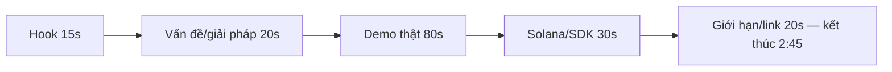

# 013 — Video demo Dev3pack: kịch bản tối đa 165 giây

> Ngày kiểm tra: **17/11/2026** (Asia/Ho_Chi_Minh). Đã mở [trang chủ Dev3pack](https://hack.dev3pack.xyz) và [FAQ](https://hack.dev3pack.xyz/faq) bằng browser. Thể lệ đã đối chiếu; kịch bản dưới là đề xuất nội bộ, chưa quay/xuất video hoặc đo sản phẩm.

## 1. Mục tiêu và điều cần nhớ

FAQ yêu cầu video **dưới 3 phút**, quá 3 phút bị loại khỏi giải. Phải cho thấy sản phẩm hoạt động thật, không thay bằng pitch deck. Chấp nhận YouTube, Loom hoặc link công khai khác; ngôn ngữ nào cũng được.

Kịch bản của repo đặt trần **165 giây = 2:45**, chừa **15 giây** so với 3:00. Không dùng 15 giây này để thêm intro/outro: **tổng file xuất**, kể cả chuyển cảnh, phải ≤165 giây theo kế hoạch. Đây là biên tự đề xuất, không phải giới hạn mới của BTC.

## 2. Phiên bản và bằng chứng kiểm tra

| Nội dung | Bằng chứng / trạng thái |
| --- | --- |
| Luật video, nền tảng, ngôn ngữ | [FAQ Dev3pack](https://hack.dev3pack.xyz/faq), đọc bằng browser 17/11/2026 |
| Chấm bài | Product/Technical, hai vòng; top 100 vào vòng xem code, founder-market fit và live demo; không công bố trọng số |
| Kịch bản 165 giây | Đã kiểm tổng thời lượng trên giấy; chưa có file video để đo |
| Latency, rent, test, deployment | **Chưa kiểm chứng**, phải điền số đo và bằng chứng của sản phẩm |
| Công cụ quay, độ phân giải | Dùng công cụ đội đã có; 1080p/16:9 là gợi ý, không phải điều kiện BTC; version/license và thời gian dựng chưa kiểm chứng |

## 3. Kiến thức chính

### 3.1. Chứng minh một luồng sử dụng thật

Cho thấy nhu cầu, thao tác, phản hồi và kết quả kiểm chứng được. Mọi dự án mặc định vào track Solana. **Chưa có track DePIN/AI Agent hoặc bounty riêng của sponsor được công bố**; partner tracks còn chờ trước kickoff. Chỉ trình diễn SDK có vai trò thật, không suy điểm/giải từ số SDK. [FAQ](https://hack.dev3pack.xyz/faq), kiểm tra 17/11/2026.

Nhà tài trợ/giải và form năm bước xem [001](001-hackathon-rules.md), [012](012-winning-solana-hackathons.md). Hạn nộp **29/11/2026**, giờ UTC xem dashboard. Chấp nhận devnet/mainnet; repo open source, README tách trước/trong sự kiện, đội phải hiểu và giải thích code kể cả khi dùng AI.

### 3.2. Bảng thời lượng tự đề xuất — tổng 165 giây

| Đoạn | Bắt đầu | Kết thúc | Giây | Nội dung hình ảnh |
| --- | --- | --- | ---: | --- |
| Hook | 0:00 | 0:15 | 15 | Một tình huống người dùng cụ thể, không bịa số liệu thị trường |
| Vấn đề / giải pháp | 0:15 | 0:35 | 20 | Tên app, người dùng, giá trị chính |
| Demo thật | 0:35 | 1:55 | 80 | Connect → thao tác → ký nếu cần → trạng thái và kết quả thật |
| Solana / SDK và bằng chứng | 1:55 | 2:25 | 30 | Explorer/log đúng cluster; code/check/test có thật; vai trò SDK |
| Giới hạn / đội / link | 2:25 | 2:45 | 20 | Phần đã làm, phần còn thiếu, repo và live link |
| **Tổng** | **0:00** | **2:45** | **165** | **15 giây biên so với 3:00** |



### 3.3. Bằng chứng cần điền trước khi thu lời thoại

| Điều muốn nói | Chỗ trống cần hoàn thành | Điều kiện sử dụng |
| --- | --- | --- |
| Tốc độ transaction | **[điền số liệu đo được]**: thời gian gửi → `processed`/`confirmed`/`finalized`, cluster, RPC, số mẫu | Ghi đúng commitment đã đo; không gọi processed/confirmed là finality |
| Tiết kiệm rent | **[điền số liệu đo được]**: lamports trước/sau, account size, plugins, baseline cùng điều kiện | Chưa đo thì bỏ câu so sánh; không tự dùng “80%” |
| Bảo mật PDA | **[điền số liệu đo được]** và **[điền invariant, signer/owner/authority checks, negative tests + log]** | PDA tự nó không bảo đảm an toàn; số test cũng không chứng minh an toàn tuyệt đối |
| Build/test/deploy trong sự kiện | **[điền số liệu đo được]**, **[điền commit, thời điểm, test log, deployment link]** | Tách phần trước/trong sự kiện; không tuyên bố toàn bộ được làm trong 48h khi chưa có căn cứ |

Phân biệt commitment theo [Solana Transaction Confirmation](https://solana.com/developers/guides/advanced/confirmation). Kiểm tra account/quyền xem [007](007-solana-program-security.md). Chưa có bằng chứng thì nói rõ chưa đo/chưa làm hoặc bỏ câu; không đọc nguyên placeholder như một kết quả.

### 3.4. Quay, xuất và kiểm tra

- Thu thao tác thật; chữ và âm thanh phải rõ. Phụ đề tiếng Anh là hỗ trợ tùy chọn, không phải điều kiện dự thi.
- Có thể chuẩn bị bản ghi thật dự phòng, ghi rõ bản build/cluster và nếu tua/cắt thời gian chờ. Không dùng video đã cắt để suy tốc độ hoặc giả dữ liệu thành live result.
- Kiểm tổng duration của **file xuất** và bản phát qua link công khai, kể cả đoạn cuối; nếu quá 165 giây thì rút lời thoại, không chỉ đổi bảng.
- Tránh video quá 3 phút, pitch deck thay demo, link cần đăng nhập, chữ quá nhỏ hoặc flow lỗi không được giải thích. Chỉ lỗi thời lượng >3 phút có mức loại khỏi giải được FAQ nêu cụ thể; không tự gán các mức điểm phạt khác.

### 3.5. Tham khảo, có thể lỗi thời — Colosseum/Superteam 2024–2025

Bản cũ dẫn homepage của các giải này để gọi cấu trúc video là “chuẩn”. Chưa có permalink video/hướng dẫn hỗ trợ nên bỏ cách gán đó. Trường hợp lịch sử có nguồn nằm ở [012](012-winning-solana-hackathons.md), không dùng để suy thể lệ Dev3pack. Hiệu quả công cụ dựng, tỷ lệ tiết kiệm thời gian và thời gian sản xuất **chưa kiểm chứng** vì chưa quay thử.

## 4. Ví dụ hoặc quy trình tối thiểu

### Lời thoại mẫu và thao tác — tối đa 2:45

Lời thoại tiếng Anh chỉ là lựa chọn; có thể nói tiếng Việt. Các câu có chỗ trống chỉ được giữ sau khi điền bằng chứng, rồi đọc thử theo bảng thời lượng. Tổng thời gian thực chưa được kiểm chứng bằng video.

```text
[0:00 - 0:15] HOOK — 15 giây
Visual: [Tình huống thật của người dùng].
Voice: "[Nhóm người dùng] need a simpler way to [tác vụ].
Here is the problem we are addressing: [vấn đề đã quan sát]."

[0:15 - 0:35] PROBLEM & SOLUTION — 20 giây
Visual: Trang chính của [Tên app], thao tác sẽ demo.
Voice: "[Tên app] helps [người dùng] do [giá trị chính].
We use Solana for [lý do cụ thể của sản phẩm]."
Nếu nói về latency: [điền số liệu đo được], [commitment, cluster, RPC, số mẫu].
Nếu chưa đo, bỏ câu latency; không khẳng định sub-second finality.

[0:35 - 1:55] LIVE DEMO — 80 giây
Visual: Kết nối ví, chọn [tính năng], điền [đầu vào], xác nhận nếu cần.
Voice: "I connect my wallet and choose [tính năng].
I enter [đầu vào] and select [nút]. The wallet shows [nội dung xác nhận].
The app now reports [trạng thái thật]. Here is [kết quả thật] and its transaction link."
Giữ thời gian cho thao tác; giải thích nếu demo đang ở trạng thái chờ/lỗi.
Số đo nếu có: [điền số liệu đo được], không coi dữ liệu UI mock là kết quả on-chain.

[1:55 - 2:25] SOLANA / SDK EVIDENCE — 30 giây
Visual: Explorer đúng cluster; đoạn code/check hoặc test log liên quan.
Voice: "The program stores [trạng thái] and checks [quyền/invariant].
[SDK thực dùng] handles [vai trò có thể nhìn thấy]."
Rent nếu có: [điền số liệu đo được], [baseline/account size cùng điều kiện].
PDA/quyền: [điền invariant và negative test thực chạy], [điền số liệu đo được].
Bỏ nội dung chưa xây/chưa đo; không hứa PDA bảo đảm an toàn tuyệt đối.

[2:25 - 2:45] LIMITS / TEAM / LINKS — 20 giây
Visual: Repo open source, live link, danh sách phần trước/trong sự kiện.
Voice: "We built [phần làm trong sự kiện]; [phần có sẵn] predates it.
Our current limitation is [giới hạn thật].
The code and demo are available at [link công khai]."
Build/test/deploy: [điền số liệu đo được], [commit/thời điểm/log/link thật].
Kết thúc cả hình và tiếng không muộn hơn 2:45.
```

## 5. Tự kiểm tra

1. Tổng 15 + 20 + 80 + 30 + 20 là bao nhiêu? **165 giây**, dư 15 giây so với 180; file xuất vẫn cần đo thực tế.
2. UI hiện confirmed có đủ để nói finalized dưới một giây? **Không**, khác commitment và chưa có số đo.
3. Có PDA có được nói an toàn tuyệt đối? **Không**, phải kiểm invariant/quyền và nêu giới hạn.
4. Quá 3 phút chỉ bị trừ điểm? **Không**, FAQ nói bị loại khỏi điều kiện xét giải.
5. Bắt buộc phụ đề tiếng Anh hoặc YouTube? **Không**, mọi ngôn ngữ được chấp nhận; Loom/link công khai cũng được.

## 6. Nguồn và độ tin cậy

- [Dev3pack trang chủ](https://hack.dev3pack.xyz), [FAQ](https://hack.dev3pack.xyz/faq) — nguồn chính thức, kiểm tra bằng browser **17/11/2026**.
- [Solana Transaction Confirmation](https://solana.com/developers/guides/advanced/confirmation) — nguồn phân biệt commitment; không chứng minh latency sản phẩm.
- Mốc 165 giây, checklist và lời thoại là đề xuất nội bộ, không phải công thức thắng giải đã đo.

## 7. Điểm chưa kiểm chứng và bước tiếp theo

Chưa có video xuất thật, số đo latency/rent, test log, deployment hay bằng chứng xây trong sự kiện. Giờ UTC trên dashboard và partner track/bounty cuối cùng còn chờ xác nhận. Khi có sản phẩm, điền bằng chứng và đo file xuất; không coi việc sửa tài liệu là đã build/test/deploy app.

### Bài học / lỗi đã gặp

Lịch 180 giây không đáp ứng “dưới 3 phút”; placeholder phải yêu cầu bằng chứng, không cài sẵn thành tích để đọc như sự thật.
