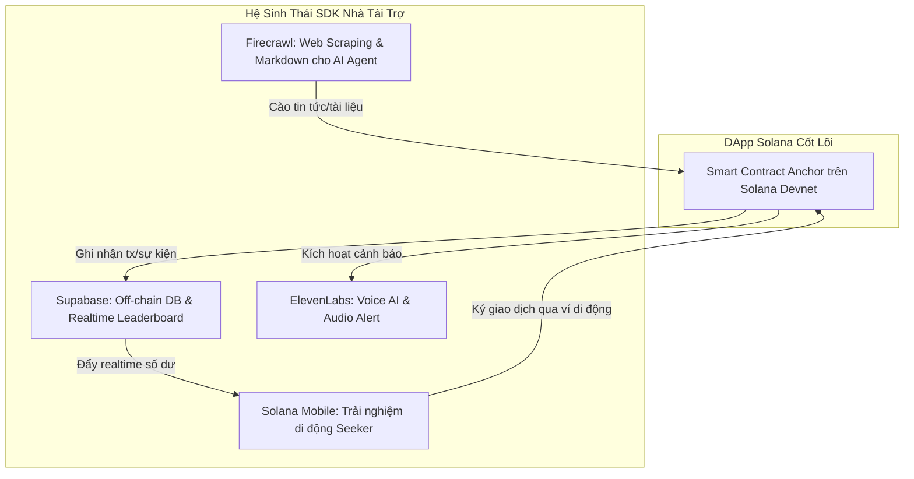

# 014 — SDK Nhà Tài Trợ: Supabase, ElevenLabs, Firecrawl và Solana Mobile

> Ngày kiểm tra: 2026-11-17 (Asia/Ho_Chi_Minh). Phạm vi: phân tích tính năng, hạn mức miễn phí (Free Tier), độ khó và chiến lược tích hợp 48 giờ.
> Trạng thái: đã đối chiếu tài liệu chính thức của Supabase, ElevenLabs, Firecrawl và Solana Mobile; tổng hợp ma trận so sánh khả thi.

---

## 1. Mục tiêu và điều cần nhớ

Sau bài học này, bạn có thể:
1. Hiểu rõ vai trò và bài toán thực tế của **4 SDK nhà tài trợ** (Supabase, ElevenLabs, Firecrawl, Solana Mobile) trong một dApp Solana.
2. Nắm vững hạn mức Free Tier và các "bẫy" giới hạn tốc độ (rate limits) để không bị cạn quota trong lúc demo.
3. Đánh giá chính xác thời gian và độ khó tích hợp của từng SDK trong khung giờ 48 giờ hackathon.
4. Áp dụng chiến lược **"Ghép Lego" (Lego Stacking)**: kết hợp hài hòa các SDK để săn nhiều giải thưởng phụ (Bounties) mà không làm phức tạp hóa hệ thống.

Thời lượng đọc: khoảng 15 phút.

---

## 2. Phiên bản và bằng chứng kiểm tra

| SDK / Nhà tài trợ | Thư viện & Phiên bản (2026-11) | Mức kiểm chứng |
| --- | --- | --- |
| **Supabase** | `@supabase/supabase-js` **2.48.x** | Đã đối chiếu docs; Postgres 15+, Auth, Realtime, Storage |
| **ElevenLabs** | `elevenlabs` **1.50.x** (Node/Web SDK) | Đã đối chiếu docs REST API v1 Text-to-Speech |
| **Firecrawl** | `@mendable/firecrawl-js` **1.18.x** | Đã đối chiếu docs web scraping & LLM markdown extraction |
| **Solana Mobile** | `@solana-mobile/mobile-wallet-adapter-protocol` **2.1.x** | Đã đối chiếu đặc tả giao thức MWA |

---

## 3. Kiến thức chính

### 3.1. Phân tích chi tiết 4 SDK Nhà tài trợ



---

#### 1. Supabase (The Open Source Firebase Alternative)
- **Làm được gì trong app Solana?**
  - **Lưu trữ dữ liệu Off-chain tiết kiệm chi phí**: Lưu trữ thông tin người dùng (nickname, avatar, bio), lịch sử nhiệm vụ, bảng xếp hạng (Leaderboards), và catalog vật phẩm off-chain. Lưu những dữ liệu này trên blockchain Solana sẽ ngốn hàng trăm USD tiền rent không cần thiết.
  - **Xác thực ví Web3 (Sign-in with Solana - SIWS)**: Người dùng ký thông điệp mã hóa qua ví (hàm `signMessage`), Supabase Edge Function xác minh chữ ký Ed25519 bằng public key và cấp phiên đăng nhập JWT bảo mật.
  - **Cập nhật thời gian thực (Realtime Subscriptions)**: Lắng nghe sự thay đổi của cơ sở dữ liệu qua WebSocket, tự động cập nhật số dư, bảng xếp hạng hoặc hành động của người chơi khác lên giao diện web mà không cần người dùng tải lại trang.
- **Hạn mức Free Tier**:
  - 500 MB Postgres Database.
  - 50,000 Người dùng hoạt động hàng tháng (MAU).
  - 1 GB lưu trữ file (Storage).
  - 500,000 lượt gọi Edge Functions / tháng.
  - *Đánh giá*: Hoàn toàn dư dả cho quy mô thi đấu hackathon.
- **Thời gian & Độ khó tích hợp trong 48h**:
  - **Rất dễ (1–2 giờ)**. Tạo dự án trên Dashboard trong 2 phút, cài `@supabase/supabase-js`, khởi tạo client với `SUPABASE_URL` và `SUPABASE_ANON_KEY` là dùng được ngay.

---

#### 2. ElevenLabs (Voice AI & Text-to-Speech hàng đầu thế giới)
- **Làm được gì trong app Solana?**
  - **Nhân vật ảo & NPC Web3 biết nói**: Tạo ra các nhân vật game, quản gia AI (AI Butler) hoặc trợ lý đầu tư tài chính có giọng nói tự nhiên, truyền cảm như người thật.
  - **Cảnh báo âm thanh sự kiện On-chain (Dramatic Audio Alerts)**: Khi phát hiện giao dịch cá mập di chuyển số lượng lớn token, hoặc khi người chơi hoàn thành nhiệm vụ đúc được NFT hiếm, ElevenLabs phát ra thông báo giọng nói kịch tính ngay trong app.
  - **Hỗ trợ tiếp cận (Accessibility)**: Đọc to các điều khoản giao dịch phức tạp, hướng dẫn người mới chơi từng bước làm quen với ví Solana.
- **Hạn mức Free Tier**:
  - 10,000 ký tự văn bản / tháng (~10 đến 15 phút audio chất lượng cao).
  - Hỗ trợ hàng chục ngôn ngữ (bao gồm tiếng Anh, tiếng Việt).
  - Thư viện giọng mẫu phong phú.
- **Thời gian & Độ khó tích hợp trong 48h**:
  - **Cực kỳ dễ (30–60 phút)**. Chỉ cần gọi 1 hàm API gửi đoạn text, nhận về stream audio và phát trực tiếp trên thẻ `<audio>` của trình duyệt.
- **Lưu ý hackathon**: Vì free tier giới hạn 10,000 ký tự, hãy cache các file audio thông báo cố định sẵn trong thư mục `public/` hoặc Supabase Storage; chỉ dùng API ElevenLabs để sinh giọng nói cho các đoạn text động mang tính cá nhân hóa của người dùng.

---

#### 3. Firecrawl (Cào dữ liệu web tối ưu cho AI & LLM)
- **Làm được gì trong app Solana?**
  - **Cào dữ liệu sạch cho AI Trading & Analytics Agents**: Các trang web tài chính, sàn DEX hay bài báo phân tích thị trường thường chứa đầy mã quảng cáo, HTML rác và menu phức tạp. Firecrawl tự động render JavaScript và chuyển đổi toàn bộ trang web thành định dạng **Markdown thuần túy**, giúp tiết kiệm 80% dung lượng Context Window của AI model.
  - **Quét tin tức & Tâm lý thị trường (Social Sentiment Analysis)**: Tự động cào các bài đăng mới nhất trên các blog crypto, tin tức coin để AI Agent tổng hợp và đưa ra đề xuất đầu tư on-chain.
  - **Xác thực thông tin dự án**: Tự động cào roadmap hoặc whitepaper từ website của một token để AI tự động chấm điểm độ uy tín (Scam/Rugpull score).
- **Hạn mức Free Tier**:
  - 500 credits miễn phí khi tạo tài khoản (mỗi lần cào 1 URL tốn 1 credit).
  - Hỗ trợ endpoint Scrape (1 trang) và Crawl (toàn bộ domain).
- **Thời gian & Độ khó tích hợp trong 48h**:
  - **Dễ (1–2 giờ)**. Sử dụng SDK `@mendable/firecrawl-js`. Thao tác lấy dữ liệu chỉ gồm 3 dòng code.

---

#### 4. Solana Mobile (MWA & Seeker Ecosystem)
- **Làm được gì trong app Solana?**
  - Kết nối ứng dụng di động với ví phần cứng trên dòng điện thoại Solana Seeker / Saga.
  - Mở cánh cửa tranh tài tại các hạng mục giải thưởng Mobile Track / Seeker Bounty.
- **Hạn mức Free Tier**:
  - Hoàn toàn miễn phí, mã nguồn mở 100%.
- **Thời gian & Độ khó tích hợp trong 48h**:
  - Native React Native: **Khó (8–12 giờ)**.
  - Responsive Web App hỗ trợ MWA trên trình duyệt di động: **Dễ đến Trung bình (2–3 giờ)**.

---

### 3.2. Bảng ma trận đối chiếu 4 SDK Nhà tài trợ

| Tiêu chí | Supabase | ElevenLabs | Firecrawl | Solana Mobile (MWA) |
| --- | --- | --- | --- | --- |
| **Vai trò chính** | Backend, DB, Auth, Realtime | Giọng nói AI, Audio feedback | Thu thập dữ liệu web sạch cho AI | Kết nối ví trên điện thoại Seeker |
| **Free Tier** | 500MB DB, 50k MAU | 10k ký tự/tháng | 500 credits | Miễn phí 100% |
| **Thời gian tích hợp** | 1 – 2 giờ | 30 – 60 phút | 1 – 2 giờ | 2 – 3 giờ (Web) / 8+ giờ (Native) |
| **Độ khó kỹ thuật** | Rất thấp (Dễ) | Rất thấp (Dễ) | Thấp (Dễ) | Trung bình (Web) / Cao (Native) |
| **Tiềm năng ẵm Bounty** | Rất cao | Cao | Rất cao (Track AI) | Rất cao (Track Mobile) |
| **Rủi ro lớn nhất** | Quên cấu hình RLS bảo mật | Hết ký tự nếu spam audio | Hết 500 credits nếu cào lặp | Kẹt môi trường Android Studio |

---

### 3.3. Chiến Lược "Ghép Lego" (Lego Stacking Strategy) ẵm trọn Bounty

Để tối đa hóa cơ hội đạt giải thưởng từ các nhà tài trợ, bạn không nên dùng các SDK một cách rời rạc. Hãy xây dựng một kịch bản sản phẩm có sự phối hợp nhịp nhàng giữa chúng:

> **Ý tưởng minh họa: "Solana AI Guardian — Vệ Binh Giám Sát Thị Trường"**
> 1. **Firecrawl**: Tự động cào dữ liệu tin tức tài chính và phân tích tâm lý từ các trang báo crypto lớn &rarr; chuyển thành Markdown gửi cho AI Agent.
> 2. **AI Agent (Gemini / Solana Program)**: Đọc dữ liệu phân tích, đưa ra quyết định cảnh báo rủi ro danh mục đầu tư.
> 3. **Supabase**: Lưu trữ danh mục ví của người dùng, ghi nhận lịch sử cảnh báo và đồng bộ bảng xếp hạng danh mục an toàn qua Realtime WebSocket.
> 4. **ElevenLabs**: Tự động phát âm thanh thông báo bằng giọng nói AI: *"Alert! Whale liquidation detected in pool SOL-USDC. Recommended action: reduce leverage."*
> 5. **Solana Mobile**: Toàn bộ giao diện web được thiết kế chuẩn mobile-first; khi người dùng mở trên điện thoại Seeker, web tự kích hoạt ví Seed Vault qua MWA để người dùng bấm xác nhận ký lệnh rebalance chỉ với 1 chạm vân tay.

*Kết quả*: Chỉ với 1 sản phẩm hoàn chỉnh, bạn đã đủ điều kiện ứng tuyển cùng lúc vào **4 hạng mục Bounty của nhà tài trợ**!

---

## 4. Ví dụ và Quy trình tối thiểu

### 4.1. Tích hợp Supabase Client & Realtime (TypeScript)

```typescript
import { createClient } from '@supabase/supabase-js';

const supabaseUrl = 'https://your-project.supabase.co';
const supabaseAnonKey = 'your-anon-key';

export const supabase = createClient(supabaseUrl, supabaseAnonKey);

// Lắng nghe sự kiện thay đổi điểm số người chơi thời gian thực
export function subscribeToLeaderboard(callback: (payload: any) => void) {
  return supabase
    .channel('public:leaderboard')
    .on('postgres_changes', { event: 'UPDATE', schema: 'public', table: 'profiles' }, callback)
    .subscribe();
}
```

### 4.2. Tích hợp Firecrawl Scrape sang Markdown cho AI (TypeScript)

```typescript
import FirecrawlApp from '@mendable/firecrawl-js';

const app = new FirecrawlApp({ apiKey: 'fc-your-api-key' });

export async function fetchCleanCryptoNews(url: string): Promise<string> {
  const scrapeResult = await app.scrapeUrl(url, {
    formats: ['markdown'],
  });

  if (!scrapeResult.success) {
    throw new Error(`Firecrawl thất bại: ${scrapeResult.error}`);
  }

  // Trả về văn bản Markdown đã được lọc sạch quảng cáo, sẵn sàng nạp cho LLM
  return scrapeResult.markdown || '';
}
```

### 4.3. ElevenLabs qua backend; browser chỉ nhận audio

**Cảnh báo:** `ELEVENLABS_API_KEY` là secret, chỉ đặt trong biến môi trường server. Không dùng tiền tố public như `VITE_`/`NEXT_PUBLIC_`, không truyền key qua props, browser bundle hoặc request từ browser. [ElevenLabs Authentication](https://elevenlabs.io/docs/api-reference/authentication) yêu cầu giữ key ngoài client-side code; single-use token chỉ dùng được với những endpoint được hỗ trợ, không mặc định áp dụng cho TTS này.

Mẫu TypeScript cho backend Node có Web Fetch API, **chưa chạy hoặc triển khai**. Route `/api/voice-alert` phải nối tới handler dưới đây. `authorizeAndConsumeQuota` là dependency **do ứng dụng tự triển khai**, không phải API của ElevenLabs: xác minh session, kiểm tra origin/CSRF theo cơ chế đăng nhập và áp hạn mức nguyên tử theo user; chỉ trả `true` khi được phép. Thiếu guard thì không thể khởi tạo handler; không thay guard bằng hàm luôn trả `true`.

```typescript
// CHỈ SERVER: ví dụ server/voice-alert.ts, không import vào frontend.
type VoiceAlertGuard = (request: Request) => Promise<boolean>;

export function createVoiceAlertHandler(authorizeAndConsumeQuota: VoiceAlertGuard) {
  return async function POST(request: Request): Promise<Response> {
    if (request.method !== 'POST') {
      return new Response('Method not allowed', { status: 405 });
    }
    if (!(await authorizeAndConsumeQuota(request))) {
      return new Response('Không có quyền hoặc đã hết hạn mức.', { status: 403 });
    }
    const input = await request.json().catch(() => null);
    if (typeof input?.text !== 'string' || !input.text.trim() || input.text.length > 500) {
      return new Response('Nội dung phải có 1–500 ký tự.', { status: 400 });
    }
    const apiKey = process.env.ELEVENLABS_API_KEY;
    const voiceId = process.env.ELEVENLABS_VOICE_ID;
    if (!apiKey || !voiceId) {
      return new Response('Dịch vụ âm thanh chưa được cấu hình.', { status: 503 });
    }
    try {
      const upstream = await fetch(
        `https://api.elevenlabs.io/v1/text-to-speech/${encodeURIComponent(voiceId)}?output_format=mp3_44100_128`,
        {
          method: 'POST',
          headers: { 'Content-Type': 'application/json', 'xi-api-key': apiKey },
          body: JSON.stringify({ text: input.text, model_id: 'eleven_multilingual_v2' }),
          signal: AbortSignal.timeout(15_000),
        },
      );
      if (!upstream.ok || !upstream.body) {
        return new Response('Không tạo được âm thanh.', { status: 502 });
      }
      return new Response(upstream.body, {
        headers: { 'Content-Type': 'audio/mpeg', 'Cache-Control': 'no-store' },
      });
    } catch {
      return new Response('Dịch vụ âm thanh chưa phản hồi.', { status: 502 });
    }
  };
}
```

Endpoint, `model_id` và `output_format` được đối chiếu với [Create speech](https://elevenlabs.io/docs/api-reference/text-to-speech/convert), ngày 17/11/2026. Voice ID phải thuộc quyền sử dụng của tài khoản. Không chuyển tiếp header hoặc body lỗi từ upstream ra client.

```typescript
// CHỈ BROWSER: gọi route cùng origin, không nhận hoặc biết API key ElevenLabs.
export async function playVoiceAlert(text: string): Promise<void> {
  const response = await fetch('/api/voice-alert', {
    method: 'POST',
    credentials: 'same-origin',
    headers: { 'Content-Type': 'application/json' },
    body: JSON.stringify({ text }),
  });
  if (!response.ok) throw new Error('Không phát được thông báo âm thanh.');
  const audioUrl = URL.createObjectURL(await response.blob());
  const audio = new Audio(audioUrl);
  const release = () => URL.revokeObjectURL(audioUrl);
  audio.addEventListener('ended', release, { once: true });
  audio.addEventListener('error', release, { once: true });
  try {
    await audio.play(); // Gọi từ thao tác người dùng; browser có thể chặn autoplay.
  } catch (error) {
    release();
    throw error;
  }
}
```

Trước khi dùng thật: kiểm tra guard từ chối request chưa đăng nhập/hết quota, giới hạn kích thước request ở route/gateway, xử lý upstream timeout và xác nhận DevTools chỉ thấy `/api/voice-alert` cùng audio, không thấy key. Đây là checklist cần chạy sau, chưa phải kết quả kiểm thử.

---

## 5. Tự kiểm tra

1. **Tại sao không nên lưu trữ toàn bộ dữ liệu hồ sơ người dùng (avatar, nickname, lịch sử) trực tiếp lên blockchain Solana?**
   - *Đáp án*: Vì chi phí lưu trữ (rent) trên blockchain rất đắt đỏ và không cần thiết cho các dữ liệu thứ cấp. Dùng Supabase giúp lưu trữ miễn phí, truy vấn siêu nhanh bằng SQL và dễ dàng đồng bộ realtime lên frontend.

2. **Lợi thế lớn nhất của Firecrawl so với các thư viện cào web thông thường (như axios + cheerio) là gì?**
   - *Đáp án*: Firecrawl có khả năng tự động thực thi JavaScript (headless browser), vượt qua các rào cản cơ bản và trích xuất trực tiếp trang web thành định dạng **Markdown sạch sẽ**, loại bỏ menu/quảng cáo, tối ưu cho AI Context Window.

3. **Làm thế nào để không bị cạn hạn mức 10,000 ký tự miễn phí của ElevenLabs trong 48 giờ hackathon?**
   - *Đáp án*: Chỉ gọi API ElevenLabs cho các nội dung văn bản động mang tính cá nhân hóa; các âm thanh cố định (chào mừng, thông báo chung) nên tải file mp3 về lưu sẵn trong thư mục `public/` hoặc Supabase Storage để tái sử dụng.

---

## 6. Nguồn và độ tin cậy

- [Supabase JavaScript Documentation](https://supabase.com/docs/reference/javascript/introduction) — Tài liệu chính thức SDK Supabase (Đã đối chiếu).
- [ElevenLabs API Reference](https://elevenlabs.io/docs/api-reference) — Hướng dẫn tích hợp Text-to-Speech và WebSocket API (Đã đối chiếu).
- [Firecrawl Official Documentation](https://docs.firecrawl.dev/) — Đặc tả API scrape & crawl sang Markdown cho LLMs (Đã đối chiếu).
- [Solana Mobile SDK Hub](https://docs.solanamobile.com/) — Hướng dẫn Mobile Wallet Adapter (Đã đối chiếu).

---

## 7. Điểm chưa kiểm chứng và bước tiếp theo

- **Điểm chưa kiểm chứng**: Khả năng Firecrawl bị chặn bởi một số trang web tài chính áp dụng Cloudflare Turnstile nghiêm ngặt ở tầng cao (trong hackathon, nên chuẩn bị sẵn danh sách 3–5 nguồn tin tức mở cho phép cào mượt mà).
- **Bước tiếp theo**: Đăng ký sẵn tài khoản miễn phí trên Supabase, ElevenLabs và Firecrawl từ trước sự kiện để có sẵn API Key, sẵn sàng tích hợp khi bước vào 48h thi đấu.
