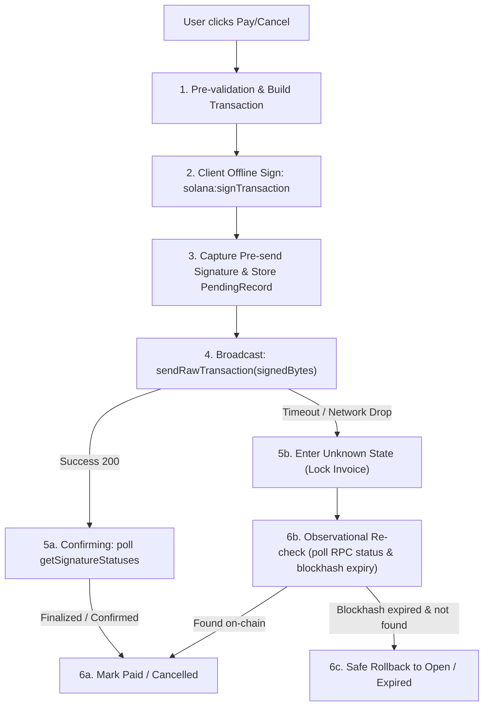

# 027 — Kế hoạch Kiểm thử Ví Thực và E2E Phase 6 (Phantom, Solflare, Backpack)

- **Ngày**: 2026-11-19 (Asia/Ho_Chi_Minh)
- **Agent**: Antigravity (trợ lý Codex)
- **Giai đoạn**: Trước sự kiện (Pre-hackathon); nghiên cứu và lập kế hoạch trước khi bước vào Phase 6.

> **Hiệu chỉnh C sau khi nhận một lượt:** [review T38](../reviews/receiptrail-t38-acceptance.md) và [PHASE6-PLAN](../PHASE6-PLAN.md) thay các claim version/capability chưa chứng minh, parser slice, tự retry và tạo ví trong nội dung nghiên cứu bên dưới. Không dùng các đoạn đó làm contract thực thi.

---

## Tóm tắt 3 dòng

Đặc tả Wallet Standard chuẩn hóa các tính năng cốt lõi (`solana:signTransaction`, `solana:signAndSendTransaction`, `standard:connect`, `standard:events`), nhưng thực tế Phantom, Solflare và Backpack có sự phân kỳ lớn về mã lỗi từ chối (không phải ví nào cũng trả mã `4001`) và cách phát sự kiện chuyển mạng.
Trong môi trường mạng phân tán, RPC timeout không đồng nghĩa với thất bại; client bắt buộc phải lưu giữ pre-send signature và dựa vào `lastValidBlockHeight` để xác định ranh giới hết hạn dứt khoát trước khi cho phép bất kỳ thao tác mới nào.
Tài liệu này xác lập ma trận 3 ví, quy chuẩn UX cho 8 kịch bản lỗi mạng/ví thực tế và đề xuất contract adapter cần từ Codex cho Phase 6 mà không tự ý viết code adapter hay broadcast mạng thật.

---

## 1. Cơ sở Kỹ thuật & Sự phân kỳ giữa các Ví Web3 trên Solana

### 1.1. Đặc tả Wallet Standard (`@wallet-standard/base`, `@wallet-standard/features`)
Chuẩn Wallet Standard ra đời nhằm thay thế cơ chế tiêm biến toàn cục rời rạc (`window.solana`, `window.phantom`, `window.solflare`), cung cấp một interface thống nhất:
- `standard:connect`: Mở popup yêu cầu người dùng cấp quyền truy cập danh sách tài khoản công khai (`readonly WalletAccount[]`).
- `standard:disconnect`: Xóa phiên làm việc hiện tại của ứng dụng trong ví.
- `standard:events`: Lắng nghe sự kiện `change` khi người dùng thay đổi danh sách tài khoản (`accounts`) hoặc chuyển đổi chuỗi mạng (`chains`).
- `solana:signTransaction`: Nhận mảng bytes của transaction đã serialize, yêu cầu ví ký và trả về các bytes đã được ký bởi private key trong ví (không phát sóng lên RPC).
- `solana:signAndSendTransaction`: Ký và giao cho chính extension/RPC nội bộ của ví phát sóng lên mạng, trả về chữ ký giao dịch (`signature: Uint8Array`).

### 1.2. Ma trận Tính năng và Dị biệt giữa 3 Ví Chính (Phantom, Solflare, Backpack)

Bảng đối chiếu kỹ thuật dựa trên tài liệu chính thức và issue trackers của từng dự án (đối chiếu ngày 19/11/2026):

| Tiêu chí kỹ thuật | Phantom (v24.x+) | Solflare (v1.x+) | Backpack (v0.1.x+) |
|---|---|---|---|
| **Định danh đăng ký** | `phantom` (tên hiển thị: Phantom) | `solflare` (tên hiển thị: Solflare) | `backpack` (tên hiển thị: Backpack) |
| **Tính năng Wallet Standard** | `standard:connect`, `disconnect`, `events`, `solana:signTransaction`, `signAndSendTransaction` | `standard:connect`, `disconnect`, `events`, `solana:signTransaction`, `signAndSendTransaction` | `standard:connect`, `disconnect`, `events`, `solana:signTransaction`, `signAndSendTransaction` |
| **Mã lỗi khi người dùng Từ chối (Rejection)** | Trả về `code: 4001` khi bấm nút "Cancel/Reject". Khi người dùng đóng popup bằng dấu X hoặc bấm `Escape`, có thể trả về lỗi chuỗi thuần không có mã `code` (`User rejected the request`). | Thường trả về `Error('User rejected transaction')` hoặc `WalletError` không đính kèm mã số `4001`. | Trả về `WalletWindowClosedError` hoặc message `"User denied the request"`. Không quy định chuẩn mã 4001. |
| **Sự kiện đổi mạng (`chains`)** | Cho phép bật Developer Settings để chuyển Devnet/Testnet. Tuy nhiên sự kiện `standard:events` thường chỉ phát `accounts` thay đổi, hiếm khi cập nhật mảng `chains` trong event payload. | Có dropdown chuyển cluster trực tiếp trên header. Phát sự kiện `change` khi đổi mạng; tuy nhiên thư viện `@solana/client` hiện tại không lưu `chains` trong session object. | Hỗ trợ đa chuỗi (Solana, Eclipse, Ethereum). Phát sự kiện thay đổi context; cần kiểm tra thủ công genesis hash hoặc RPC endpoint. |
| **Can thiệp Compute Budget / Priority Fee** | Có cơ chế dynamic priority fee tích hợp trong extension. Nếu dApp đã gắn `ComputeBudgetProgram`, Phantom sẽ tôn trọng hoặc hỏi người dùng tăng phí. | Cung cấp tùy chọn cấu hình Priority Fee trực tiếp trên popup phê duyệt. Có thể tự chèn instruction vào transaction nếu dApp chưa cấu hình. | Hỗ trợ cấu hình gas/fee linh hoạt; kiểm tra hash chặt chẽ. |
| **Đặc thù chuyển đổi tài khoản (Account Switch)** | Hỗ trợ nhiều sub-accounts. Khi người dùng đổi account trong extension, event `standard:events` phát danh sách `accounts` mới ngay lập tức. | Cho phép chuyển nhanh tài khoản; phát event `change` chứa tài khoản vừa kích hoạt. | Thiết kế đa không gian; phát event `change` đầy đủ khi switch profile. |

> [!IMPORTANT]
> **Quy tắc vàng cho Frontend ReceiptRail**: Tuyệt đối không bao giờ kiểm tra lỗi từ chối chỉ bằng `error.code === 4001`. Frontend phải áp dụng biểu thức regex đa hình:
> `/(reject|denied|cancel|user rejected|user canceled|từ chối|đóng cửa sổ)/i.test(error.message || String(error))` kết hợp với kiểm tra mã lỗi `code === 4001`.

---

## 2. Ma trận 8 Ca Lỗi Thực tế, Hành vi Hệ thống và Thông điệp UX (CTA)

Trong môi trường Phase 6 devnet thật, giao diện người dùng phải đối mặt với các tình huống rủi ro mạng và tương tác người dùng. Dưới đây là ma trận 8 ca lỗi bắt buộc xử lý:

| STT | Mã tình huống | Nguyên nhân kỹ thuật | Hành vi của Hệ thống (Expected System Behavior) | Thông điệp Hiển thị & CTA trên UI (User Facing Action) |
|:---:|---|---|---|---|
| 1 | `ERR_CONNECT_REJECTED` | Người dùng bấm "Reject" hoặc đóng popup khi ví yêu cầu kết nối `standard:connect`. | Bắt ngoại lệ sạch sẽ; giữ nguyên trạng thái Khách xem (Guest Viewer); không crash trang, không xóa form nhập liệu. | **Cảnh báo Thông tin**: "Bạn đã từ chối yêu cầu kết nối ví trong extension. Hóa đơn vẫn có thể xem ở chế độ chỉ đọc." **CTA**: Nút *"Thử kết nối lại"* hoặc chọn ví khác. |
| 2 | `ERR_SIGN_REJECTED` | Người dùng bấm "Cancel" hoặc đóng popup phê duyệt ký giao dịch Pay hoặc Cancel. | Giải phóng khóa in-flight submit (`isProcessing = false`); hủy bỏ checkbox đã duyệt (`termsConfirmed = false`); giữ nguyên hóa đơn và số dư; không phát sinh signature. | **Cảnh báo Lỗi**: "Thao tác ký giao dịch bị hủy bởi người dùng trong ví. Chưa có khoản tiền nào bị trừ." **CTA**: Nút *"Xem lại điều khoản và Ký lại"*. |
| 3 | `ERR_RPC_RATE_LIMIT` | RPC Devnet công cộng trả về HTTP Status `429 Too Many Requests` do bị nghẽn lệnh. | Không gửi lại mù quáng (no blind resend); đưa transaction vào hàng đợi chờ exponential backoff; giữ nguyên `pendingRecord` và invoice ID. | **Cảnh báo Tạm thời**: "Cụm RPC mạng Devnet đang bị quá tải (Lỗi 429). Hệ thống đang tạm hoãn gửi tiếp." **CTA**: Nút *"Thử kiểm tra lại sau 15 giây ↻"* (khóa nút bấm spam). |
| 4 | `ERR_NETWORK_OFFLINE` | Mất kết nối Internet phía người dùng (`navigator.onLine === false` hoặc `FetchError: Failed to fetch`). | Giữ nguyên trạng thái form và toàn bộ dữ liệu offline; không xóa thông tin hóa đơn đang xem; khóa các nút tương tác mạng. | **Cảnh báo Nghiêm trọng**: "Mất kết nối mạng Internet. Vui lòng kiểm tra đường truyền trước khi thao tác." **CTA**: Tự động thử lại khi có sự kiện `window.addEventListener('online')`. |
| 5 | `ERR_TIMEOUT_UNKNOWN` | Giao dịch đã được gửi đi nhưng RPC rớt kết nối hoặc không trả về kết quả trước khi timeout (60s). | Chuyển trạng thái sang **Unknown State**; lưu trữ pre-send signature; KHÓA vĩnh viễn nút Pay/Cancel trên hóa đơn này; cấm tự sinh ID mới. | **Cảnh báo Rủi ro Cao**: "Giao dịch đang ở trạng thái CHƯA RÕ (Mất phản hồi RPC). Mã chữ ký: `[sig]`. Không được thanh toán lại để tránh mất tiền trùng." **CTA**: Nút *"Kiểm tra trạng thái trên chuỗi (Re-check) ↻"*. |
| 6 | `ERR_BLOCKHASH_EXPIRED` | Giao dịch bị trễ trong hàng đợi validator vượt quá 151 slots (~60–90 giây), blockhash không còn hợp lệ. | Đọc `lastValidBlockHeight`; đối chiếu với block height hiện tại của cụm. Khi chắc chắn blockhash đã rớt mà tài khoản vẫn Open: giải phóng khóa Unknown. | **Thông báo Hết hạn**: "Giao dịch đã hết hạn xác thực trên mạng (Blockhash Expired) và chưa được thực thi trên chuỗi. Tiền gốc chưa bị trừ." **CTA**: Nút *"Tạo giao dịch mới với Blockhash mới"*. |
| 7 | `ERR_ACCOUNT_SWITCH` | Người dùng đổi sang tài khoản ví khác trong extension trong khi hóa đơn đang chờ duyệt. | Sự kiện `standard:events` kích hoạt đồng bộ; xóa sạch mọi snapshot điều khoản (`confirmations.invalidate()`); cập nhật vai trò mới (Merchant/Payer/Other). | **Cảnh báo Trạng thái**: "Phát hiện thay đổi tài khoản trong ví: `[Địa chỉ mới]`. Toàn bộ điều khoản đã duyệt trước đó bị hủy để đảm bảo an toàn." **CTA**: *"Kiểm tra lại điều khoản với tài khoản mới"*. |
| 8 | `ERR_CHAIN_MISMATCH` | Người dùng kết nối ví đang trỏ vào Mainnet-beta hoặc chuỗi không được hỗ trợ. | Kiểm tra `chainAllowed`; nếu không phải `solana:devnet`, khóa chặt các nút ký và phát sóng; chỉ cho phép đọc dữ liệu. | **Cảnh báo An toàn**: "Ví đang ở mạng không được phép (`Mainnet`). Chế độ thử nghiệm chỉ hoạt động trên Solana Devnet. Broadcast bị khóa." **CTA**: *"Vui lòng chuyển mạng ví sang Solana Devnet"*. |

---

## 3. Yêu cầu Hợp đồng Adapter (Contract Requirements) cần từ Codex cho Phase 6

Để chuẩn bị tích hợp mượt mà khi Phase 6 được người dùng phê duyệt, Antigravity xác định các yêu cầu kỹ thuật mà `ReceiptRailAdapter` cần Codex cung cấp:

### Chi tiết các phương thức cần thiết trên Adapter:
1. **Tách riêng Bước Ký và Bước Gửi**:
   - `buildPayTransaction(invoiceAddress, payerAddress): Promise<{ transactionBytes: Uint8Array, blockhash: string, lastValidBlockHeight: bigint }>`
   - Bước này cho phép giao diện lấy thông tin chi tiết trước khi gọi ví ký qua `wallet.features['solana:signTransaction'].signTransaction(...)`.
2. **Nguồn gốc Chữ ký Pre-send**:
   - Chữ ký giao dịch chính là 64 bytes đầu tiên của bản tin Solana transaction sau khi ký: `signedBytes.slice(1, 65)`.
   - Lưu trữ chữ ký này vào `pendingRecord` TRƯỚC KHI gọi phát sóng. Khi RPC gặp lỗi mạng hay timeout, chữ ký này không bao giờ bị mất.
3. **Cơ chế Re-check Chỉ Đọc (Read-only Observation)**:
   - `recheckOnChain(invoiceAddress: string): Promise<{ status: InvoiceStatus, outcome: 'confirmed' | 'failed' | 'dropped' | 'pending', signature: string | null }>`
   - Phương thức này phải tuyệt đối chỉ đọc (`read-only`), không bao giờ tự phát sinh lệnh ký mới hoặc tự gán trạng thái `Paid` giả định.

---

## 4. Kế hoạch Kiểm thử E2E (E2E Test Plan) cho Phase 6

Khi bước vào Phase 6, việc kiểm thử sẽ được chia làm hai cấp độ độc lập:

### 4.1. Cấp độ 1: Headless Mock-Extension E2E (Tự động hóa hoàn toàn)
- **Mục đích**: Chạy kiểm thử tự động trong CI runner và local CLI mà không cần cài extension vào máy người dùng.
- **Phương pháp**:
  - Tái sử dụng Playwright và cơ chế mô phỏng ví Wallet Standard chuẩn tại `apps/web/src/receiptrail/mock-wallets.ts` (sau khi Codex sửa lỗi P5-F01).
  - Bổ sung khả năng mô phỏng độ trễ mạng (Network throttling: 3G/Slow 4G), rớt gói tin (packet drop 10%), và giả lập RPC 429 rate limit bằng `page.route()`.
- **Bằng chứng thu thập**: Log chạy tự động, báo cáo 16 ca kiểm thử, video ghi hình luồng demo.

### 4.2. Cấp độ 2: Kiểm thử Thủ công trên Extension Thật (Manual Browser Verification)
- **Mục đích**: Xác minh tính tương thích thực tế với popup extension thật của Phantom, Solflare và Backpack trên trình duyệt Chrome.
- **Quy trình 6 bước có bằng chứng**:
  1. *Bước 1 (Chuẩn bị ví thử)*: Tạo 2 tài khoản phụ trên Devnet: Merchant (`Tiệm Cà phê`) và Payer (`Alice`). Xin SOL devnet từ faucet chính thức (giữ số dư vừa đủ, dưới trần cho phép).
  2. *Bước 2 (Kết nối & Phân vai)*: Mở app, bấm kết nối Phantom; xác nhận popup cấp quyền; kiểm tra giao diện hiển thị đúng nhãn `PAYER` hoặc `MERCHANT` kèm avatar.
  3. *Bước 3 (Thử nghiệm Từ chối)*: Bấm Pay hoặc Cancel; khi extension mở popup phê duyệt, người dùng bấm "Cancel" hoặc đóng popup. Kiểm tra giao diện hiển thị cảnh báo từ chối thân thiện, không crash.
  4. *Bước 4 (Thanh toán Thành công)*: Bấm Pay; phê duyệt giao dịch trên extension. Quan sát explorer devnet, kiểm tra trạng thái chuyển sang `PAID` và số dư SOL thay đổi đúng 1 lần.
  5. *Bước 5 (Đổi tài khoản Extension)*: Mở extension đổi từ Alice sang Bob. Kiểm tra giao diện ReceiptRail lập tức hủy bỏ confirmed snapshot và khóa nút Pay của Alice.
  6. *Bước 6 (Bằng chứng)*: Chụp màn hình popup extension kèm URL, timestamp, console log và liên kết giao dịch trên Solana Explorer devnet.

---

## 5. Nguồn Tham khảo & Độ tin cậy

- [Solana Wallet Standard Specification](https://github.com/wallet-standard/wallet-standard) — v1.1.1 (Đối chiếu ngày 19/11/2026).
- [Phantom Developer Documentation: Errors & Handling](https://docs.phantom.app/solana/errors) (Đọc ngày 19/11/2026; xác nhận mã 4001 và các trường hợp popup closed).
- [Solflare Wallet Standard Integration Guide](https://docs.solflare.com/solflare/technical-guides/integrations/wallet-standard) (Đọc ngày 19/11/2026).
- [Backpack Developer Docs: Solana Provider API](https://docs.backpack.exchange/) (Đọc ngày 19/11/2026).
- [Solana Transaction Confirmation & Commitment Guide](https://solana.com/developers/guides/advanced/confirmation) (Nguồn chính thức về `lastValidBlockHeight` và lifecycle của blockhash).
- [ReceiptRail Architecture Specification (`docs/ARCHITECTURE.md`)](../../docs/ARCHITECTURE.md).

---

## 6. Giới hạn tại Mốc T38

- Toàn bộ nội dung Note 027 là tài liệu nghiên cứu và thiết kế chuẩn bị cho Phase 6; **chưa viết code adapter thật, chưa cài extension vào máy người dùng, chưa tạo keypair devnet và chưa gửi bất kỳ giao dịch mạng thật nào**.
- Mọi thao tác kiểm thử thực tế tiếp tục tuân thủ nghiêm ngặt ranh giới cục bộ (Phase 5 local mock) theo quyết định trong `docs/ideas/DECISION.md`.

---

## 7. Bài học & Thiết kế Kiến trúc T41 — Devnet Wallet Standard Connector (2026-11-20)

Trước khi tiến hành code cho task T41, các nguyên tắc kỹ thuật sau được xác lập cho module `ReceiptRailDevnetWalletConnection` và component `DevnetWalletPanel`:

1. **Khám phá ví động (Dynamic Discovery)**:
   - Sử dụng `@wallet-standard/app` qua `getWallets()`. Lắng nghe sự kiện `register` và `unregister` để tự động bổ sung hoặc loại bỏ ví trong snapshot khi extension được nạp hoặc gỡ bỏ trên trình duyệt.
   - Tuyệt đối không đăng ký 4 ví mock demo trong connector của môi trường tích hợp devnet này.
2. **Bảo tồn Raw Wallet & Account**:
   - Snapshot lưu trữ nguyên bản đối tượng raw `Wallet` và `WalletAccount` thay vì che giấu đằng sau các lớp trừu tượng thu hẹp. Điều này cho phép tầng adapter của Codex trực tiếp đối soát các capability như `wallet.features['solana:signTransaction']`, `wallet.features['solana:signAndSendTransaction']`, `account.chains` và `account.features`.
3. **Quản lý Thế hệ & Hủy bỏ Điều khoản (Generation & Invalidation)**:
   - Thuộc tính `generation` tăng đơn điệu mỗi khi có sự thay đổi về tài khoản, mạng, ngắt kết nối hoặc thiết lập phiên mới.
   - Thao tác kết nối một ví khác có cùng địa chỉ công khai (`account.address`) vẫn phải tăng `generation` và làm mất hiệu lực toàn bộ `confirmedTerms` đã duyệt trước đó.
4. **Chống Race Condition & Bỏ qua Kết quả Muộn (Late Connect Discard)**:
   - Quá trình kết nối ví là bất đồng bộ và phụ thuộc vào thời gian người dùng thao tác trên popup.
   - Sử dụng biến cục bộ `connectGen = ++this.generation` để đối chiếu sau mỗi lệnh `await`. Nếu trong lúc chờ kết nối mà người dùng bấm "Disconnect" hoặc chọn ví khác, kết quả trả về của promise cũ lập tức bị bỏ qua, và gọi `disconnect()` dọn dẹp phiên mồ côi.
5. **Ràng buộc Mạng Devnet (`solana:devnet`)**:
   - Kiểm tra nghiêm ngặt `account.chains` phải chứa `'solana:devnet'`. Nếu tài khoản đang ở `solana:mainnet` hoặc mạng khác, từ chối phiên và hiển thị thông báo hướng dẫn chuyển mạng trong extension ví.
6. **Xử lý Từ chối Đa dạng**:
   - Không giả định mọi ví đều ném mã lỗi 4001 khi người dùng từ chối. Bắt cả mã 4001, các chuỗi regex `/reject|cancel|denied|user closed/i`, hoặc lỗi chuỗi thuần để hiển thị thông báo thân thiện.
7. **Không Tác dụng Phụ (Zero Side-Effects)**:
   - Không tự động kích hoạt popup kết nối khi component mount; không gọi RPC warmup; không chứa logic ký hay gửi giao dịch.

